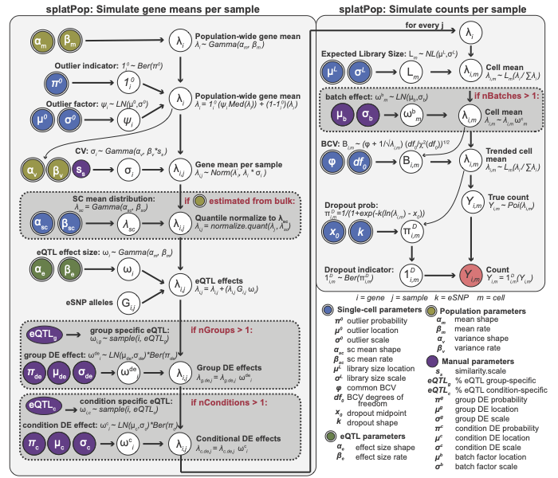
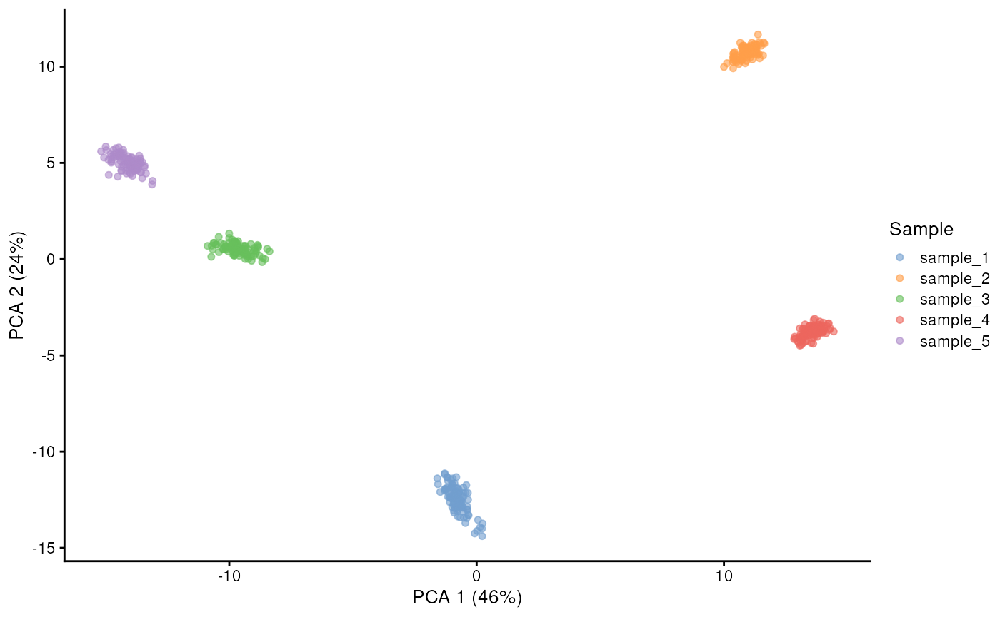
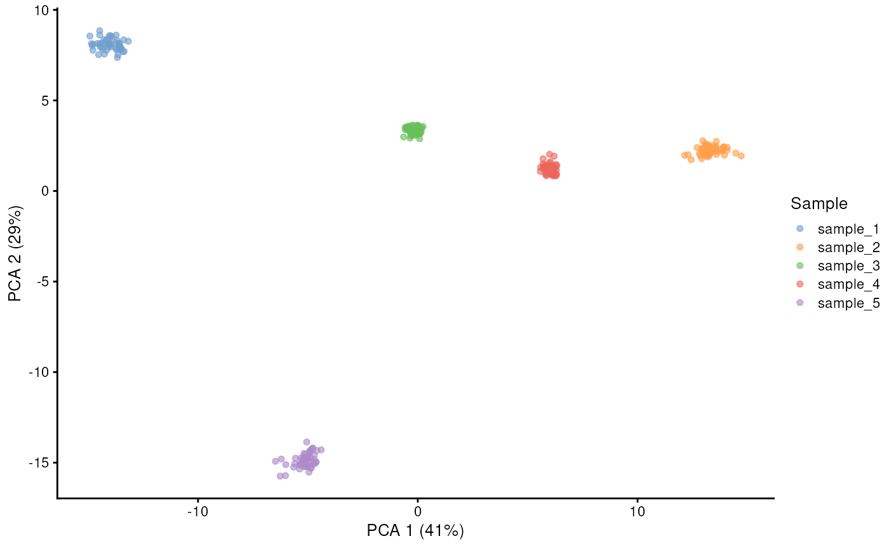
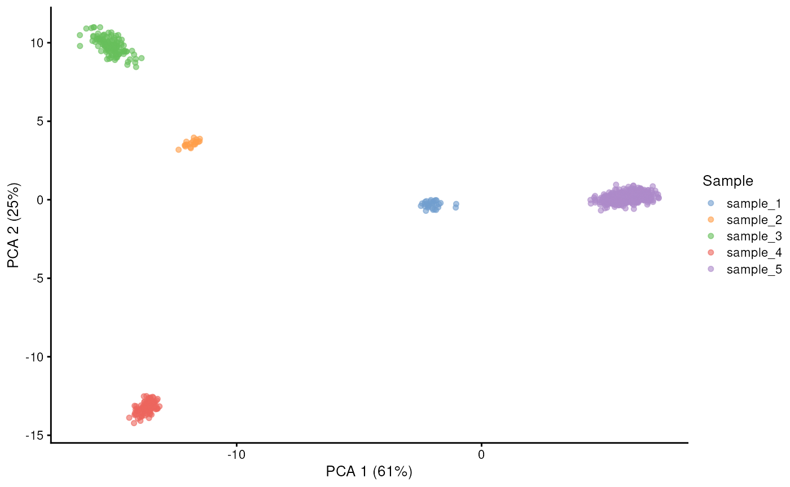
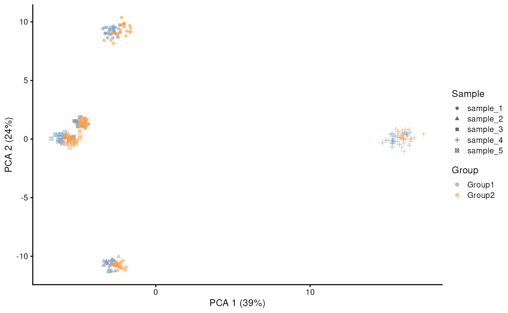
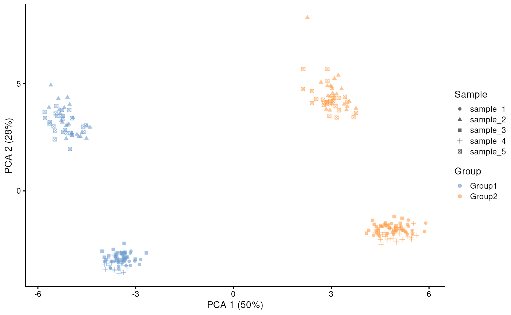
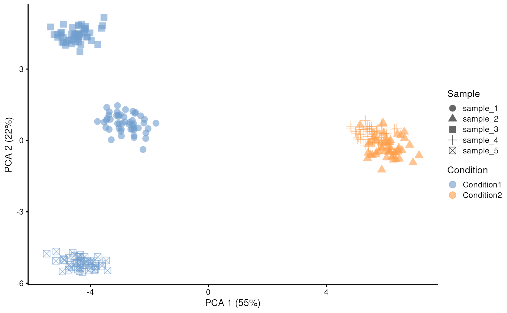
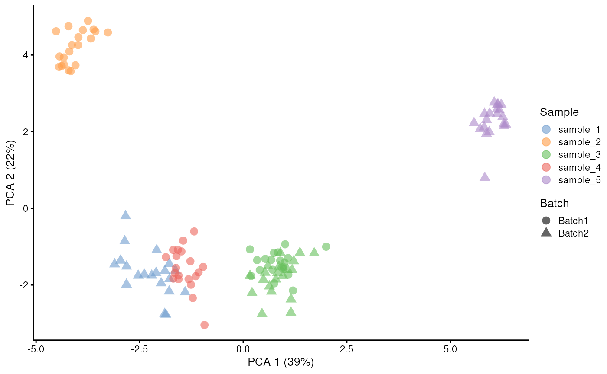
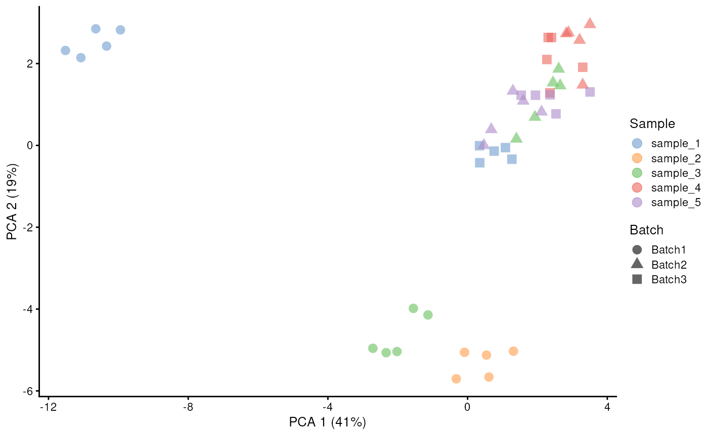
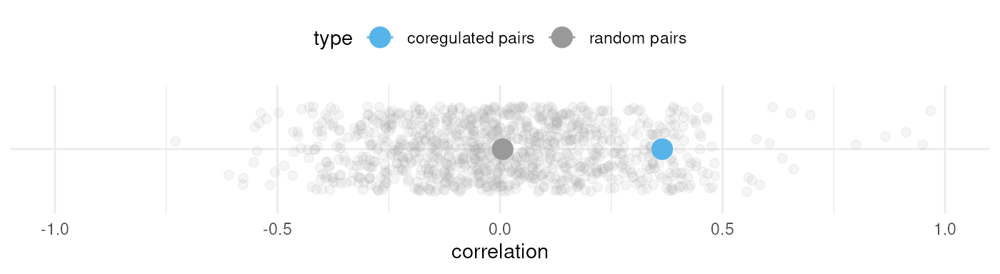

# splatPop: simulating single-cell data for populations

\
[`suppressPackageStartupMessages`](https://rdrr.io/r/base/message.html)`(``{`\
`    `[`library`](https://rdrr.io/r/base/library.html)`(`[`"splatter"`](https://bioconductor.org/packages/splatter/)`)`\
`    `[`library`](https://rdrr.io/r/base/library.html)`(`[`"scater"`](http://bioconductor.org/packages/scater/)`)`\
`    `[`library`](https://rdrr.io/r/base/library.html)`(``"VariantAnnotation"``)`\
`    `[`library`](https://rdrr.io/r/base/library.html)`(`[`"ggplot2"`](https://ggplot2.tidyverse.org)`)`\
`}``)`\
[`set.seed`](https://rdrr.io/r/base/Random.html)`(``42``)`

splatPop logo

## Introduction

splatPop is an extension of the splat model that allows you to simulate
single-cell RNA-sequencing count data for a population. Like with splat,
these simulations resemble real scRNA-seq data because they use
parameters estimated from empirical data. Provided with genotype
information (VCF) for a population as input, splatPop simulates gene
counts for multiple cells for all individuals in the population. The vcf
information is used to achieve realistic population structure in the
simulated data by modeling expression Quantitative Trait Loci (eQTL)
effects, where the expression of a gene is associated with the genotype
of the individual at a specific loci. Finally, splatPop allows for the
simulation of complex data sets including:

1.  **Cell group effects:** Where multiple, heterogeneous cell-groups
    are simulated for each individual. These groups could represent
    different cell-types or the same cell-type before/after a treatment.
    Group effects include group-specific differential expression (DE)
    and/or group-specific expression Quantitative Trait Loci (eQTL)
    effects.
2.  **Conditional effects between individuals:** Where individuals are
    simulated as belonging to different conditional cohorts
    (e.g. different treatment groups or groups with different disease
    statuses). Conditional effects include DE and/or eQTL effects.
3.  **Batch effect from multiplexed experimental designs:** Like in
    splat, batch effects are simulated by assigning small batch-specific
    DE effects to all genes. splatPop allows for the simulation of
    different patterns of batch effects, such as those resulting from
    multiplexed sequencing designs.

## Quick start

The primary simulation function is `splatPopSimulate`, which runs
through the two main phases:

1.  `splatPopSimulateMeans`: the simulation of means for all genes for
    all individuals in the population.
2.  `splatPopSimulateSC`: the simulation of single-cell counts for all
    cells for all genes for all individuals.

The second phase is essentially a wrapper around the original
`splatSimulate` function, which is described in detail
[here](http://oshlacklab.com/splatter/articles/splatter.md). The figure
below describes these two phases. Input parameters that can be estimated
from real data have double borders and are shaded by the type of data
used. The final output (red) is a matrix of means for each gene and each
individual that is used as input to the second phase.

The splatPop model for estimating gene means.

To get started with splatPop, you only need genotype information for the
population you want to simulate provided as a [VariantAnnotation
object](https://bioconductor.org/packages/release/bioc/html/VariantAnnotation.html).
A mock VariantAnnotation object can be produced using the `mockVCF`
function. Here we simulate single-cell RNA-sequencing counts for 100
random genes for 6 random samples:

\
`vcf`` ``<-`` `[`mockVCF`](http://oshlacklab.com/splatter/reference/mockVCF.md)`(``)`\
`gff`` ``<-`` `[`mockGFF`](http://oshlacklab.com/splatter/reference/mockGFF.md)`(``)`\
\
`sim`` ``<-`` `[`splatPopSimulate`](http://oshlacklab.com/splatter/reference/splatPopSimulate.md)`(``vcf ``=`` ``vcf``, gff ``=`` ``gff``, sparsify ``=`` ``FALSE``)`\
`#> Designing population...`\
`#> Simulating data for genes in GFF...`\
`#> Simulating gene means for population...`\
`#> Simulating sc counts for Group1...`\
`#> Done!`\
`sim`` ``<-`` `[`logNormCounts`](https://rdrr.io/pkg/scuttle/man/logNormCounts.html)`(``sim``)`\
`#> Warning in .library_size_factors(assay(x, assay.type), ...): 'librarySizeFactors' is deprecated.`\
`#> Use 'scrapper::centerSizeFactors' instead.`\
`#> See help("Deprecated")`\
`#> Warning in .local(x, ...): 'normalizeCounts' is deprecated.`\
`#> Use 'scrapper::normalizeCounts' instead.`\
`#> See help("Deprecated")`\
`sim`` ``<-`` `[`runPCA`](https://rdrr.io/pkg/BiocSingular/man/runPCA.html)`(``sim``, ncomponents ``=`` ``5``)`\
[`plotPCA`](https://rdrr.io/pkg/BiocGenerics/man/plotPCA.html)`(``sim``, colour_by ``=`` ``"Sample"``)`

## Detailed look into splatPop

### Step 1: Parameter Estimation

The parameters used in splatPop have sensible default values estimated
from GTEx data (v7, thyroid tissue). However, they can also be estimated
from real data provided by the user using the `splatPopEstimate`. The
gamma distributions describing the population-level gene mean and
variance levels can be estimated from real population scale bulk or
aggregated single-cell RNA-seq data. The gamma distribution describing
eQTL effect sizes can be estimated from real eQTL mapping results. You
can also provide this function with a SCE object or matrix of
single-cell counts to estimate single-cell parameters described in
splat.

All parameters needed for splatPop simulations are stored in a
`SplatPopParams` object. In addition to the compartments in
`SplatParams` described in detail in the [Splat parameters
vignette](http://oshlacklab.com/splatter/articles/splat_params.md) and
the parameters that are set manually (described below), `SplatPopParams`
also contains the following parameters that can be estimated from real
data:

- **Population parameters**
  - `pop.mean.shape` - Shape parameter for mean expression from
    population scale data.
  - `pop.mean.rate` - Rate parameter for mean expression from population
    scale data.
  - `pop.cv.param` - Shape and rate parameters for the coefficient of
    variation (cv) across individuals from the population scale data,
    binned by mean expression.
- **eQTL effect size parameters**
  - `eqtl.ES.shape` - Shape parameter for eQTL effect sizes.
  - `eqtl.ES.rate` - Rate parameter for eQTL effect sizes.

The parameters that can be estimated are in parentheses in the
`SplatPopParms` object, while those that can’t be estimated are in
brackets. Those that have been changed from their default value (either
by hand or by estimation) are in ALL CAPS.

For example, we can estimate new parameter values from user provided
data…

\
`bulk.means`` ``<-`` `[`mockBulkMatrix`](http://oshlacklab.com/splatter/reference/mockBulkMatrix.md)`(``n.genes ``=`` ``100``, n.samples ``=`` ``100``)`\
`bulk.eqtl`` ``<-`` `[`mockBulkeQTL`](http://oshlacklab.com/splatter/reference/mockBulkeQTL.md)`(``n.genes ``=`` ``100``)`\
`counts`` ``<-`` `[`mockSCE`](https://rdrr.io/pkg/scuttle/man/mockSCE.html)`(``)`\
\
`params.est`` ``<-`` `[`splatPopEstimate`](http://oshlacklab.com/splatter/reference/splatPopEstimate.md)`(`\
`    means ``=`` ``bulk.means``,`\
`    eqtl ``=`` ``bulk.eqtl``,`\
`    counts ``=`` ``counts`\
`)`\
`#> NOTE: Library sizes have been found to be normally distributed instead of log-normal. You may want to check this is correct.`\
`params.est`\
`#> A ``Params`` object of class ``SplatPopParams`` `\
`#> Parameters can be (estimable) or ``[not estimable]``, 'Default' or  ``'NOT DEFAULT'`` `\
`#> ``Secondary`` parameters are usually set during simulation`\
`#> `\
`#> ``Global:`` `\
`#> ``(GENES)``  ``(CELLS)``   ``[SEED]`` `\
`#>    ``2000``      ``200``   ``627954`` `\
`#> `\
`#> 54 additional parameters `\
`#> `\
`#> ``Batches:`` `\
`#>     ``[BATCHES]``  ``[BATCH CELLS]``     ``[Location]``        ``[Scale]``       ``[Remove]`` `\
`#>             ``1``            ``200``            0.1            0.1          FALSE `\
`#> `\
`#> ``Mean:`` `\
`#>             ``(RATE)``             ``(SHAPE)`` `\
`#> ``0.0032307940581403``   ``0.526078501677712`` `\
`#> `\
`#> ``Library size:`` `\
`#>       ``(LOCATION)``           ``(SCALE)``            ``(NORM)`` `\
`#>         ``356760.9``  ``11696.4546478837``              ``TRUE`` `\
`#> `\
`#> ``Exprs outliers:`` `\
`#> ``(PROBABILITY)``     (Location)        (Scale) `\
`#>             ``0``              4            0.5 `\
`#> `\
`#> ``Groups:`` `\
`#>      ``[Groups]``  ``[Group Probs]`` `\
`#>             1              1 `\
`#> `\
`#> ``Diff expr:`` `\
`#> ``[Probability]``    ``[Down Prob]``     ``[Location]``        ``[Scale]`` `\
`#>           0.1            0.5            0.1            0.4 `\
`#> `\
`#> ``BCV:`` `\
`#>     ``(COMMON DISP)``              ``(DOF)`` `\
`#> ``0.733611972921535``   ``19330.7444613858`` `\
`#> `\
`#> ``Dropout:`` `\
`#>            ``[Type]``         ``(MIDPOINT)``            ``(SHAPE)`` `\
`#>              none   ``2.71312371514202``  ``-1.38282416681196`` `\
`#> `\
`#> ``Paths:`` `\
`#>         ``[From]``         ``[Steps]``          ``[Skew]``    ``[Non-linear]``  ``[Sigma Factor]`` `\
`#>              0             100             0.5             0.1             0.8 `\
`#> `\
`#> ``Population params:`` `\
`#>       ``(MEAN.SHAPE)``         ``(MEAN.RATE)``    ``[pop.quant.norm]``  ``[similarity.scale]`` `\
`#>  ``0.432222522305613``  ``0.0092636167813702``                TRUE                   1 `\
`#>       ``[batch.size]``     ``[nCells.sample]``      ``[nCells.shape]``       ``[nCells.rate]`` `\
`#>                 10               FALSE                 1.5               0.015 `\
`#>          ``[cv.bins]`` `\
`#>                 10 `\
`#> `\
`#> ``(CV.PARAMS)`\
`#> ``data.frame (10 x 4) with columns: start, end, shape, rate`` `\
`#>   start  end     shape      rate`\
`#> 1  0.00 0.67  2.367153  4.885277`\
`#> 2  0.67 1.49 10.186321 14.083342`\
`#> 3  1.49 3.99  1.694126  2.465621`\
`#> 4  3.99 6.06  8.200299 10.850105`\
`#> # ... with 6 more rows`\
`#> `\
`#> ``eQTL params:`` `\
`#>                  ``[eqtl.n]``                ``[eqtl.dist]`` `\
`#>                       0.5                      1e+06 `\
`#>            ``[eqtl.maf.min]``             ``[eqtl.maf.max]`` `\
`#>                      0.05                          1 `\
`#>              ``[eqtl.coreg]``      ``[eqtl.group.specific]`` `\
`#>                         0                        0.2 `\
`#> ``[eqtl.condition.specific]``            ``(EQTL.ES.SHAPE)`` `\
`#>                       0.2           ``5.30287679494779`` `\
`#>            ``(EQTL.ES.RATE)`` `\
`#>          ``17.4262929846207`` `\
`#> `\
`#> ``Condition params:`` `\
`#>    ``[nConditions]``  ``[condition.prob]``        ``[cde.prob]``    ``[cde.downProb]`` `\
`#>                1                 1               0.1               0.5 `\
`#>     ``[cde.facLoc]``    ``[cde.facScale]`` `\
`#>              0.1               0.4`

Note that `splatPopEstimate` will only estimate new parameters if the
data required is provided. For example, if you want to simulate data
using default gene means and eQTL parameters, but from single-cell
parameters estimated from your own real single-cell counts data, you
could run `splatPopEstimate` with only the `counts` argument provided.

### Step 2: Simulate gene means

The `splatPopSimulate` function runs both phases of splatPop, however we
can run these two phases separately to highlight their distinct
functions. The first phase is run using `splatPopSimulateMeans`.

#### Input data

`splatPopSimulateMeans` requires two pieces of input data: genotypes and
genes. Mock data can be provided using `mockVCF` and `mockGFF`,
respectively. These mock functions generate random SNP and gene
annotation data for chromosome 22.

To simulate populations with realistic population structure, real
genotype data should be provided as a [VariantAnnotation
object](https://bioconductor.org/packages/release/bioc/html/VariantAnnotation.html).

splatPop can be told what genes to simulate in three ways:

1.  **GFF/GTF (-gff data.frame):** Provide a GFF/GTF file as a
    `data.frame` object. splatPop will filter out all non-gene features
    (3rd column != gene). This method uses real gene names and
    locations, but will randomly assign expression values and eQTL
    effects to these genes.
2.  **Key (-key data.frame):** Provide a `data.frame` object including
    information about genes you want to simulate. At minimum, this
    object must include columns specifying the *geneID*, *chromosome*,
    and location (*geneMiddle*). With just those columns, splatPop will
    function the same as if a GFF was provided. However, you can also
    use this object to specify other information. If you provide a
    desired mean (*meanSampled*) and variance (*cvSampled*) for each
    gene, splatPop will use these instead of randomly sampled values. If
    you provide eSNP information (*eSNP.ID* and *eQTL.EffectSize*) and
    the group effect information (*eQTL.group*, *GroupDE.GroupN*),
    splatPop will simulate gene means with these eQTL associations
    instead of generating eQTL associations and group effects randomly.
    Finally, if you provide conditional effect information
    (*eQTL.condition*, *ConditionDE.ConditionN*), splatPop will use
    those conditional effects instead of randomly assigning its own.
3.  **Randomly (-gff NULL -key NULL):** This option will call `mockGFF`
    to generate a random GFF file for a specified chromosome. This is
    the default option if neither `gff` or `key` is provided.

Note that splatPop will assign eSNPs to genes within a defined window,
thus the provided genotype and gene information needs to span the same
genomic regions.

#### Control parameters

In addition to the parameters estimated from real data, the
`SplatPopParams` object also includes control parameters that must be
set by the user. In addition to the parameters described in detail in
the [Splat parameters
vignette](http://oshlacklab.com/splatter/articles/splat_params.md), the
following `SplatPopParams` control parameters can be changed using
`setParams`:

- **Population parameters**
  - `similarity.scale` - Scaling factor for the population variance (cv)
    rate parameter. Increasing this scaling factor increases the
    similarity between individuals.
  - `pop.quant.norm` - Logical to run the quantile normalization
    function, which fits the distribution of gene means for each
    individual to the distribution estimated from the single-cell data,
    the parameter can be set to FALSE.
  - `batch.size` - The number of samples to include in each batch
    (described in detail below)
  - `nCells.sample` - Logical indicating if the number of cells to
    simulate for each sample should be sampled from a gamma
    distribution.
  - `nCells.shape` - Gamma distribution shape parameter for the number
    of cells to simulate for each sample
  - `nCells.rate` - Gamma distribution rate parameter for the number of
    cells to simulate for each sample
  - `cv.bins` - The number of bins to include when estimating population
    scale variance parameters.
- **eQTL Parameters**
  - `eqtl.n` - Number (\>1) or percent (\<=1) of genes to assign with
    eQTL effects.
  - `eqtl.dist` - Maximum distance (bp) between the center of a gene and
    possible eSNPs for that gene.
  - `eqtl.maf.min` - Minimum Minor Allele Frequency (MAF) of eSNPs.
  - `eqtl.maf.max` - Maximum MAF of eSNPs.
  - `eqtl.group.specific` - Percent of eQTL effects to make group
    specific. The number of groups is specified using the “group.prob”
    parameter.
  - `eqtl.condition.specific` - Percent of eQTL effects to make
    condition specific. The number of conditions is specified using the
    `nConditions` or `condition.prob` parameters.
  - additional conditional effect parameters described below…
- **Group specific parameters**
  - `nGroups` - Number of groups to simulate for each individual.
  - `group.prob` - Array of the proportion of cells that should be
    simulated in each group.

In addition to the group specific eQTL effects, each group will have
group specific differential expression effects, which are not associated
with a genetic variant). These parameters are estimated from real
single-cell data as described in
[splatter](http://oshlacklab.com/splatter/articles/splatter.md).

#### Output

The output of `splatPopSimulateMeans` is a list containing:

- `means` - a data.frame (or list of data.frames if `nGroups` \> 1) with
  simulated mean gene expression value for each gene (row) and each
  sample (column).
- `key` - a data.frame listing for all simulated genes: the assigned
  mean and variance (before and after quantile normalization), the
  assigned eSNP and its effect size and type (global/group specific),
  and other group effects.

Note that when `splatPopSimulate` is run, these to objects are contained
in the output SingleCellExperiment object (details below). Let’s look at
a snapshot of some simulated means and the corresponding key…

\
`params`` ``<-`` `[`newSplatPopParams`](http://oshlacklab.com/splatter/reference/newParams.md)`(``)`\
\
`sim.means`` ``<-`` `[`splatPopSimulateMeans`](http://oshlacklab.com/splatter/reference/splatPopSimulateMeans.md)`(`\
`    vcf ``=`` ``vcf``,`\
`    gff ``=`` ``gff``,`\
`    params ``=`` ``params`\
`)`\
`#> Simulating data for genes in GFF...`\
`#> Simulating gene means for population...`\
\
[`round`](https://rdrr.io/r/base/Round.html)`(``sim.means``$``means``[``1``:``5``, ``1``:``3``]``, digits ``=`` ``2``)`\
`#>         sample_1 sample_2 sample_3`\
`#> gene_01     0.33     0.32     1.17`\
`#> gene_02     3.53     2.94     2.73`\
`#> gene_03     4.66     3.53     1.87`\
`#> gene_04     0.00     4.37     5.80`\
`#> gene_05     0.09     0.33     0.18`\
\
[`print`](https://rdrr.io/r/base/print.html)`(``sim.means``$``key``[``1``:``5``, ``]``, digits ``=`` ``2``)`\
`#>         chromosome geneStart geneEnd geneMiddle meanSampled.noOutliers`\
`#> gene_01          1     77213   78271      77742                  17.82`\
`#> gene_02          1    103406  104027     103716                  61.91`\
`#> gene_03          1    116698  118185     117441                  44.36`\
`#> gene_04          1    153751  155935     154843                  83.33`\
`#> gene_05          1    178045  178621     178333                   0.14`\
`#>         OutlierFactor meanSampled cvSampled eQTL.group eQTL.condition eSNP.ID`\
`#> gene_01             1       17.82      0.41     global         global snp_126`\
`#> gene_02             1       61.91      0.16       <NA>         global    <NA>`\
`#> gene_03             1       44.36      0.57       <NA>         global    <NA>`\
`#> gene_04             1       83.33      0.95     global         global snp_055`\
`#> gene_05             1        0.14      1.18       <NA>         global    <NA>`\
`#>         eSNP.chromosome eSNP.loc eSNP.MAF eQTL.EffectSize`\
`#> gene_01               1    74399      0.1           -0.71`\
`#> gene_02            <NA>       NA       NA              NA`\
`#> gene_03            <NA>       NA       NA              NA`\
`#> gene_04               1   458901      0.1           -0.25`\
`#> gene_05            <NA>       NA       NA              NA`\
`#>         ConditionDE.Condition1 meanQuantileNorm cvQuantileNorm`\
`#> gene_01                      1             0.95           0.39`\
`#> gene_02                      1             2.92           0.18`\
`#> gene_03                      1             3.22           0.57`\
`#> gene_04                      1             3.44           0.72`\
`#> gene_05                      1             0.21           0.42`\
\
[`print`](https://rdrr.io/r/base/print.html)`(``sim.means``$``conditions``)`\
`#>     sample_1     sample_2     sample_3     sample_4     sample_5 `\
`#> "Condition1" "Condition1" "Condition1" "Condition1" "Condition1"`

#### Other examples

**Replicate a simulation by providing a gene key**

As described above, information about genes can also be provided in a
data.frame using the `key` argument. If you provide
`splatPopSimulateMeans` with the key output from a previous run, it will
generate a new population with the same properties, essentially creating
a replicate. Here is a snapshot of such a replicate using the key
simulated above:

\
`sim.means.rep2`` ``<-`` `[`splatPopSimulateMeans`](http://oshlacklab.com/splatter/reference/splatPopSimulateMeans.md)`(`\
`    vcf ``=`` ``vcf``,`\
`    key ``=`` ``sim.means``$``key``,`\
`    params ``=`` `[`newSplatPopParams`](http://oshlacklab.com/splatter/reference/newParams.md)`(``)`\
`)`\
`#> Simulating data for genes in key...`\
`#> Simulating gene means for population...`\
\
[`round`](https://rdrr.io/r/base/Round.html)`(``sim.means.rep2``$``means``[``1``:``5``, ``1``:``5``]``, digits ``=`` ``2``)`\
`#>         sample_1 sample_2 sample_3 sample_4 sample_5`\
`#> gene_01     1.09     0.30     1.18     1.01     0.93`\
`#> gene_02     2.81     2.59     3.57     3.57     3.05`\
`#> gene_03     1.28     5.21     1.09     3.89     0.23`\
`#> gene_04     3.57     5.91     2.81     5.84     6.62`\
`#> gene_05     0.06     0.08     0.08     0.27     0.19`

**Estimating parameters from bulk expression data**

An important step of `splatPopSimulate` is the quantile normalization of
simulated gene means for each sample to match a gamma distribution
estimated from real single-cell RNA-seq data using `splatEstimate` or
`splatPopEstimate`. This step ensures that even if bulk sequencing data
are used to estimate population parameters, the means output from
`splatPopSimulateMeans` will be distributed like a single-cell dataset.

If you already have bulk expression data for a population, you can use
this quantile normalization function directly on that data and use the
output as input to `splatPopSimulateSC`. Note that this will not
simulate eQTL or group effects, just simulate single-cell counts using
the bulk means provided.

\
`bulk.qnorm`` ``<-`` `[`splatPopQuantNorm`](http://oshlacklab.com/splatter/reference/splatPopQuantNorm.md)`(`[`newSplatPopParams`](http://oshlacklab.com/splatter/reference/newParams.md)`(``)``, ``bulk.means``)`\
[`round`](https://rdrr.io/r/base/Round.html)`(``bulk.qnorm``[``1``:``5``, ``1``:``5``]``, ``3``)`\
`#>       [,1]  [,2]  [,3]  [,4]  [,5]`\
`#> [1,] 0.471 0.226 0.399 0.264 0.207`\
`#> [2,] 3.117 2.323 3.117 2.998 2.898`\
`#> [3,] 2.782 3.381 3.660 2.782 4.348`\
`#> [4,] 0.159 0.147 0.175 0.189 0.106`\
`#> [5,] 3.241 2.782 4.838 1.429 1.725`

**Generate a population directly from empirical data**

The power of splatter, and splatPop by extension, comes from estimating
important parameters from empirical data and then using the
distributions defined by those parameters to generate realistic
simulated data, maintaining the properties of the empirical data without
directly replicating it. While this allows you to simulate datasets that
differ from your empirical data (for example, with different numbers of
genes or with different sized eQTL effects), there may be cases when you
want to more exactly replicate an empirical dataset, for example if you
want gene-gene relationships to be maintained. To run splatPop in this
mode, provide `splatPopSimulate` or `splatPopSimulateMeans` with the
vcf, gff, eQTL, and population-scale gene means data directly. This will
overwrite the splatPop population and eqtl parameters and instead
replicate the data provided. For example, provided with the following
eQTL mapping data:

\
`emp`` ``<-`` `[`mockEmpiricalSet`](http://oshlacklab.com/splatter/reference/mockEmpiricalSet.md)`(``)`\
[`head`](https://rdrr.io/r/utils/head.html)`(``emp``$``eqtl``[``, `[`c`](https://rdrr.io/r/base/c.html)`(``"geneID"``, ``"snpID"``, ``"snpCHR"``, ``"snpLOC"``, ``"snpMAF"``, ``"slope"``)``]``)`\
`#>    geneID    snpID snpCHR  snpLOC snpMAF      slope`\
`#> 1 gene_01 snp_0313      1 1207279   0.20 0.15640282`\
`#> 2 gene_02 snp_0650      1 1222931   0.20 0.31290847`\
`#> 3 gene_03 snp_0284      1  700857   0.35 0.38922460`\
`#> 4 gene_04 snp_0845      1 1974477   0.30 0.87286319`\
`#> 5 gene_05 snp_0998      1 1823546   0.15 0.44487101`\
`#> 6 gene_06 snp_0059      1  903476   0.25 0.09598499`

the gene location information will be pulled from the GFF and the gene
mean and variance information will be pulled from the population-scale
gene mean data, to produce a splatPop key:

\
`emp.sim`` ``<-`` `[`splatPopSimulateMeans`](http://oshlacklab.com/splatter/reference/splatPopSimulateMeans.md)`(`\
`    vcf ``=`` ``emp``$``vcf``,`\
`    gff ``=`` ``emp``$``gff``,`\
`    eqtl ``=`` ``emp``$``eqtl``,`\
`    means ``=`` ``emp``$``means``,`\
`    params ``=`` `[`newSplatPopParams`](http://oshlacklab.com/splatter/reference/newParams.md)`(``)`\
`)`\
`#> Using base gene means from data provided...`\
`#> Simulating gene means for population...`\
[`head`](https://rdrr.io/r/utils/head.html)`(``emp.sim``$``key``)`\
`#>         chromosome geneStart geneEnd geneMiddle meanSampled.noOutliers`\
`#> gene_01          1     43010   42427      43301              13.905934`\
`#> gene_02          1     86752   88278      87515              25.525215`\
`#> gene_03          1    461017  460940     461055               6.371952`\
`#> gene_04          1    503677  505017     504347               3.243389`\
`#> gene_05          1    614357  615663     615010             281.381431`\
`#> gene_06          1    765685  766205     765945             104.791698`\
`#>         OutlierFactor meanSampled cvSampled eQTL.group eQTL.condition  eSNP.ID`\
`#> gene_01             1   13.905934 0.1653995     global         global snp_0313`\
`#> gene_02             1   25.525215 1.0644913     global         global snp_0650`\
`#> gene_03             1    6.371952 0.6243719     global         global snp_0284`\
`#> gene_04             1    3.243389 0.8873307     global         global snp_0845`\
`#> gene_05             1  281.381431 0.8091753     global         global snp_0998`\
`#> gene_06             1  104.791698 0.4762132     global         global snp_0059`\
`#>         eSNP.chromosome eSNP.loc eSNP.MAF eQTL.EffectSize`\
`#> gene_01               1  1207279     0.20      0.15640282`\
`#> gene_02               1  1222931     0.20      0.31290847`\
`#> gene_03               1   700857     0.35      0.38922460`\
`#> gene_04               1  1974477     0.30      0.87286319`\
`#> gene_05               1  1823546     0.15      0.44487101`\
`#> gene_06               1   903476     0.25      0.09598499`\
`#>         ConditionDE.Condition1 meanQuantileNorm cvQuantileNorm`\
`#> gene_01                      1        1.6771573      0.2635190`\
`#> gene_02                      1        2.0490667      0.8068973`\
`#> gene_03                      1        0.9187752      0.2827743`\
`#> gene_04                      1        0.5684466      0.8162079`\
`#> gene_05                      1       20.6453436      0.6891738`\
`#> gene_06                      1        6.4452683      1.2910601`

### Step 3: Simulate single cell counts

Finally, single cell level data is simulated using `splatPopSimulateSC`.
Running this function on its own requires the `SplatPopParams` object
and the two outputs from `splatPopSimulateMeans`: the key and the
simulated means matrix (or list of matrices if nGroups \> 1). The user
can also provide additional parameters for the single-cell simulation,
for example how many cells to simulate.

Looking at the output of `splatPopSimulateSC` we see that it is a single
`SingleCellExperiment` object (SCE) with a row for each feature (gene)
and a column for each cell. The simulated counts are accessed using
`counts`, although it can also hold other expression measures such as
FPKM or TPM. Information about each cell (e.g. sample, group, batch) is
held in the `colData` and information about each gene (e.g. location,
eQTL effects, and other data from the splatPop key) is held in the
`rowData`. The `splatPopParams` object and the simulated gene means
matrix/list of matrices is also saved as metadata in the SCE object.

\
`sim.sc`` ``<-`` `[`splatPopSimulateSC`](http://oshlacklab.com/splatter/reference/splatPopSimulateSC.md)`(`\
`    params ``=`` ``params``,`\
`    key ``=`` ``sim.means``$``key``,`\
`    sim.means ``=`` ``sim.means``$``means``,`\
`    batchCells ``=`` ``50``,`\
`    sparsify ``=`` ``FALSE`\
`)`\
`#> Simulating sc counts for Group1...`\
`#> Done!`\
`sim.sc`\
`#> class: SingleCellExperiment `\
`#> dim: 50 250 `\
`#> metadata(2): Params Simulated_Means`\
`#> assays(6): BatchCellMeans BaseCellMeans ... TrueCounts counts`\
`#> rownames(50): gene_01 gene_02 ... gene_49 gene_50`\
`#> rowData names(28): sample_1.Group1.Gene._ sample_1.Group1.GeneMean._`\
`#>   ... meanQuantileNorm cvQuantileNorm`\
`#> colnames(250): sample_1:Cell1 sample_1:Cell2 ... sample_5:Cell49`\
`#>   sample_5:Cell50`\
`#> colData names(6): Cell Batch ... Group Condition`\
`#> reducedDimNames(0):`\
`#> mainExpName: NULL`\
`#> altExpNames(0):`

We can visualize these simulations using plotting functions from
**scater** like plotPCA…

\
`sim.sc`` ``<-`` `[`logNormCounts`](https://rdrr.io/pkg/scuttle/man/logNormCounts.html)`(``sim.sc``)`\
`#> Warning in .library_size_factors(assay(x, assay.type), ...): 'librarySizeFactors' is deprecated.`\
`#> Use 'scrapper::centerSizeFactors' instead.`\
`#> See help("Deprecated")`\
`#> Warning in .local(x, ...): 'normalizeCounts' is deprecated.`\
`#> Use 'scrapper::normalizeCounts' instead.`\
`#> See help("Deprecated")`\
`sim.sc`` ``<-`` `[`runPCA`](https://rdrr.io/pkg/BiocSingular/man/runPCA.html)`(``sim.sc``, ncomponents ``=`` ``10``)`\
[`plotPCA`](https://rdrr.io/pkg/BiocGenerics/man/plotPCA.html)`(``sim.sc``, colour_by ``=`` ``"Sample"``)`

Another useful feature of splatPop is the ability to simulate N cells
per individual, where N is sampled from a gamma distribution provided by
the user.

\
`params.nCells`` ``<-`` `[`newSplatPopParams`](http://oshlacklab.com/splatter/reference/newParams.md)`(`\
`    nCells.sample ``=`` ``TRUE``,`\
`    nCells.shape ``=`` ``1.5``,`\
`    nCells.rate ``=`` ``0.01`\
`)`\
\
`sim.sc.nCells`` ``<-`` `[`splatPopSimulate`](http://oshlacklab.com/splatter/reference/splatPopSimulate.md)`(`\
`    vcf ``=`` ``vcf``,`\
`    gff ``=`` ``gff``,`\
`    params ``=`` ``params.nCells``,`\
`    sparsify ``=`` ``FALSE`\
`)`\
`#> Designing population...`\
`#> Simulating data for genes in GFF...`\
`#> Simulating gene means for population...`\
`#> Simulating sc counts for Group1...`\
`#> Done!`\
\
`sim.sc.nCells`` ``<-`` `[`logNormCounts`](https://rdrr.io/pkg/scuttle/man/logNormCounts.html)`(``sim.sc.nCells``)`\
`#> Warning in .library_size_factors(assay(x, assay.type), ...): 'librarySizeFactors' is deprecated.`\
`#> Use 'scrapper::centerSizeFactors' instead.`\
`#> See help("Deprecated")`\
`#> Warning in .local(x, ...): 'normalizeCounts' is deprecated.`\
`#> Use 'scrapper::normalizeCounts' instead.`\
`#> See help("Deprecated")`\
`sim.sc.nCells`` ``<-`` `[`runPCA`](https://rdrr.io/pkg/BiocSingular/man/runPCA.html)`(``sim.sc.nCells``, ncomponents ``=`` ``2``)`\
[`plotPCA`](https://rdrr.io/pkg/BiocGenerics/man/plotPCA.html)`(``sim.sc.nCells``, colour_by ``=`` ``"Sample"``)`

### Complex splatPop simulations

#### Cell-group effects

The population simulated above is an example of a dataset with a single
cell type across many samples. However, splatPop also allows you to
simulate population-scale data for a mixture of cell-groups. These
groups could represent different cell-types or could represent the same
cell type before and after treatment.

Two types of group effects are included: group-specific eQTL and
group-specific differential expression (DE) effects. The number of
groups to simulate is set using the *group.prob* parameter in
`SplatPopParams`. The DE effects are implemented as in the `splat`
simulation, with the user able to control `splatPopParam` parameters
including *de.prob*, *de.downProb*, *de.facLoc*, and *de.facScale*. For
group-specific eQTL, the proportion of eQTL to designate as
group-specific eQTL is set using *eqtl.group.specific*.

When used to simulate single-cell data with group-specific effects,
`splatSimulatePop` also outputs:

- **Cell information (`colData`)**
  - `Group` - The group ID for each cell.

\
`params.group`` ``<-`` `[`newSplatPopParams`](http://oshlacklab.com/splatter/reference/newParams.md)`(`\
`    batchCells ``=`` ``50``,`\
`    group.prob ``=`` `[`c`](https://rdrr.io/r/base/c.html)`(``0.5``, ``0.5``)`\
`)`\
\
`sim.sc.gr2`` ``<-`` `[`splatPopSimulate`](http://oshlacklab.com/splatter/reference/splatPopSimulate.md)`(`\
`    vcf ``=`` ``vcf``,`\
`    gff ``=`` ``gff``,`\
`    params ``=`` ``params.group``,`\
`    sparsify ``=`` ``FALSE`\
`)`\
`#> Designing population...`\
`#> Simulating data for genes in GFF...`\
`#> Simulating gene means for population...`\
`#> Simulating sc counts for Group1...`\
`#> Simulating sc counts for Group2...`\
`#> Done!`\
\
`sim.sc.gr2`` ``<-`` `[`logNormCounts`](https://rdrr.io/pkg/scuttle/man/logNormCounts.html)`(``sim.sc.gr2``)`\
`#> Warning in .library_size_factors(assay(x, assay.type), ...): 'librarySizeFactors' is deprecated.`\
`#> Use 'scrapper::centerSizeFactors' instead.`\
`#> See help("Deprecated")`\
`#> Warning in .local(x, ...): 'normalizeCounts' is deprecated.`\
`#> Use 'scrapper::normalizeCounts' instead.`\
`#> See help("Deprecated")`\
`sim.sc.gr2`` ``<-`` `[`runPCA`](https://rdrr.io/pkg/BiocSingular/man/runPCA.html)`(``sim.sc.gr2``, ncomponents ``=`` ``10``)`\
[`plotPCA`](https://rdrr.io/pkg/BiocGenerics/man/plotPCA.html)`(``sim.sc.gr2``, colour_by ``=`` ``"Group"``, shape_by ``=`` ``"Sample"``)`

From the PCA plot above you can see that in this simulation the sample
effect outweighs the group effect. But we can tune these parameters to
change the relative weight of these effects. First we can decrease the
sample effect by increasing the *similarity.scale* parameter. And second
we can increase the group effect by adjusting the *eqtl.group.specific*
and *de* parameters:

\
`params.group`` ``<-`` `[`newSplatPopParams`](http://oshlacklab.com/splatter/reference/newParams.md)`(`\
`    batchCells ``=`` ``50``,`\
`    similarity.scale ``=`` ``8``,`\
`    eqtl.group.specific ``=`` ``0.6``,`\
`    de.prob ``=`` ``0.5``,`\
`    de.facLoc ``=`` ``0.5``,`\
`    de.facScale ``=`` ``0.5``,`\
`    group.prob ``=`` `[`c`](https://rdrr.io/r/base/c.html)`(``0.5``, ``0.5``)`\
`)`\
\
`sim.sc.gr2`` ``<-`` `[`splatPopSimulate`](http://oshlacklab.com/splatter/reference/splatPopSimulate.md)`(`\
`    vcf ``=`` ``vcf``,`\
`    gff ``=`` ``gff``,`\
`    params ``=`` ``params.group``,`\
`    sparsify ``=`` ``FALSE`\
`)`\
`#> Designing population...`\
`#> Simulating data for genes in GFF...`\
`#> Simulating gene means for population...`\
`#> Simulating sc counts for Group1...`\
`#> Simulating sc counts for Group2...`\
`#> Done!`\
\
`sim.sc.gr2`` ``<-`` `[`logNormCounts`](https://rdrr.io/pkg/scuttle/man/logNormCounts.html)`(``sim.sc.gr2``)`\
`#> Warning in .library_size_factors(assay(x, assay.type), ...): 'librarySizeFactors' is deprecated.`\
`#> Use 'scrapper::centerSizeFactors' instead.`\
`#> See help("Deprecated")`\
`#> Warning in .local(x, ...): 'normalizeCounts' is deprecated.`\
`#> Use 'scrapper::normalizeCounts' instead.`\
`#> See help("Deprecated")`\
`sim.sc.gr2`` ``<-`` `[`runPCA`](https://rdrr.io/pkg/BiocSingular/man/runPCA.html)`(``sim.sc.gr2``, ncomponents ``=`` ``10``)`\
[`plotPCA`](https://rdrr.io/pkg/BiocGenerics/man/plotPCA.html)`(``sim.sc.gr2``, colour_by ``=`` ``"Group"``, shape_by ``=`` ``"Sample"``)`

#### Conditional effects

Conditional effects are effects that are specific to a subset of the
individuals being simulated. First, splatPop randomly assigns samples to
cohorts, with the number of cohorts and proportion of individuals in
each cohort specified using the *condition.prob* parameter. These
cohorts can represent different treatment groups or groups with
different disease statuses, where every sample is assigned to only one
cohort.

Like with group effects, the two types of conditional effects are
included: condition-specific eQTL and condition-specific differential
expression (DE) effects. The DE effects are implemented as in the
`splat` simulation, with the user able to control `splatPopParam`
parameters including *cde.prob*, *cde.downProb*, *cde.facLoc*, and
*cde.facScale*. For condition-specific eQTL, the proportion of eQTL to
designate as condition-specific eQTL is set using
*eqtl.condition.specific*.

\
`params.cond`` ``<-`` `[`newSplatPopParams`](http://oshlacklab.com/splatter/reference/newParams.md)`(`\
`    eqtl.n ``=`` ``0.5``,`\
`    batchCells ``=`` ``50``,`\
`    similarity.scale ``=`` ``5``,`\
`    condition.prob ``=`` `[`c`](https://rdrr.io/r/base/c.html)`(``0.5``, ``0.5``)``,`\
`    eqtl.condition.specific ``=`` ``0.5``,`\
`    cde.facLoc ``=`` ``1``,`\
`    cde.facScale ``=`` ``1`\
`)`\
\
`sim.pop.cond`` ``<-`` `[`splatPopSimulate`](http://oshlacklab.com/splatter/reference/splatPopSimulate.md)`(`\
`    vcf ``=`` ``vcf``,`\
`    gff ``=`` ``gff``,`\
`    params ``=`` ``params.cond``,`\
`    sparsify ``=`` ``FALSE`\
`)`\
`#> Designing population...`\
`#> Simulating data for genes in GFF...`\
`#> Simulating gene means for population...`\
`#> Simulating sc counts for Group1...`\
`#> Done!`\
\
`sim.pop.cond`` ``<-`` `[`logNormCounts`](https://rdrr.io/pkg/scuttle/man/logNormCounts.html)`(``sim.pop.cond``)`\
`#> Warning in .library_size_factors(assay(x, assay.type), ...): 'librarySizeFactors' is deprecated.`\
`#> Use 'scrapper::centerSizeFactors' instead.`\
`#> See help("Deprecated")`\
`#> Warning in .local(x, ...): 'normalizeCounts' is deprecated.`\
`#> Use 'scrapper::normalizeCounts' instead.`\
`#> See help("Deprecated")`\
`sim.pop.cond`` ``<-`` `[`runPCA`](https://rdrr.io/pkg/BiocSingular/man/runPCA.html)`(``sim.pop.cond``, ncomponents ``=`` ``10``)`\
[`plotPCA`](https://rdrr.io/pkg/BiocGenerics/man/plotPCA.html)`(`\
`    ``sim.pop.cond``,`\
`    colour_by ``=`` ``"Condition"``,`\
`    shape_by ``=`` ``"Sample"``,`\
`    point_size ``=`` ``3`\
`)`

In this example, the five samples are assigned to one of the two
condition cohorts, and PCA 1 separates cells primarily by cohort.

#### Batch effects

Population-scale single-cell RNA-sequencing is typically achieved
through multiplexing, where multiple samples are sequenced together in
one batch and then separated computationally. Two parameters control how
splatPop simulates data with batch structure: *batchCells* and
*batch.size*. The *batchCells* parameter is a list containing the number
of cells you want to simulate for each sample in each batch, where the
length of the list is the total number of batches to simulate. The
*batch.size* parameter controls how many samples are included in each
batch. If (# batches) x (# samples per batch) is greater than the number
of samples in the VCF file, splatPop will randomly assign some samples
to \>1 batch. Thus, by adjusting these two parameters you can design
experiments where:

- all samples are in one batch (batchCells=nCells, batch.size=nSamples)
- all samples are present in multiple batches (batchCells=c(nCells,
  nCells), batch.size=nSamples)

In the following example, we request two batches (with 20 cells/sample
in each) with 3 samples in each batch. Given the VCF file contains 5
samples, the simulated data will have one sample replicated in both
batches.

\
`params.batches`` ``<-`` `[`newSplatPopParams`](http://oshlacklab.com/splatter/reference/newParams.md)`(`\
`    similarity.scale ``=`` ``4``,`\
`    batchCells ``=`` `[`c`](https://rdrr.io/r/base/c.html)`(``20``, ``20``)``,`\
`    batch.size ``=`` ``3``,`\
`    batch.facLoc ``=`` ``0.1``,`\
`    batch.facScale ``=`` ``0.2`\
`)`\
\
`sim.pop.batches`` ``<-`` `[`splatPopSimulate`](http://oshlacklab.com/splatter/reference/splatPopSimulate.md)`(`\
`    vcf ``=`` ``vcf``,`\
`    gff ``=`` ``gff``,`\
`    params ``=`` ``params.batches``,`\
`    sparsify ``=`` ``FALSE`\
`)`\
`#> Designing population...`\
`#> Simulating data for genes in GFF...`\
`#> Simulating gene means for population...`\
`#> Simulating sc counts for Group1...`\
`#> Done!`\
`sim.pop.batches`` ``<-`` `[`logNormCounts`](https://rdrr.io/pkg/scuttle/man/logNormCounts.html)`(``sim.pop.batches``)`\
`#> Warning in .library_size_factors(assay(x, assay.type), ...): 'librarySizeFactors' is deprecated.`\
`#> Use 'scrapper::centerSizeFactors' instead.`\
`#> See help("Deprecated")`\
`#> Warning in .local(x, ...): 'normalizeCounts' is deprecated.`\
`#> Use 'scrapper::normalizeCounts' instead.`\
`#> See help("Deprecated")`\
`sim.pop.batches`` ``<-`` `[`runPCA`](https://rdrr.io/pkg/BiocSingular/man/runPCA.html)`(``sim.pop.batches``, ncomponents ``=`` ``10``)`\
[`plotPCA`](https://rdrr.io/pkg/BiocGenerics/man/plotPCA.html)`(`\
`    ``sim.pop.batches``,`\
`    colour_by ``=`` ``"Sample"``,`\
`    shape_by ``=`` ``"Batch"``,`\
`    point_size ``=`` ``3`\
`)`

Different distributions can be used to sample batch effect sizes for
different batches. For example, here we simulate three batches with 3
samples per batch and only 5 cells/sample/batch (for easy viewing),
where batch 1 has a large batch effect compared to batches 2 and 3.

\
`params.batches`` ``<-`` `[`newSplatPopParams`](http://oshlacklab.com/splatter/reference/newParams.md)`(`\
`    similarity.scale ``=`` ``8``,`\
`    batchCells ``=`` `[`c`](https://rdrr.io/r/base/c.html)`(``5``, ``5``, ``5``)``,`\
`    batch.size ``=`` ``3``,`\
`    batch.facLoc ``=`` `[`c`](https://rdrr.io/r/base/c.html)`(``0.5``, ``0.1``, ``0.1``)``,`\
`    batch.facScale ``=`` `[`c`](https://rdrr.io/r/base/c.html)`(``0.6``, ``0.15``, ``0.15``)`\
`)`\
\
`sim.pop.batches`` ``<-`` `[`splatPopSimulate`](http://oshlacklab.com/splatter/reference/splatPopSimulate.md)`(`\
`    vcf ``=`` ``vcf``,`\
`    gff ``=`` ``gff``,`\
`    params ``=`` ``params.batches``,`\
`    sparsify ``=`` ``FALSE`\
`)`\
`#> Designing population...`\
`#> Simulating data for genes in GFF...`\
`#> Simulating gene means for population...`\
`#> Simulating sc counts for Group1...`\
`#> Done!`\
`sim.pop.batches`` ``<-`` `[`logNormCounts`](https://rdrr.io/pkg/scuttle/man/logNormCounts.html)`(``sim.pop.batches``)`\
`#> Warning in .library_size_factors(assay(x, assay.type), ...): 'librarySizeFactors' is deprecated.`\
`#> Use 'scrapper::centerSizeFactors' instead.`\
`#> See help("Deprecated")`\
`#> Warning in .local(x, ...): 'normalizeCounts' is deprecated.`\
`#> Use 'scrapper::normalizeCounts' instead.`\
`#> See help("Deprecated")`\
`sim.pop.batches`` ``<-`` `[`runPCA`](https://rdrr.io/pkg/BiocSingular/man/runPCA.html)`(``sim.pop.batches``, ncomponents ``=`` ``10``)`\
[`plotPCA`](https://rdrr.io/pkg/BiocGenerics/man/plotPCA.html)`(`\
`    ``sim.pop.batches``,`\
`    colour_by ``=`` ``"Sample"``,`\
`    shape_by ``=`` ``"Batch"``,`\
`    point_size ``=`` ``3`\
`)`

#### Gene co-regulation

splatPop randomly selects an eSNP within the desired window for each
eGene. By chance some eGenes may be assigned the same eSNP, but if many
SNPs are provided this is rare. However, the `eqtl.coreg` parameter can
be used to randomly select a percent of eGenes, sort them by chromosome
and location, and assign them the same eSNP. This function maintains the
randomly sampled effect sizes and designation as a global, group
specific, and/or condition specific eQTL, however it does ensure that
all eQTL with the same eSNP are given the same effect sign. Here, for
example, we show the expression correlation between randomly paired
genes in a splatPop simulation (grey) compared to expression correlation
between co-regulated genes (blue), with the average correlation for each
type designated by the large point.

\
`params.coreg`` ``<-`` `[`newSplatPopParams`](http://oshlacklab.com/splatter/reference/newParams.md)`(``eqtl.coreg ``=`` ``0.4``, eqtl.ES.rate ``=`` ``2``)`\
`vcf`` ``<-`` `[`mockVCF`](http://oshlacklab.com/splatter/reference/mockVCF.md)`(``n.sample ``=`` ``20``, n.snps ``=`` ``1200``)`\
`gff`` ``<-`` `[`mockGFF`](http://oshlacklab.com/splatter/reference/mockGFF.md)`(``n.genes ``=`` ``100``)`\
`sim.coreg`` ``<-`` `[`splatPopSimulateMeans`](http://oshlacklab.com/splatter/reference/splatPopSimulateMeans.md)`(``vcf ``=`` ``vcf``, gff ``=`` ``gff``, params ``=`` ``params.coreg``)`\
`#> Simulating data for genes in GFF...`\
`#> Simulating gene means for population...`\
`key`` ``<-`` ``sim.coreg``$``key`\
`sim.cor`` ``<-`` `[`cor`](https://rdrr.io/r/stats/cor.html)`(`[`t`](https://rdrr.io/pkg/BiocGenerics/man/t.html)`(``sim.coreg``$``means``)``)`\
`coregSNPs`` ``<-`` `[`names`](https://rdrr.io/r/base/names.html)`(`[`which`](https://rdrr.io/pkg/BiocGenerics/man/which.html)`(`[`table`](https://rdrr.io/pkg/BiocGenerics/man/table.html)`(``sim.coreg``$``key``$``eSNP.ID``)`` ``==`` ``2``)``)`\
\
`coregCorList`` ``<-`` `[`c`](https://rdrr.io/r/base/c.html)`(``)`\
`for`` ``(``snp`` ``in`` ``coregSNPs``)`` ``{`\
`    ``coregGenes`` ``<-`` `[`row.names`](https://rdrr.io/r/base/row.names.html)`(``sim.coreg``$``key``)``[`[`which`](https://rdrr.io/pkg/BiocGenerics/man/which.html)`(``sim.coreg``$``key``$``eSNP.ID`` ``==`` ``snp``)``]`\
`    ``coregCorList`` ``<-`` `[`c`](https://rdrr.io/r/base/c.html)`(``coregCorList``, ``sim.cor``[``coregGenes``[``1``]``, ``coregGenes``[``2``]``]``)`\
`}`\
\
`randCorList`` ``<-`` `[`c`](https://rdrr.io/r/base/c.html)`(``)`\
`for`` ``(``n`` ``in`` ``1``:``1000``)`` ``{`\
`    ``genes`` ``<-`` `[`sample`](https://rdrr.io/pkg/AnnotationDbi/man/Bimap-envirAPI.html)`(`[`row.names`](https://rdrr.io/r/base/row.names.html)`(``sim.coreg``$``key``)``, ``2``)`\
`    ``randCorList`` ``<-`` `[`c`](https://rdrr.io/r/base/c.html)`(``randCorList``, ``sim.cor``[``genes``[``1``]``, ``genes``[``2``]``]``)`\
`}`\
\
`cor.df`` ``<-`` `[`as.data.frame`](https://rdrr.io/pkg/BiocGenerics/man/as.data.frame.html)`(`[`list`](https://rdrr.io/r/base/list.html)`(`\
`    type ``=`` `[`c`](https://rdrr.io/r/base/c.html)`(`\
`        `[`rep`](https://rdrr.io/r/base/rep.html)`(``"coregulated pairs"``, `[`length`](https://rdrr.io/r/base/length.html)`(``coregCorList``)``)``,`\
`        `[`rep`](https://rdrr.io/r/base/rep.html)`(``"random pairs"``, `[`length`](https://rdrr.io/r/base/length.html)`(``randCorList``)``)`\
`    ``)``,`\
`    correlation ``=`` `[`c`](https://rdrr.io/r/base/c.html)`(``coregCorList``, ``randCorList``)``,`\
`    id ``=`` ``"x"`\
`)``)`\
\
[`ggplot`](https://ggplot2.tidyverse.org/reference/ggplot.html)`(``cor.df``, `[`aes`](https://ggplot2.tidyverse.org/reference/aes.html)`(``x ``=`` ``correlation``, y ``=`` ``id``, color ``=`` ``type``, alpha ``=`` ``type``)``)`` ``+`\
`    `[`geom_jitter`](https://ggplot2.tidyverse.org/reference/geom_jitter.html)`(``size ``=`` ``2``, width ``=`` ``0.1``)`` ``+`\
`    `[`scale_alpha_discrete`](https://ggplot2.tidyverse.org/reference/scale_alpha.html)`(``range ``=`` `[`c`](https://rdrr.io/r/base/c.html)`(``0.6``, ``0.1``)``)`` ``+`\
`    `[`stat_summary`](https://ggplot2.tidyverse.org/reference/stat_summary.html)`(``fun ``=`` ``mean``, geom ``=`` ``"pointrange"``, size ``=`` ``1``, alpha ``=`` ``1``)`` ``+`\
`    `[`theme_minimal`](https://ggplot2.tidyverse.org/reference/ggtheme.html)`(``)`` ``+`\
`    `[`theme`](https://ggplot2.tidyverse.org/reference/theme.html)`(`\
`        axis.title.y ``=`` `[`element_blank`](https://ggplot2.tidyverse.org/reference/element.html)`(``)``,`\
`        axis.text.y ``=`` `[`element_blank`](https://ggplot2.tidyverse.org/reference/element.html)`(``)``,`\
`        legend.position ``=`` ``"top"`\
`    ``)`` ``+`\
`    `[`xlim`](https://ggplot2.tidyverse.org/reference/lims.html)`(`[`c`](https://rdrr.io/r/base/c.html)`(``-``1``, ``1``)``)`` ``+`\
`    `[`scale_color_manual`](https://ggplot2.tidyverse.org/reference/scale_manual.html)`(``values ``=`` `[`c`](https://rdrr.io/r/base/c.html)`(``"#56B4E9"``, ``"#999999"``)``)`\
`#> Warning: Using alpha for a discrete variable is not advised.`\
`#> Warning: Removed 2 rows containing missing values or values outside the scale range`\
`` #> (`geom_segment()`). ``

## Session information

\
[`sessionInfo`](https://rdrr.io/r/utils/sessionInfo.html)`(``)`\
`#> R version 4.6.1 (2026-06-24)`\
`#> Platform: x86_64-pc-linux-gnu`\
`#> Running under: Ubuntu 24.04.5 LTS`\
`#> `\
`#> Matrix products: default`\
`#> BLAS:   /usr/lib/x86_64-linux-gnu/openblas-pthread/libblas.so.3 `\
`#> LAPACK: /usr/lib/x86_64-linux-gnu/openblas-pthread/libopenblasp-r0.3.26.so;  LAPACK version 3.12.0`\
`#> `\
`#> locale:`\
`#>  [1] LC_CTYPE=en_US.UTF-8       LC_NUMERIC=C              `\
`#>  [3] LC_TIME=en_US.UTF-8        LC_COLLATE=en_US.UTF-8    `\
`#>  [5] LC_MONETARY=en_US.UTF-8    LC_MESSAGES=en_US.UTF-8   `\
`#>  [7] LC_PAPER=en_US.UTF-8       LC_NAME=C                 `\
`#>  [9] LC_ADDRESS=C               LC_TELEPHONE=C            `\
`#> [11] LC_MEASUREMENT=en_US.UTF-8 LC_IDENTIFICATION=C       `\
`#> `\
`#> time zone: Etc/UTC`\
`#> tzcode source: system (glibc)`\
`#> `\
`#> attached base packages:`\
`#> [1] stats4    stats     graphics  grDevices utils     datasets  methods  `\
`#> [8] base     `\
`#> `\
`#> other attached packages:`\
`#>  [1] VariantAnnotation_1.59.4    Rsamtools_2.29.0           `\
`#>  [3] Biostrings_2.81.9           XVector_0.53.0             `\
`#>  [5] scater_1.41.3               ggplot2_4.0.3              `\
`#>  [7] scuttle_1.23.2              splatter_1.37.1            `\
`#>  [9] SingleCellExperiment_1.35.2 SummarizedExperiment_1.43.0`\
`#> [11] Biobase_2.73.2              GenomicRanges_1.65.4       `\
`#> [13] Seqinfo_1.3.2               IRanges_2.47.5             `\
`#> [15] S4Vectors_0.51.10           BiocGenerics_0.59.13       `\
`#> [17] generics_0.1.4              MatrixGenerics_1.25.0      `\
`#> [19] matrixStats_1.5.0           BiocStyle_2.41.0           `\
`#> `\
`#> loaded via a namespace (and not attached):`\
`#>   [1] DBI_1.3.0                bitops_1.1-0             gridExtra_2.3.1         `\
`#>   [4] rlang_1.3.0              magrittr_2.0.5           otel_0.2.0              `\
`#>   [7] compiler_4.6.1           RSQLite_3.53.3           GenomicFeatures_1.65.0  `\
`#>  [10] png_0.1-9                systemfonts_1.3.2        vctrs_0.7.3             `\
`#>  [13] pkgconfig_2.0.3          crayon_1.5.3             fastmap_1.2.0           `\
`#>  [16] backports_1.5.1          labeling_0.4.3           rmarkdown_2.32          `\
`#>  [19] UCSC.utils_1.9.0         preprocessCore_1.75.3    ggbeeswarm_0.7.3        `\
`#>  [22] ragg_1.5.2               bit_4.6.0                xfun_0.62               `\
`#>  [25] cachem_1.1.0             beachmat_2.29.3          cigarillo_1.3.1         `\
`#>  [28] GenomeInfoDb_1.49.1      jsonlite_2.0.0           blob_1.3.0              `\
`#>  [31] DelayedArray_0.39.8      BiocParallel_1.47.0      irlba_2.4.1             `\
`#>  [34] parallel_4.6.1           R6_2.6.1                 bslib_0.12.0            `\
`#>  [37] RColorBrewer_1.1-3       limma_3.99.4             rtracklayer_1.73.0      `\
`#>  [40] jquerylib_0.1.4          Rcpp_1.1.2               bookdown_0.48           `\
`#>  [43] knitr_1.52               BiocBaseUtils_1.15.1     splines_4.6.1           `\
`#>  [46] Matrix_1.7-6             tidyselect_1.2.1         abind_1.4-8             `\
`#>  [49] yaml_2.3.12              viridis_0.6.5            codetools_0.2-20        `\
`#>  [52] curl_8.1.0               lattice_0.23-1           tibble_3.3.1            `\
`#>  [55] withr_3.0.3              KEGGREST_1.53.6          S7_0.2.2                `\
`#>  [58] evaluate_1.0.5           survival_3.8-12          desc_1.4.3              `\
`#>  [61] fitdistrplus_1.2-6       pillar_1.11.1            BiocManager_1.30.27     `\
`#>  [64] checkmate_2.3.4          RCurl_1.98-1.20          scales_1.4.0            `\
`#>  [67] glue_1.8.1               tools_4.6.1              BiocIO_1.23.3           `\
`#>  [70] BiocNeighbors_2.7.3      ScaledMatrix_1.21.0      BSgenome_1.81.1         `\
`#>  [73] GenomicAlignments_1.49.2 locfit_1.5-9.12          XML_3.99-0.25           `\
`#>  [76] fs_2.1.0                 cowplot_1.2.0            grid_4.6.1              `\
`#>  [79] edgeR_4.99.12            AnnotationDbi_1.75.2     beeswarm_0.4.0          `\
`#>  [82] BiocSingular_1.29.2      restfulr_0.0.17          vipor_0.4.7             `\
`#>  [85] cli_3.6.6                rsvd_1.0.6               textshaping_1.0.5       `\
`#>  [88] S4Arrays_1.13.2          viridisLite_0.4.3        dplyr_1.2.1             `\
`#>  [91] gtable_0.3.6             sass_0.4.10              digest_0.6.39           `\
`#>  [94] SparseArray_1.13.5       ggrepel_0.9.8            rjson_0.2.23            `\
`#>  [97] htmlwidgets_1.6.4        farver_2.1.2             memoise_2.0.1           `\
`#> [100] htmltools_0.5.9          pkgdown_2.2.1            lifecycle_1.0.5         `\
`#> [103] httr_1.4.9               statmod_1.5.2            MASS_7.3-66             `\
`#> [106] bit64_4.8.6`
