# Splat simulation parameters

This vignette describes the Splat simulation model and the parameters it
uses in more detail.

\
[`library`](https://rdrr.io/r/base/library.html)`(`[`"splatter"`](https://bioconductor.org/packages/splatter/)`)`\
`#> Loading required package: SingleCellExperiment`\
`#> Loading required package: SummarizedExperiment`\
`#> Loading required package: MatrixGenerics`\
`#> Loading required package: matrixStats`\
`#> `\
`#> Attaching package: 'MatrixGenerics'`\
`#> The following objects are masked from 'package:matrixStats':`\
`#> `\
`#>     colAlls, colAnyNAs, colAnys, colAvgsPerRowSet, colCollapse,`\
`#>     colCounts, colCummaxs, colCummins, colCumprods, colCumsums,`\
`#>     colDiffs, colIQRDiffs, colIQRs, colLogSumExps, colMadDiffs,`\
`#>     colMads, colMaxs, colMeans2, colMedians, colMins, colOrderStats,`\
`#>     colProds, colQuantiles, colRanges, colRanks, colSdDiffs, colSds,`\
`#>     colSums2, colTabulates, colVarDiffs, colVars, colWeightedMads,`\
`#>     colWeightedMeans, colWeightedMedians, colWeightedSds,`\
`#>     colWeightedVars, rowAlls, rowAnyNAs, rowAnys, rowAvgsPerColSet,`\
`#>     rowCollapse, rowCounts, rowCummaxs, rowCummins, rowCumprods,`\
`#>     rowCumsums, rowDiffs, rowIQRDiffs, rowIQRs, rowLogSumExps,`\
`#>     rowMadDiffs, rowMads, rowMaxs, rowMeans2, rowMedians, rowMins,`\
`#>     rowOrderStats, rowProds, rowQuantiles, rowRanges, rowRanks,`\
`#>     rowSdDiffs, rowSds, rowSums2, rowTabulates, rowVarDiffs, rowVars,`\
`#>     rowWeightedMads, rowWeightedMeans, rowWeightedMedians,`\
`#>     rowWeightedSds, rowWeightedVars`\
`#> Loading required package: GenomicRanges`\
`#> Loading required package: stats4`\
`#> Loading required package: BiocGenerics`\
`#> Loading required package: generics`\
`#> `\
`#> Attaching package: 'generics'`\
`#> The following objects are masked from 'package:base':`\
`#> `\
`#>     as.difftime, as.factor, as.ordered, intersect, is.element, setdiff,`\
`#>     setequal, union`\
`#> `\
`#> Attaching package: 'BiocGenerics'`\
`#> The following objects are masked from 'package:stats':`\
`#> `\
`#>     IQR, mad, sd, var, xtabs`\
`#> The following object is masked from 'package:utils':`\
`#> `\
`#>     data`\
`#> The following objects are masked from 'package:base':`\
`#> `\
`#>     anyDuplicated, aperm, append, as.data.frame, basename, cbind,`\
`#>     colnames, dirname, do.call, duplicated, eval, evalq, Filter, Find,`\
`#>     get, grep, grepl, is.unsorted, lapply, Map, mapply, match, mget,`\
`#>     order, paste, pmax, pmax.int, pmin, pmin.int, Position, rank,`\
`#>     rbind, Reduce, rownames, sapply, saveRDS, scale, sequence, table,`\
`#>     tapply, transform, unique, unsplit, which.max, which.min`\
`#> Loading required package: S4Vectors`\
`#> `\
`#> Attaching package: 'S4Vectors'`\
`#> The following object is masked from 'package:utils':`\
`#> `\
`#>     findMatches`\
`#> The following objects are masked from 'package:base':`\
`#> `\
`#>     expand.grid, I, unname`\
`#> Loading required package: IRanges`\
`#> Loading required package: Seqinfo`\
`#> Loading required package: Biobase`\
`#> Welcome to Bioconductor`\
`#> `\
`#>     Vignettes contain introductory material; view with`\
`#>     'browseVignettes()'. To cite Bioconductor, see`\
`#>     'citation("Biobase")', and for packages 'citation("pkgname")'.`\
`#> `\
`#> Attaching package: 'Biobase'`\
`#> The following object is masked from 'package:MatrixGenerics':`\
`#> `\
`#>     rowMedians`\
`#> The following objects are masked from 'package:matrixStats':`\
`#> `\
`#>     anyMissing, rowMedians`\
[`library`](https://rdrr.io/r/base/library.html)`(`[`"scater"`](http://bioconductor.org/packages/scater/)`)`\
`#> Loading required package: scuttle`\
`#> Loading required package: ggplot2`\
[`library`](https://rdrr.io/r/base/library.html)`(`[`"ggplot2"`](https://ggplot2.tidyverse.org)`)`

## The base Splat model

This figure, taken from the Splatter publication, describes the core of
the Splat simulation model.

Splat simulation model

The Splat simulation uses a hierarchical probabilistic where different
aspects of a dataset are generated from appropriate statistical
distributions. The first stage generates a mean expression level for
each gene. These are originally chosen from a Gamma distribution. For
some genes that are selected to be outliers with high expression a
factor is generated from a log-normal distribution. These factors are
then multiplied by the median gene mean to create new means for those
genes.

The next stage incorporates variation in the counts per cell. An
expected library size (total counts) is chosen for each cell from a
log-normal distribution. The library sizes are then used to scale the
gene means for each cell, resulting in a range a counts per cell in the
simulated dataset. The gene means are then further adjusted to enforce a
relationship between the mean expression level and the variability.

The final cell by gene matrix of gene means is then used to generate a
count matrix using a Poisson distribution. The result is a synthetic
dataset consisting of counts from a Gamma-Poisson (or negative-binomial)
distribution. An additional optional step can be used to replicate a
“dropout” effect. A probability of dropout is generated using a logistic
function based on the underlying mean expression level. A Bernoulli
distribution is then used to create a dropout matrix which sets some of
the generated counts to zero.

The model described here will generate a single population of cells but
the Splat simulation has been designed to be as flexible as possible and
can create scenarios including multiple groups of cells (cell types),
continuous paths between cell types and multiple experimental batches.
The parameters used to create these types of simulations and how they
interact with the model are described below.

## Splat simulation parameters

Within Splatter the parameters for the Splat simulation model are held
in the `SplatParams` object. Let’s create one of these objects and see
what it looks like.

\
`params`` ``<-`` `[`newSplatParams`](http://oshlacklab.com/splatter/reference/newParams.md)`(``)`\
`params`\
`#> A ``Params`` object of class ``SplatParams`` `\
`#> Parameters can be (estimable) or ``[not estimable]``, 'Default' or  ``'NOT DEFAULT'`` `\
`#> ``Secondary`` parameters are usually set during simulation`\
`#> `\
`#> ``Global:`` `\
`#> (Genes)  (Cells)   ``[SEED]`` `\
`#>   10000      100   ``841111`` `\
`#> `\
`#> 29 additional parameters `\
`#> `\
`#> ``Batches:`` `\
`#>     ``[Batches]``  ``[Batch Cells]``     ``[Location]``        ``[Scale]``       ``[Remove]`` `\
`#>             1            100            0.1            0.1          FALSE `\
`#> `\
`#> ``Mean:`` `\
`#>  (Rate)  (Shape) `\
`#>     0.3      0.6 `\
`#> `\
`#> ``Library size:`` `\
`#> (Location)     (Scale)      (Norm) `\
`#>         11         0.2       FALSE `\
`#> `\
`#> ``Exprs outliers:`` `\
`#> (Probability)     (Location)        (Scale) `\
`#>          0.05              4            0.5 `\
`#> `\
`#> ``Groups:`` `\
`#>      ``[Groups]``  ``[Group Probs]`` `\
`#>             1              1 `\
`#> `\
`#> ``Diff expr:`` `\
`#> ``[Probability]``    ``[Down Prob]``     ``[Location]``        ``[Scale]`` `\
`#>           0.1            0.5            0.1            0.4 `\
`#> `\
`#> ``BCV:`` `\
`#> (Common Disp)          (DoF) `\
`#>           0.1             60 `\
`#> `\
`#> ``Dropout:`` `\
`#>     ``[Type]``  (Midpoint)     (Shape) `\
`#>       none           0          -1 `\
`#> `\
`#> ``Paths:`` `\
`#>         ``[From]``         ``[Steps]``          ``[Skew]``    ``[Non-linear]``  ``[Sigma Factor]`` `\
`#>              0             100             0.5             0.1             0.8`

Like all the parameter objects in Splatter printing this object displays
all the parameters required for this simulation. As we haven’t set any
of the parameters the default values are shown but if we were to change
any of them they would be highlighted. We can also see which parameters
can be estimated by the Splat estimation procedure and which can’t. The
default values have been chosen to be fairly realistic but it is
recommended that estimation is used to get a simulation that is more
like the data you are interested in. Parameters can be modified by
setting them in the `SplatParams` object or by providing them directly
to the simulation function.

The rest of this section provides details of all this parameters and
explains how they can be used with examples.

### Global parameters

These parameters are used in every simulation model and control global
features of the dataset produced.

#### `nGenes` - Number of genes

The number of genes to simulate.

\
`# Set the number of genes to 1000`\
`params`` ``<-`` `[`setParam`](http://oshlacklab.com/splatter/reference/setParam.md)`(``params``, ``"nGenes"``, ``1000``)`\
\
`sim`` ``<-`` `[`splatSimulate`](http://oshlacklab.com/splatter/reference/splatSimulate.md)`(``params``, verbose ``=`` ``FALSE``)`\
[`dim`](https://rdrr.io/r/base/dim.html)`(``sim``)`\
`#> [1] 1000  100`

#### `nCells` - Number of cells

The number of genes to simulate. In the Splat simulation this cannot be
set directly but must be controlled using the `batchCells` parameter.

#### `seed` - Random seed

Seed to use for generating random numbers including selecting values
from distributions. By changing this value multiple simulated datasets
with the same parameters can be produced. Simulations produced using the
same set of parameters and random seed should be identical but there may
be differences between operating systems, software versions etc.

### Batch parameters

These parameters control experimental batches in the simulated dataset.
The overall effect of how batch effects are included in the model is
similar to technical replicates (i.e. the same biological sample
sequenced multiple times). This means that the underlying structure is
consistent between batches but a global technical signature is added may
separate them.

#### `nBatches` - Number of batches

The number of batches in the simulation. This cannot be set directly but
is controlled by setting `batchCells`.

#### `batchCells` - Cells per batch

A vector specifying the number of cells in each batch. The number of
batches (`nBatches`) is equal to the length of the vector and the number
of cells (`nCells`) is equal to the sum.

\
`# Simulation with two batches of 100 cells`\
`sim`` ``<-`` `[`splatSimulate`](http://oshlacklab.com/splatter/reference/splatSimulate.md)`(``params``, batchCells ``=`` `[`c`](https://rdrr.io/r/base/c.html)`(``100``, ``100``)``, verbose ``=`` ``FALSE``)`\
\
`# PCA plot using scater`\
`sim`` ``<-`` `[`logNormCounts`](https://rdrr.io/pkg/scuttle/man/logNormCounts.html)`(``sim``)`\
`#> Warning in .library_size_factors(assay(x, assay.type), ...): 'librarySizeFactors' is deprecated.`\
`#> Use 'scrapper::centerSizeFactors' instead.`\
`#> See help("Deprecated")`\
`#> Warning in .local(x, ...): 'normalizeCounts' is deprecated.`\
`#> Use 'scrapper::normalizeCounts' instead.`\
`#> See help("Deprecated")`\
`sim`` ``<-`` `[`runPCA`](https://rdrr.io/pkg/BiocSingular/man/runPCA.html)`(``sim``)`\
[`plotPCA`](https://rdrr.io/pkg/BiocGenerics/man/plotPCA.html)`(``sim``, colour_by ``=`` ``"Batch"``)`

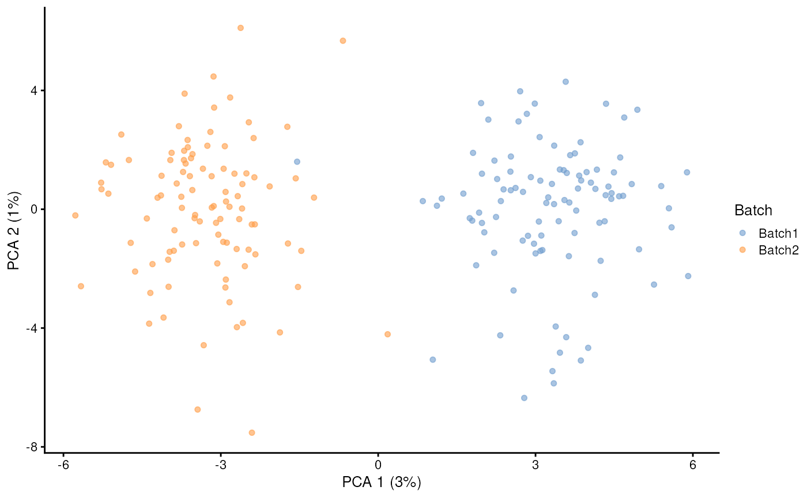

#### `batch.facLoc` - Batch factor location and `batch.facScale` - Batch factor scale

Batches are specified by generating a small scaling factor for each gene
in each batch from a log-normal distribution. These factors are then
applied to the underlying gene means in each batch. Modifying these
parameters affects how different the batches are from each other by
generating bigger or smaller factors.

\
`# Simulation with small batch effects`\
`sim1`` ``<-`` `[`splatSimulate`](http://oshlacklab.com/splatter/reference/splatSimulate.md)`(`\
`    ``params``,`\
`    batchCells ``=`` `[`c`](https://rdrr.io/r/base/c.html)`(``100``, ``100``)``,`\
`    batch.facLoc ``=`` ``0.001``,`\
`    batch.facScale ``=`` ``0.001``,`\
`    verbose ``=`` ``FALSE`\
`)`\
`sim1`` ``<-`` `[`logNormCounts`](https://rdrr.io/pkg/scuttle/man/logNormCounts.html)`(``sim1``)`\
`#> Warning in .library_size_factors(assay(x, assay.type), ...): 'librarySizeFactors' is deprecated.`\
`#> Use 'scrapper::centerSizeFactors' instead.`\
`#> See help("Deprecated")`\
`#> Warning in .local(x, ...): 'normalizeCounts' is deprecated.`\
`#> Use 'scrapper::normalizeCounts' instead.`\
`#> See help("Deprecated")`\
`sim1`` ``<-`` `[`runPCA`](https://rdrr.io/pkg/BiocSingular/man/runPCA.html)`(``sim1``)`\
[`plotPCA`](https://rdrr.io/pkg/BiocGenerics/man/plotPCA.html)`(``sim1``, colour_by ``=`` ``"Batch"``)`` ``+`` `[`ggtitle`](https://ggplot2.tidyverse.org/reference/labs.html)`(``"Small batch effects"``)`

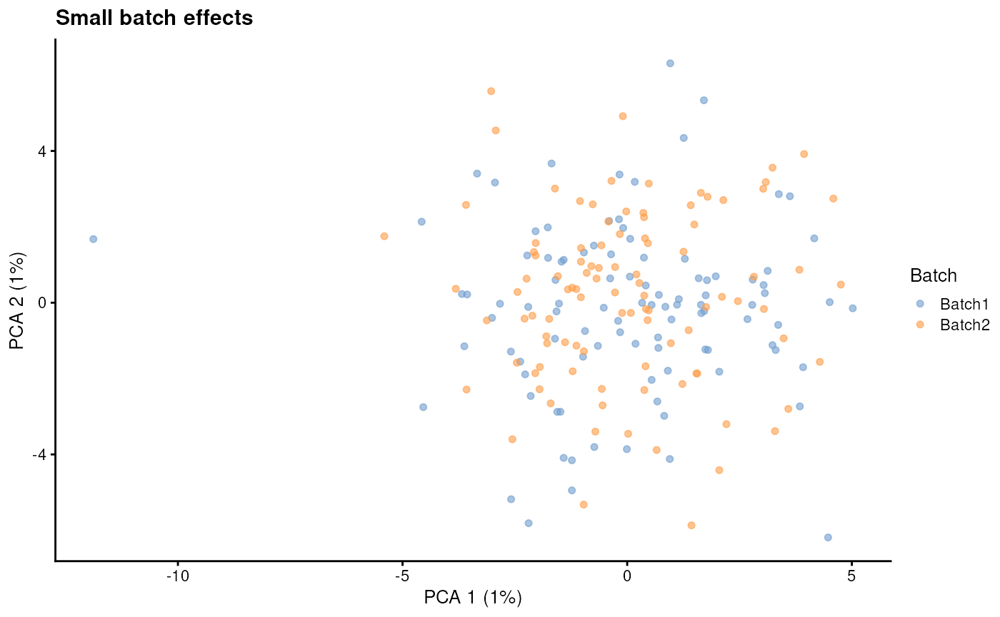

\
\
`# Simulation with big batch effects`\
`sim2`` ``<-`` `[`splatSimulate`](http://oshlacklab.com/splatter/reference/splatSimulate.md)`(`\
`    ``params``,`\
`    batchCells ``=`` `[`c`](https://rdrr.io/r/base/c.html)`(``100``, ``100``)``,`\
`    batch.facLoc ``=`` ``0.5``,`\
`    batch.facScale ``=`` ``0.5``,`\
`    verbose ``=`` ``FALSE`\
`)`\
`sim2`` ``<-`` `[`logNormCounts`](https://rdrr.io/pkg/scuttle/man/logNormCounts.html)`(``sim2``)`\
`#> Warning in .library_size_factors(assay(x, assay.type), ...): 'librarySizeFactors' is deprecated.`\
`#> Use 'scrapper::centerSizeFactors' instead.`\
`#> See help("Deprecated")`\
`#> Warning in .library_size_factors(assay(x, assay.type), ...): 'normalizeCounts' is deprecated.`\
`#> Use 'scrapper::normalizeCounts' instead.`\
`#> See help("Deprecated")`\
`sim2`` ``<-`` `[`runPCA`](https://rdrr.io/pkg/BiocSingular/man/runPCA.html)`(``sim2``)`\
[`plotPCA`](https://rdrr.io/pkg/BiocGenerics/man/plotPCA.html)`(``sim2``, colour_by ``=`` ``"Batch"``)`` ``+`` `[`ggtitle`](https://ggplot2.tidyverse.org/reference/labs.html)`(``"Big batch effects"``)`

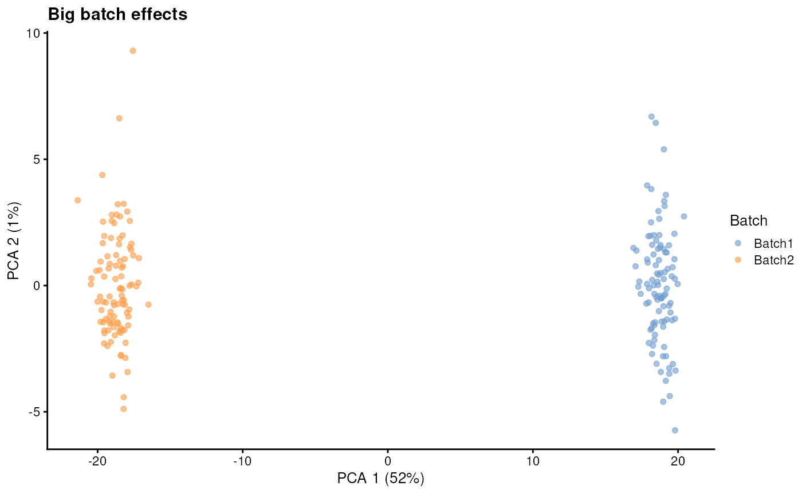

#### `batch.rmEffect` - Remove batch effect

Setting `batch.rmEffect` to `TRUE` produces a dataset that is
(approximately) identical to when `batch.rmEffect` is `FALSE` but with
the batch effect removed. This can be used as the ground truth for
evaluating batch correction.

\
`sim1`` ``<-`` `[`splatSimulate`](http://oshlacklab.com/splatter/reference/splatSimulate.md)`(`\
`    ``params``,`\
`    batchCells ``=`` `[`c`](https://rdrr.io/r/base/c.html)`(``100``, ``100``)``,`\
`    batch.rmEffect ``=`` ``FALSE``,`\
`    verbose ``=`` ``FALSE`\
`)`\
`sim1`` ``<-`` `[`logNormCounts`](https://rdrr.io/pkg/scuttle/man/logNormCounts.html)`(``sim1``)`\
`#> Warning in .library_size_factors(assay(x, assay.type), ...): 'librarySizeFactors' is deprecated.`\
`#> Use 'scrapper::centerSizeFactors' instead.`\
`#> See help("Deprecated")`\
`#> Warning in .local(x, ...): 'normalizeCounts' is deprecated.`\
`#> Use 'scrapper::normalizeCounts' instead.`\
`#> See help("Deprecated")`\
`sim1`` ``<-`` `[`runPCA`](https://rdrr.io/pkg/BiocSingular/man/runPCA.html)`(``sim1``)`\
[`plotPCA`](https://rdrr.io/pkg/BiocGenerics/man/plotPCA.html)`(``sim1``, colour_by ``=`` ``"Batch"``)`` ``+`` `[`ggtitle`](https://ggplot2.tidyverse.org/reference/labs.html)`(``"With batch effects"``)`

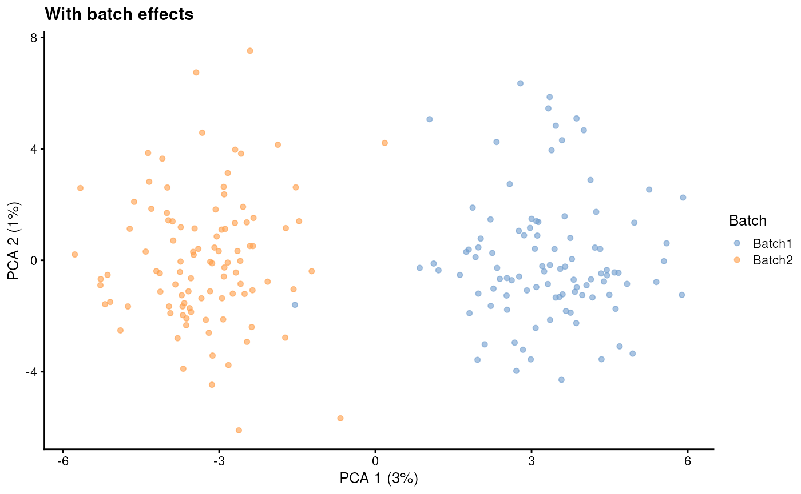

\
\
`sim2`` ``<-`` `[`splatSimulate`](http://oshlacklab.com/splatter/reference/splatSimulate.md)`(`\
`    ``params``,`\
`    batchCells ``=`` `[`c`](https://rdrr.io/r/base/c.html)`(``100``, ``100``)``,`\
`    batch.rmEffect ``=`` ``TRUE``,`\
`    verbose ``=`` ``FALSE`\
`)`\
`sim2`` ``<-`` `[`logNormCounts`](https://rdrr.io/pkg/scuttle/man/logNormCounts.html)`(``sim2``)`\
`#> Warning in .library_size_factors(assay(x, assay.type), ...): 'librarySizeFactors' is deprecated.`\
`#> Use 'scrapper::centerSizeFactors' instead.`\
`#> See help("Deprecated")`\
`#> Warning in .library_size_factors(assay(x, assay.type), ...): 'normalizeCounts' is deprecated.`\
`#> Use 'scrapper::normalizeCounts' instead.`\
`#> See help("Deprecated")`\
`sim2`` ``<-`` `[`runPCA`](https://rdrr.io/pkg/BiocSingular/man/runPCA.html)`(``sim2``)`\
[`plotPCA`](https://rdrr.io/pkg/BiocGenerics/man/plotPCA.html)`(``sim2``, colour_by ``=`` ``"Batch"``)`` ``+`` `[`ggtitle`](https://ggplot2.tidyverse.org/reference/labs.html)`(``"Batch effects removed"``)`

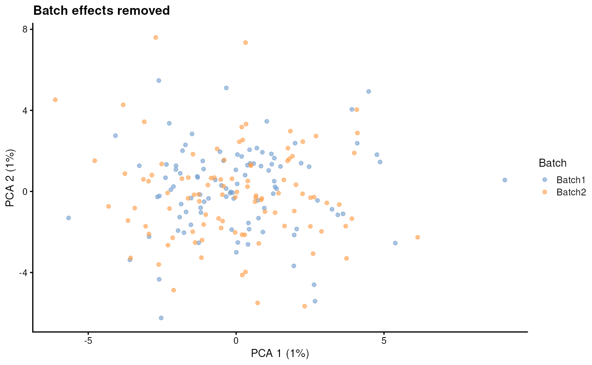

### Mean parameters

These parameters control the distribution that is used to generate the
underlying original gene means.

#### `mean.shape` - Mean shape and `mean.rate` - Mean rate

These parameters control the Gamma distribution that gene means are
drawn from. The relationship between shape and rate can be complex and
it is often better to use values estimated from a real dataset than to
try and manually set them. Although these parameters control the base
gene means the means in the final simulation will depend upon other
parts of the model, particularly the simulated total counts per cell
(library sizes).

### Library size parameters

These parameters control the expected number of counts for each cell.
Note that because of sampling the actual counts per cell in the final
simulation may be different. Turning on the dropout effect will also
effect this. We use the term “library size” here for consistency but
expected total counts would be more appropriate.

#### `lib.loc` - Library size location and `lib.scale` - Library size scale

These parameters control the shape of the distribution that is used to
generate library sizes for each cell. Increasing `lib.loc` will lead to
more counts per cell and increasing `lib.scale` will result in more
variability in the counts per cell.

#### `lib.norm` - Library size distribution

The default (and recommended) distribution used for library sizes in the
Splat simulation is a log-normal. However, in rare cases a normal
distribution might be more appropriate. Setting `lib.norm` to `TRUE`
will use a normal distribution instead of a log-normal.

### Expression outlier parameters

When developing the Splat simulation we found that while the Gamma
distribution was generally a good match for gene means for some datasets
it did not properly capture highly expressed genes. For this reason we
added expression outliers to the Splat model.

#### `out.prob` - Expression outlier probability

This parameter controls the probability that genes will be selected to
be expression outliers. Higher values will results in more outlier
genes.

\
`# Few outliers`\
`sim1`` ``<-`` `[`splatSimulate`](http://oshlacklab.com/splatter/reference/splatSimulate.md)`(``out.prob ``=`` ``0.001``, verbose ``=`` ``FALSE``)`\
[`ggplot`](https://ggplot2.tidyverse.org/reference/ggplot.html)`(`\
`    `[`as.data.frame`](https://rdrr.io/pkg/BiocGenerics/man/as.data.frame.html)`(``rowData``(``sim1``)``)``,`\
`    `[`aes`](https://ggplot2.tidyverse.org/reference/aes.html)`(``x ``=`` `[`log10`](https://rdrr.io/r/base/Log.html)`(``GeneMean``)``, fill ``=`` ``OutlierFactor`` ``!=`` ``1``)`\
`)`` ``+`\
`    `[`geom_histogram`](https://ggplot2.tidyverse.org/reference/geom_histogram.html)`(``bins ``=`` ``100``)`` ``+`\
`    `[`ggtitle`](https://ggplot2.tidyverse.org/reference/labs.html)`(``"Few outliers"``)`

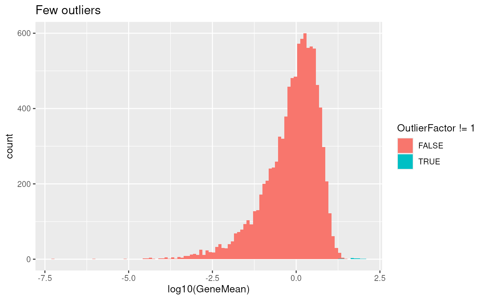

\
\
`# Lots of outliers`\
`sim2`` ``<-`` `[`splatSimulate`](http://oshlacklab.com/splatter/reference/splatSimulate.md)`(``out.prob ``=`` ``0.2``, verbose ``=`` ``FALSE``)`\
[`ggplot`](https://ggplot2.tidyverse.org/reference/ggplot.html)`(`\
`    `[`as.data.frame`](https://rdrr.io/pkg/BiocGenerics/man/as.data.frame.html)`(``rowData``(``sim2``)``)``,`\
`    `[`aes`](https://ggplot2.tidyverse.org/reference/aes.html)`(``x ``=`` `[`log10`](https://rdrr.io/r/base/Log.html)`(``GeneMean``)``, fill ``=`` ``OutlierFactor`` ``!=`` ``1``)`\
`)`` ``+`\
`    `[`geom_histogram`](https://ggplot2.tidyverse.org/reference/geom_histogram.html)`(``bins ``=`` ``100``)`` ``+`\
`    `[`ggtitle`](https://ggplot2.tidyverse.org/reference/labs.html)`(``"Lots of outliers"``)`

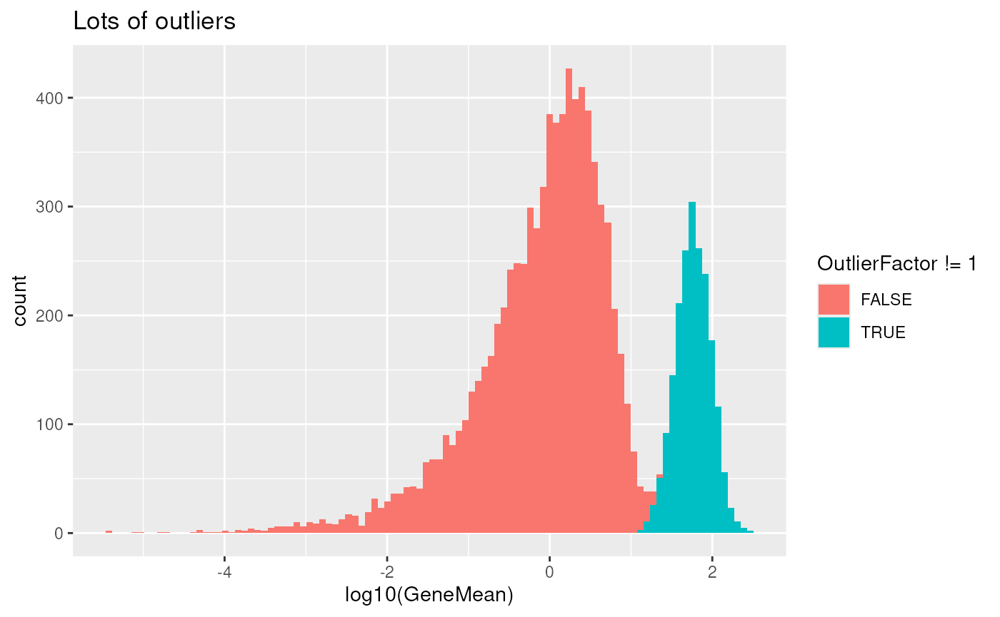

#### `out.facLoc` - Expression outlier factor location and `out.facScale` - Expression outlier factor scale

The expression outlier factors are drawn from a log-normal distribution
controlled by these parameters. The generated factors are applied to the
median mean expression rather than the existing mean for the selected
genes. This is to be consistent with the estimation procedure for these
factors and to make sure that the final means are outliers. For example
to avoid the situation where a factor is applied to a lowly expressed
gene, making it just moderately expressed rather than an expression
outlier.

#### Group parameters

Up until this stage of the simulation only a single population of cells
is considered but we often want to simulate datasets with multiple kinds
of cells. We do this by assigning cells to groups.

#### `nGroups` - Number of groups

The number of groups to simulate. This parameter cannot be set directly
and is controlled using `group.prob`.

#### `group.prob` - Group probabilities

A vector giving the probability that cells will be assigned to groups.
The length of the vector gives the number of groups (`nGroups`) and the
probabilities must sum to 1. Adjusting the number and relative values of
the probabilities changes the number and relative sizes of the groups.
To simulate groups we also need to use the `splatSimulateGroups`
function or set `method = "groups"`.

\
`params.groups`` ``<-`` `[`newSplatParams`](http://oshlacklab.com/splatter/reference/newParams.md)`(``batchCells ``=`` ``500``, nGenes ``=`` ``1000``)`\
\
`# One small group, one big group`\
`sim1`` ``<-`` `[`splatSimulateGroups`](http://oshlacklab.com/splatter/reference/splatSimulate.md)`(`\
`    ``params.groups``,`\
`    group.prob ``=`` `[`c`](https://rdrr.io/r/base/c.html)`(``0.9``, ``0.1``)``,`\
`    verbose ``=`` ``FALSE`\
`)`\
`sim1`` ``<-`` `[`logNormCounts`](https://rdrr.io/pkg/scuttle/man/logNormCounts.html)`(``sim1``)`\
`#> Warning in .library_size_factors(assay(x, assay.type), ...): 'librarySizeFactors' is deprecated.`\
`#> Use 'scrapper::centerSizeFactors' instead.`\
`#> See help("Deprecated")`\
`#> Warning in .local(x, ...): 'normalizeCounts' is deprecated.`\
`#> Use 'scrapper::normalizeCounts' instead.`\
`#> See help("Deprecated")`\
`sim1`` ``<-`` `[`runPCA`](https://rdrr.io/pkg/BiocSingular/man/runPCA.html)`(``sim1``)`\
[`plotPCA`](https://rdrr.io/pkg/BiocGenerics/man/plotPCA.html)`(``sim1``, colour_by ``=`` ``"Group"``)`` ``+`` `[`ggtitle`](https://ggplot2.tidyverse.org/reference/labs.html)`(``"One small group, one big group"``)`

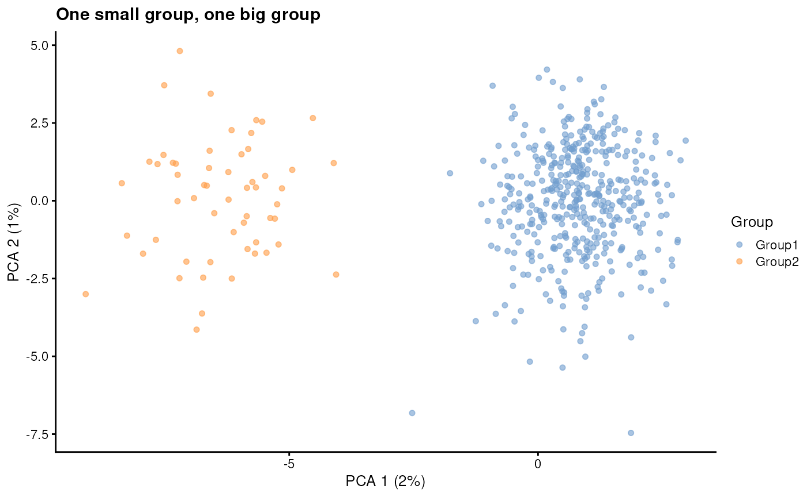

\
\
`# Five groups`\
`sim2`` ``<-`` `[`splatSimulateGroups`](http://oshlacklab.com/splatter/reference/splatSimulate.md)`(`\
`    ``params.groups``,`\
`    group.prob ``=`` `[`c`](https://rdrr.io/r/base/c.html)`(``0.2``, ``0.2``, ``0.2``, ``0.2``, ``0.2``)``,`\
`    verbose ``=`` ``FALSE`\
`)`\
`sim2`` ``<-`` `[`logNormCounts`](https://rdrr.io/pkg/scuttle/man/logNormCounts.html)`(``sim2``)`\
`#> Warning in .library_size_factors(assay(x, assay.type), ...): 'librarySizeFactors' is deprecated.`\
`#> Use 'scrapper::centerSizeFactors' instead.`\
`#> See help("Deprecated")`\
`#> Warning in .library_size_factors(assay(x, assay.type), ...): 'normalizeCounts' is deprecated.`\
`#> Use 'scrapper::normalizeCounts' instead.`\
`#> See help("Deprecated")`\
`sim2`` ``<-`` `[`runPCA`](https://rdrr.io/pkg/BiocSingular/man/runPCA.html)`(``sim2``)`\
[`plotPCA`](https://rdrr.io/pkg/BiocGenerics/man/plotPCA.html)`(``sim2``, colour_by ``=`` ``"Group"``)`` ``+`` `[`ggtitle`](https://ggplot2.tidyverse.org/reference/labs.html)`(``"Five groups"``)`

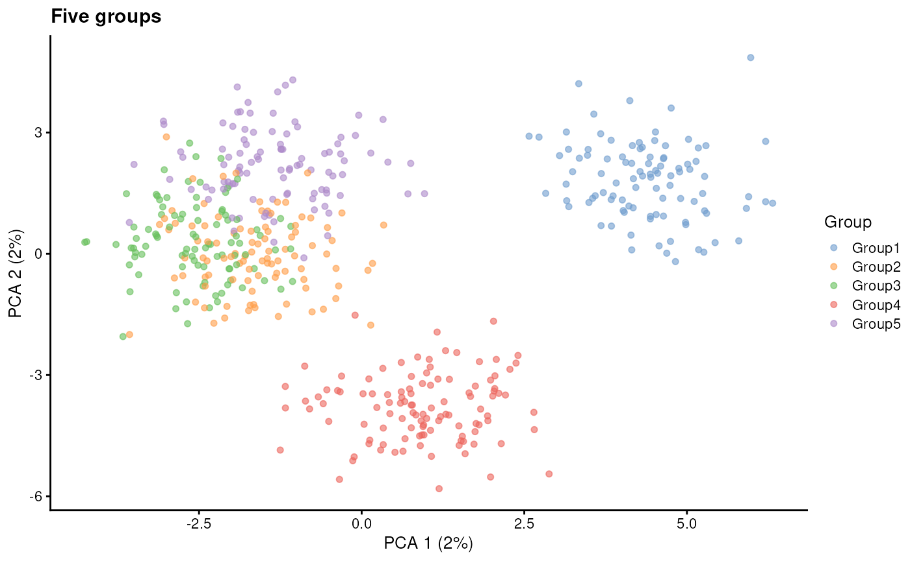

**Note:** Once there are more than three or four groups it becomes
difficult to properly view them in PCA space. We use PCA here for
simplicity but generally a non-linear dimensionality reduction such as
t-SNE or UMAP is a more useful way to visualise the groups.

#### Differential expression parameters

Different groups are created by modifying the base expression levels of
selected genes. The process for doing this is to simulate differential
expression (DE) between each group and a fictional base cell. Altering
the differential expression parameters controls how similar groups are
to each other.

#### `de.prob` - DE probability

This parameter controls the probability that a gene will be selected to
be differentially expressed.

\
`# Few DE genes`\
`sim1`` ``<-`` `[`splatSimulateGroups`](http://oshlacklab.com/splatter/reference/splatSimulate.md)`(`\
`    ``params.groups``,`\
`    group.prob ``=`` `[`c`](https://rdrr.io/r/base/c.html)`(``0.5``, ``0.5``)``,`\
`    de.prob ``=`` ``0.01``,`\
`    verbose ``=`` ``FALSE`\
`)`\
`sim1`` ``<-`` `[`logNormCounts`](https://rdrr.io/pkg/scuttle/man/logNormCounts.html)`(``sim1``)`\
`#> Warning in .library_size_factors(assay(x, assay.type), ...): 'librarySizeFactors' is deprecated.`\
`#> Use 'scrapper::centerSizeFactors' instead.`\
`#> See help("Deprecated")`\
`#> Warning in .local(x, ...): 'normalizeCounts' is deprecated.`\
`#> Use 'scrapper::normalizeCounts' instead.`\
`#> See help("Deprecated")`\
`sim1`` ``<-`` `[`runPCA`](https://rdrr.io/pkg/BiocSingular/man/runPCA.html)`(``sim1``)`\
[`plotPCA`](https://rdrr.io/pkg/BiocGenerics/man/plotPCA.html)`(``sim1``, colour_by ``=`` ``"Group"``)`` ``+`` `[`ggtitle`](https://ggplot2.tidyverse.org/reference/labs.html)`(``"Few DE genes"``)`

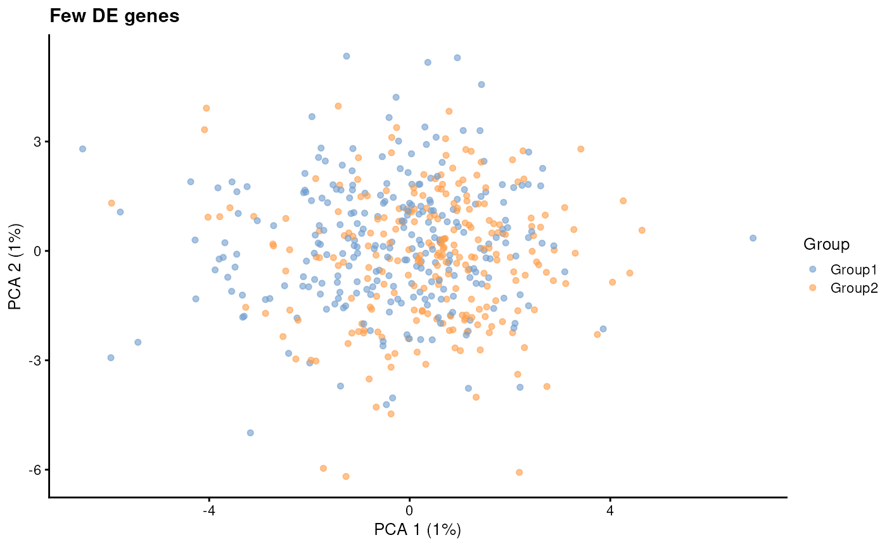

\
\
`# Lots of DE genes`\
`sim2`` ``<-`` `[`splatSimulateGroups`](http://oshlacklab.com/splatter/reference/splatSimulate.md)`(`\
`    ``params.groups``,`\
`    group.prob ``=`` `[`c`](https://rdrr.io/r/base/c.html)`(``0.5``, ``0.5``)``,`\
`    de.prob ``=`` ``0.3``,`\
`    verbose ``=`` ``FALSE`\
`)`\
`sim2`` ``<-`` `[`logNormCounts`](https://rdrr.io/pkg/scuttle/man/logNormCounts.html)`(``sim2``)`\
`#> Warning in .library_size_factors(assay(x, assay.type), ...): 'librarySizeFactors' is deprecated.`\
`#> Use 'scrapper::centerSizeFactors' instead.`\
`#> See help("Deprecated")`\
`#> Warning in .library_size_factors(assay(x, assay.type), ...): 'normalizeCounts' is deprecated.`\
`#> Use 'scrapper::normalizeCounts' instead.`\
`#> See help("Deprecated")`\
`sim2`` ``<-`` `[`runPCA`](https://rdrr.io/pkg/BiocSingular/man/runPCA.html)`(``sim2``)`\
[`plotPCA`](https://rdrr.io/pkg/BiocGenerics/man/plotPCA.html)`(``sim2``, colour_by ``=`` ``"Group"``)`` ``+`` `[`ggtitle`](https://ggplot2.tidyverse.org/reference/labs.html)`(``"Lots of DE genes"``)`

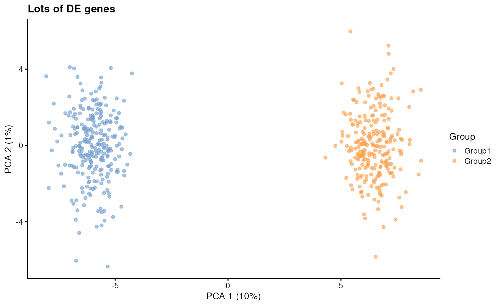

#### `de.downProb` - Down-regulation probability

A selected DE gene can be either down-regulated (has a factor less than
one) or up-regulated (has a factor greater than one). This parameter
controls the probability that a selected gene will be down-regulated.

#### `de.facLoc` - DE factor location and `de.facScale` - DE factor scale

Differential expression factors are produced from a log-normal
distribution in a similar way to batch effect factors and expression
outlier factors. Changing these parameters can result in more or less
extreme differences between groups.

\
`# Small DE factors`\
`sim1`` ``<-`` `[`splatSimulateGroups`](http://oshlacklab.com/splatter/reference/splatSimulate.md)`(`\
`    ``params.groups``,`\
`    group.prob ``=`` `[`c`](https://rdrr.io/r/base/c.html)`(``0.5``, ``0.5``)``,`\
`    de.facLoc ``=`` ``0.01``,`\
`    verbose ``=`` ``FALSE`\
`)`\
`sim1`` ``<-`` `[`logNormCounts`](https://rdrr.io/pkg/scuttle/man/logNormCounts.html)`(``sim1``)`\
`#> Warning in .library_size_factors(assay(x, assay.type), ...): 'librarySizeFactors' is deprecated.`\
`#> Use 'scrapper::centerSizeFactors' instead.`\
`#> See help("Deprecated")`\
`#> Warning in .local(x, ...): 'normalizeCounts' is deprecated.`\
`#> Use 'scrapper::normalizeCounts' instead.`\
`#> See help("Deprecated")`\
`sim1`` ``<-`` `[`runPCA`](https://rdrr.io/pkg/BiocSingular/man/runPCA.html)`(``sim1``)`\
[`plotPCA`](https://rdrr.io/pkg/BiocGenerics/man/plotPCA.html)`(``sim1``, colour_by ``=`` ``"Group"``)`` ``+`` `[`ggtitle`](https://ggplot2.tidyverse.org/reference/labs.html)`(``"Small DE factors"``)`

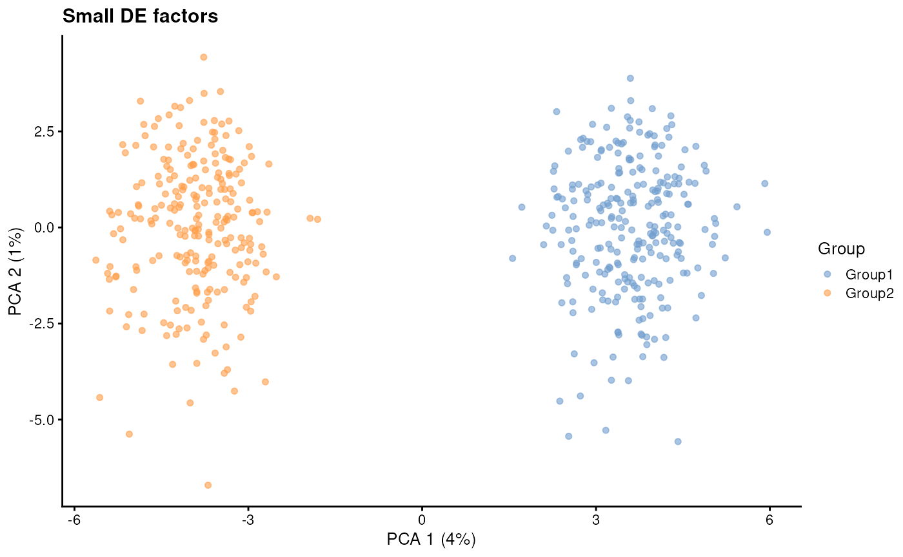

\
\
`# Big DE factors`\
`sim2`` ``<-`` `[`splatSimulateGroups`](http://oshlacklab.com/splatter/reference/splatSimulate.md)`(`\
`    ``params.groups``,`\
`    group.prob ``=`` `[`c`](https://rdrr.io/r/base/c.html)`(``0.5``, ``0.5``)``,`\
`    de.facLoc ``=`` ``0.3``,`\
`    verbose ``=`` ``FALSE`\
`)`\
`sim2`` ``<-`` `[`logNormCounts`](https://rdrr.io/pkg/scuttle/man/logNormCounts.html)`(``sim2``)`\
`#> Warning in .library_size_factors(assay(x, assay.type), ...): 'librarySizeFactors' is deprecated.`\
`#> Use 'scrapper::centerSizeFactors' instead.`\
`#> See help("Deprecated")`\
`#> Warning in .library_size_factors(assay(x, assay.type), ...): 'normalizeCounts' is deprecated.`\
`#> Use 'scrapper::normalizeCounts' instead.`\
`#> See help("Deprecated")`\
`sim2`` ``<-`` `[`runPCA`](https://rdrr.io/pkg/BiocSingular/man/runPCA.html)`(``sim2``)`\
[`plotPCA`](https://rdrr.io/pkg/BiocGenerics/man/plotPCA.html)`(``sim2``, colour_by ``=`` ``"Group"``)`` ``+`` `[`ggtitle`](https://ggplot2.tidyverse.org/reference/labs.html)`(``"Big DE factors"``)`

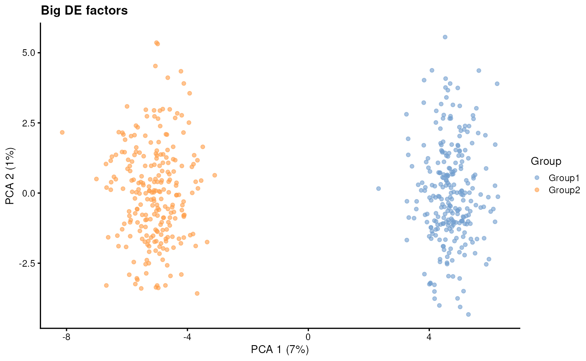

Just looking at the PCA plots this effect seems similar to adjusting
`de.prob` but the effect is achieved in a different way. A higher
`de.prob` means that more genes are differentially expressed but
changing the DE factors changes the level of DE for the same number of
genes.

#### Complex differential expression

Each of the differential expression parameters can be specified for each
group by providing a vector of values. These vectors must be the same
length as `group.prob`. Specifying parameters as vectors allows more
complex simulations where groups are more or less different to each
other rather than being equally distinct. Here are some examples of
different DE scenarios.

\
`# Different DE probs`\
`sim1`` ``<-`` `[`splatSimulateGroups`](http://oshlacklab.com/splatter/reference/splatSimulate.md)`(`\
`    ``params.groups``,`\
`    group.prob ``=`` `[`c`](https://rdrr.io/r/base/c.html)`(``0.2``, ``0.2``, ``0.2``, ``0.2``, ``0.2``)``,`\
`    de.prob ``=`` `[`c`](https://rdrr.io/r/base/c.html)`(``0.01``, ``0.01``, ``0.1``, ``0.1``, ``0.3``)``,`\
`    verbose ``=`` ``FALSE`\
`)`\
`sim1`` ``<-`` `[`logNormCounts`](https://rdrr.io/pkg/scuttle/man/logNormCounts.html)`(``sim1``)`\
`#> Warning in .library_size_factors(assay(x, assay.type), ...): 'librarySizeFactors' is deprecated.`\
`#> Use 'scrapper::centerSizeFactors' instead.`\
`#> See help("Deprecated")`\
`#> Warning in .local(x, ...): 'normalizeCounts' is deprecated.`\
`#> Use 'scrapper::normalizeCounts' instead.`\
`#> See help("Deprecated")`\
`sim1`` ``<-`` `[`runPCA`](https://rdrr.io/pkg/BiocSingular/man/runPCA.html)`(``sim1``)`\
[`plotPCA`](https://rdrr.io/pkg/BiocGenerics/man/plotPCA.html)`(``sim1``, colour_by ``=`` ``"Group"``)`` ``+`\
`    `[`labs`](https://ggplot2.tidyverse.org/reference/labs.html)`(`\
`        title ``=`` ``"Different DE probabilities"``,`\
`        caption ``=`` `[`paste`](https://rdrr.io/pkg/BiocGenerics/man/paste.html)`(`\
`            ``"Groups 1 and 2 have very few DE genes,"``,`\
`            ``"Groups 3 and 4 have the default number,"``,`\
`            ``"Group 5 has many DE genes"`\
`        ``)`\
`    ``)`

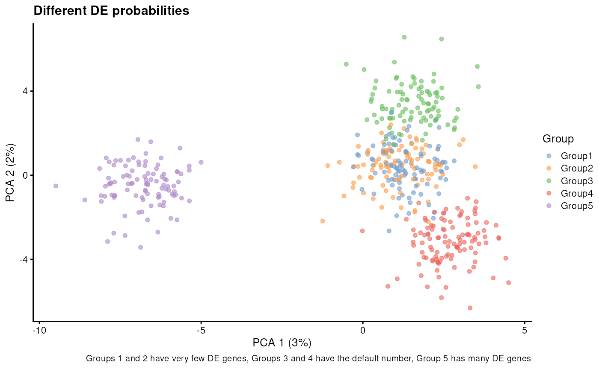

\
\
\
`# Different DE factors`\
`sim2`` ``<-`` `[`splatSimulateGroups`](http://oshlacklab.com/splatter/reference/splatSimulate.md)`(`\
`    ``params.groups``,`\
`    group.prob ``=`` `[`c`](https://rdrr.io/r/base/c.html)`(``0.2``, ``0.2``, ``0.2``, ``0.2``, ``0.2``)``,`\
`    de.facLoc ``=`` `[`c`](https://rdrr.io/r/base/c.html)`(``0.01``, ``0.01``, ``0.1``, ``0.1``, ``0.2``)``,`\
`    de.facScale ``=`` `[`c`](https://rdrr.io/r/base/c.html)`(``0.2``, ``0.5``, ``0.2``, ``0.5``, ``0.4``)``,`\
`    verbose ``=`` ``FALSE`\
`)`\
`sim2`` ``<-`` `[`logNormCounts`](https://rdrr.io/pkg/scuttle/man/logNormCounts.html)`(``sim2``)`\
`#> Warning in .library_size_factors(assay(x, assay.type), ...): 'librarySizeFactors' is deprecated.`\
`#> Use 'scrapper::centerSizeFactors' instead.`\
`#> See help("Deprecated")`\
`#> Warning in .library_size_factors(assay(x, assay.type), ...): 'normalizeCounts' is deprecated.`\
`#> Use 'scrapper::normalizeCounts' instead.`\
`#> See help("Deprecated")`\
`sim2`` ``<-`` `[`runPCA`](https://rdrr.io/pkg/BiocSingular/man/runPCA.html)`(``sim2``)`\
[`plotPCA`](https://rdrr.io/pkg/BiocGenerics/man/plotPCA.html)`(``sim2``, colour_by ``=`` ``"Group"``)`` ``+`\
`    `[`labs`](https://ggplot2.tidyverse.org/reference/labs.html)`(`\
`        title ``=`` ``"Different DE factors"``,`\
`        caption ``=`` `[`paste`](https://rdrr.io/pkg/BiocGenerics/man/paste.html)`(`\
`            ``"Group 1 has factors with small location (value),"``,`\
`            ``"and scale (variability),"``,`\
`            ``"Group 2 has small location and greater scale.\n"``,`\
`            ``"Groups 3 and 4 have greater location with small,"``,`\
`            ``"and large scales"``,`\
`            ``"Group 5 has bigger factors with moderate"``,`\
`            ``"variability"`\
`        ``)`\
`    ``)`

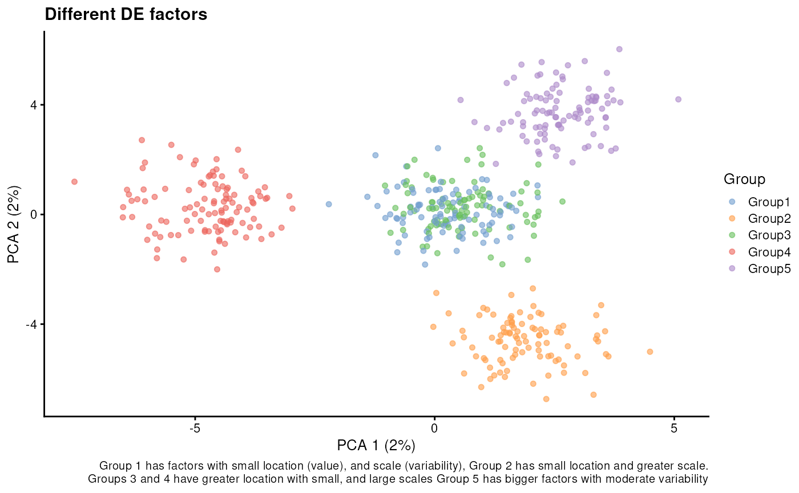

\
\
`# Combination of everything`\
`sim3`` ``<-`` `[`splatSimulateGroups`](http://oshlacklab.com/splatter/reference/splatSimulate.md)`(`\
`    ``params.groups``,`\
`    group.prob ``=`` `[`c`](https://rdrr.io/r/base/c.html)`(``0.05``, ``0.2``, ``0.2``, ``0.2``, ``0.35``)``,`\
`    de.prob ``=`` `[`c`](https://rdrr.io/r/base/c.html)`(``0.3``, ``0.1``, ``0.2``, ``0.01``, ``0.1``)``,`\
`    de.downProb ``=`` `[`c`](https://rdrr.io/r/base/c.html)`(``0.1``, ``0.4``, ``0.9``, ``0.6``, ``0.5``)``,`\
`    de.facLoc ``=`` `[`c`](https://rdrr.io/r/base/c.html)`(``0.6``, ``0.1``, ``0.1``, ``0.01``, ``0.2``)``,`\
`    de.facScale ``=`` `[`c`](https://rdrr.io/r/base/c.html)`(``0.1``, ``0.4``, ``0.2``, ``0.5``, ``0.4``)``,`\
`    verbose ``=`` ``FALSE`\
`)`\
`sim3`` ``<-`` `[`logNormCounts`](https://rdrr.io/pkg/scuttle/man/logNormCounts.html)`(``sim3``)`\
`#> Warning in .library_size_factors(assay(x, assay.type), ...): 'librarySizeFactors' is deprecated.`\
`#> Use 'scrapper::centerSizeFactors' instead.`\
`#> See help("Deprecated")`\
`#> Warning in .library_size_factors(assay(x, assay.type), ...): 'normalizeCounts' is deprecated.`\
`#> Use 'scrapper::normalizeCounts' instead.`\
`#> See help("Deprecated")`\
`sim3`` ``<-`` `[`runPCA`](https://rdrr.io/pkg/BiocSingular/man/runPCA.html)`(``sim3``)`\
[`plotPCA`](https://rdrr.io/pkg/BiocGenerics/man/plotPCA.html)`(``sim3``, colour_by ``=`` ``"Group"``)`` ``+`\
`    `[`labs`](https://ggplot2.tidyverse.org/reference/labs.html)`(`\
`        title ``=`` ``"Different DE factors"``,`\
`        caption ``=`` `[`paste`](https://rdrr.io/pkg/BiocGenerics/man/paste.html)`(`\
`            ``"Group 1 is small with many very up-regulated DE genes,"``,`\
`            ``"Group 2 has the default DE parameters,\n"``,`\
`            ``"Group 3 has many down-regulated DE genes,"``,`\
`            ``"Group 4 has very few DE genes,"``,`\
`            ``"Group 5 is large with moderate DE factors"`\
`        ``)`\
`    ``)`

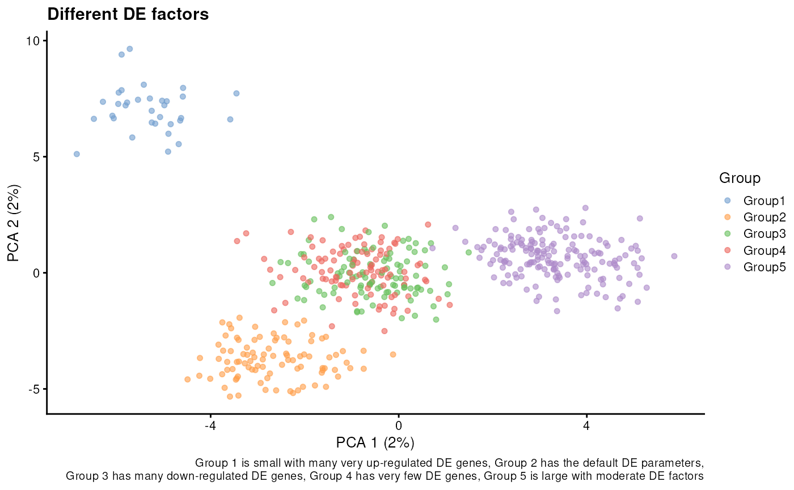

### Biological Coefficient of Variation (BCV) parameters

The BCV parameters control the variability of the genes in the simulated
dataset.

#### `bcv.common` - Common BCV

The `bcv.common` parameter controls the underlying common variability
across all genes in the dataset.

#### `bcv.df` - BCV Degrees of Freedom

This parameter sets the degrees of freedom used in the BCV inverse
chi-squared distribution. Changing this changes the effect of mean
expression on the variability of a gene.

### Dropout parameters

These parameters control whether additional dropout is added to increase
the number of zeros in the simulated dataset and if it is how that is
applied.

#### `dropout.type` - Dropout type

This parameter determines the kind of dropout effect to simulate.
Setting it to `"none"` means no dropout, “`experiment`” is global
dropout using the same set of parameters for every cell, `"batch"` uses
the same parameters for every cell in the same batch, `"group"` uses the
same parameters for every cell in the same group and `"cell"` uses a
different set of parameters for every cell.

#### `dropout.mid` - Dropout mid point and `dropout.shape` - Dropout shape

The probability that a particular count in a particular cell is set to
zero is related to the mean expression of that gene in that cell. This
relationship is represented using a logistic function with these
parameters. The `dropout.mid` parameter control the point at which the
probability is equal to 0.5 and the `dropout.shape` controls how it
changes with increasing expression. These parameters must be vectors of
the appropriate length depending on the selected dropout type.

### Path parameters

For many uses simulating groups is sufficient but in some cases it is
more appropriate to simulate continuous changes between cell types. The
number of paths and the probability of assigning cells to them is still
controlled by the `group.prob` parameter and the amount of change along
a path is controlled by the DE parameters but other aspects of the
`splatSimulatePaths` model are controlled by these parameters.

#### `path.from` - Path origin

This parameter controls the order of differentiation paths. It is a
vector the same length as `group.prob` giving the starting position of
each path. For example a `path.from` of `c(0, 1, 1, 3)` would indicate
the Path 1 starts at the origin (0), Path 2 starts at the end of Path 1,
Path 3 also starts at the end of Path 1 (a branch point) and Path 4
starts at the end of Path 3.

\
`# Linear paths`\
`sim1`` ``<-`` `[`splatSimulatePaths`](http://oshlacklab.com/splatter/reference/splatSimulate.md)`(`\
`    ``params.groups``,`\
`    group.prob ``=`` `[`c`](https://rdrr.io/r/base/c.html)`(``0.25``, ``0.25``, ``0.25``, ``0.25``)``,`\
`    de.prob ``=`` ``0.5``,`\
`    de.facLoc ``=`` ``0.2``,`\
`    path.from ``=`` `[`c`](https://rdrr.io/r/base/c.html)`(``0``, ``1``, ``2``, ``3``)``,`\
`    verbose ``=`` ``FALSE`\
`)`\
`sim1`` ``<-`` `[`logNormCounts`](https://rdrr.io/pkg/scuttle/man/logNormCounts.html)`(``sim1``)`\
`#> Warning in .library_size_factors(assay(x, assay.type), ...): 'librarySizeFactors' is deprecated.`\
`#> Use 'scrapper::centerSizeFactors' instead.`\
`#> See help("Deprecated")`\
`#> Warning in .local(x, ...): 'normalizeCounts' is deprecated.`\
`#> Use 'scrapper::normalizeCounts' instead.`\
`#> See help("Deprecated")`\
`sim1`` ``<-`` `[`runPCA`](https://rdrr.io/pkg/BiocSingular/man/runPCA.html)`(``sim1``)`\
[`plotPCA`](https://rdrr.io/pkg/BiocGenerics/man/plotPCA.html)`(``sim1``, colour_by ``=`` ``"Group"``)`` ``+`` `[`ggtitle`](https://ggplot2.tidyverse.org/reference/labs.html)`(``"Linear paths"``)`

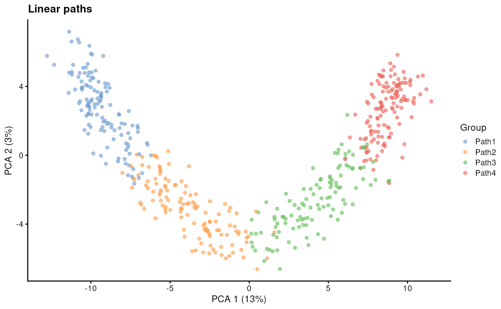

\
\
`# Branching path`\
`sim2`` ``<-`` `[`splatSimulatePaths`](http://oshlacklab.com/splatter/reference/splatSimulate.md)`(`\
`    ``params.groups``,`\
`    group.prob ``=`` `[`c`](https://rdrr.io/r/base/c.html)`(``0.25``, ``0.25``, ``0.25``, ``0.25``)``,`\
`    de.prob ``=`` ``0.5``,`\
`    de.facLoc ``=`` ``0.2``,`\
`    path.from ``=`` `[`c`](https://rdrr.io/r/base/c.html)`(``0``, ``1``, ``1``, ``3``)``,`\
`    verbose ``=`` ``FALSE`\
`)`\
`sim2`` ``<-`` `[`logNormCounts`](https://rdrr.io/pkg/scuttle/man/logNormCounts.html)`(``sim2``)`\
`#> Warning in .library_size_factors(assay(x, assay.type), ...): 'librarySizeFactors' is deprecated.`\
`#> Use 'scrapper::centerSizeFactors' instead.`\
`#> See help("Deprecated")`\
`#> Warning in .library_size_factors(assay(x, assay.type), ...): 'normalizeCounts' is deprecated.`\
`#> Use 'scrapper::normalizeCounts' instead.`\
`#> See help("Deprecated")`\
`sim2`` ``<-`` `[`runPCA`](https://rdrr.io/pkg/BiocSingular/man/runPCA.html)`(``sim2``)`\
[`plotPCA`](https://rdrr.io/pkg/BiocGenerics/man/plotPCA.html)`(``sim2``, colour_by ``=`` ``"Group"``)`` ``+`` `[`ggtitle`](https://ggplot2.tidyverse.org/reference/labs.html)`(``"Branching path"``)`

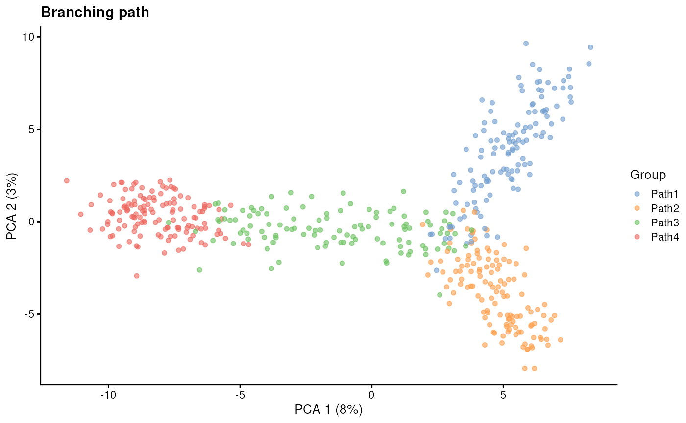

#### `path.nSteps` - Number of steps

A path is created by using the same differential expression procedure as
used for groups to generate an end point. Interpolation is then used to
create a series of steps between the start and end points. This
parameter controls the number of steps along a path and therefore how
discrete or smooth it is.

\
`# Few steps`\
`sim1`` ``<-`` `[`splatSimulatePaths`](http://oshlacklab.com/splatter/reference/splatSimulate.md)`(`\
`    ``params.groups``,`\
`    path.nSteps ``=`` ``3``,`\
`    de.prob ``=`` ``0.5``,`\
`    de.facLoc ``=`` ``0.2``,`\
`    verbose ``=`` ``FALSE`\
`)`\
`sim1`` ``<-`` `[`logNormCounts`](https://rdrr.io/pkg/scuttle/man/logNormCounts.html)`(``sim1``)`\
`#> Warning in .library_size_factors(assay(x, assay.type), ...): 'librarySizeFactors' is deprecated.`\
`#> Use 'scrapper::centerSizeFactors' instead.`\
`#> See help("Deprecated")`\
`#> Warning in .local(x, ...): 'normalizeCounts' is deprecated.`\
`#> Use 'scrapper::normalizeCounts' instead.`\
`#> See help("Deprecated")`\
`sim1`` ``<-`` `[`runPCA`](https://rdrr.io/pkg/BiocSingular/man/runPCA.html)`(``sim1``)`\
[`plotPCA`](https://rdrr.io/pkg/BiocGenerics/man/plotPCA.html)`(``sim1``, colour_by ``=`` ``"Step"``)`` ``+`` `[`ggtitle`](https://ggplot2.tidyverse.org/reference/labs.html)`(``"Few steps"``)`

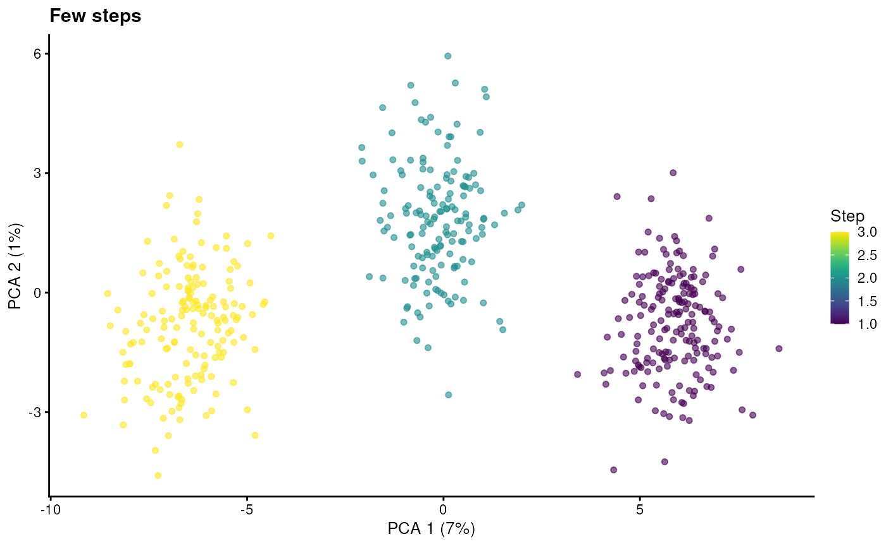

\
\
`# Lots of steps`\
`sim2`` ``<-`` `[`splatSimulatePaths`](http://oshlacklab.com/splatter/reference/splatSimulate.md)`(`\
`    ``params.groups``,`\
`    path.nSteps ``=`` ``1000``,`\
`    de.prob ``=`` ``0.5``,`\
`    de.facLoc ``=`` ``0.2``,`\
`    verbose ``=`` ``FALSE`\
`)`\
`sim2`` ``<-`` `[`logNormCounts`](https://rdrr.io/pkg/scuttle/man/logNormCounts.html)`(``sim2``)`\
`#> Warning in .library_size_factors(assay(x, assay.type), ...): 'librarySizeFactors' is deprecated.`\
`#> Use 'scrapper::centerSizeFactors' instead.`\
`#> See help("Deprecated")`\
`#> Warning in .library_size_factors(assay(x, assay.type), ...): 'normalizeCounts' is deprecated.`\
`#> Use 'scrapper::normalizeCounts' instead.`\
`#> See help("Deprecated")`\
`sim2`` ``<-`` `[`runPCA`](https://rdrr.io/pkg/BiocSingular/man/runPCA.html)`(``sim2``)`\
[`plotPCA`](https://rdrr.io/pkg/BiocGenerics/man/plotPCA.html)`(``sim2``, colour_by ``=`` ``"Step"``)`` ``+`` `[`ggtitle`](https://ggplot2.tidyverse.org/reference/labs.html)`(``"Lots of steps"``)`

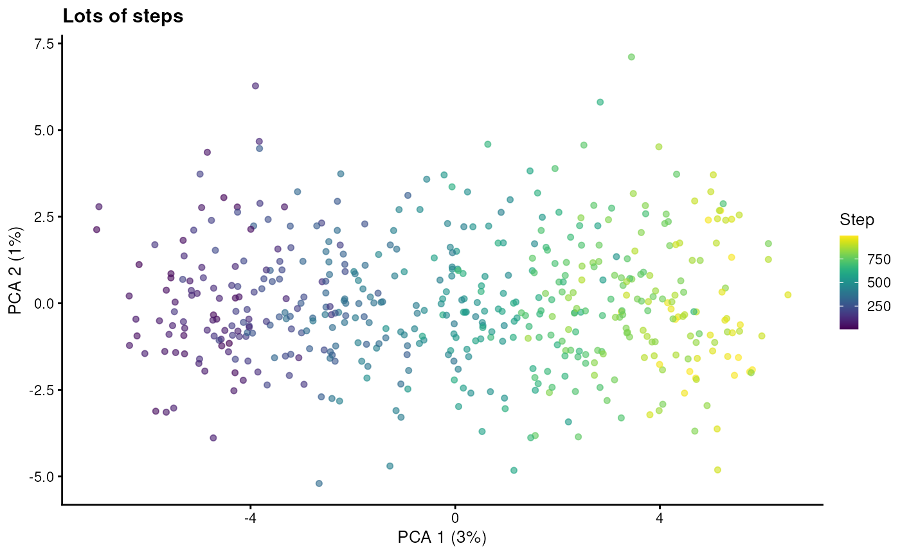

#### `path.skew` - Path skew

By default cells are evenly distributed along a path but it sometimes be
useful to introduce a skew in the distribution, For example you may want
to simulate a scenario with few stem-like cells and many differentiated
cells. Setting `path.skew` to 0 will mean that all cells come from the
end point while higher values up to 1 will skew them towards the start
point.

\
`# Skew towards the end`\
`sim1`` ``<-`` `[`splatSimulatePaths`](http://oshlacklab.com/splatter/reference/splatSimulate.md)`(`\
`    ``params.groups``,`\
`    path.skew ``=`` ``0.1``,`\
`    de.prob ``=`` ``0.5``,`\
`    de.facLoc ``=`` ``0.2``,`\
`    verbose ``=`` ``FALSE`\
`)`\
`sim1`` ``<-`` `[`logNormCounts`](https://rdrr.io/pkg/scuttle/man/logNormCounts.html)`(``sim1``)`\
`#> Warning in .library_size_factors(assay(x, assay.type), ...): 'librarySizeFactors' is deprecated.`\
`#> Use 'scrapper::centerSizeFactors' instead.`\
`#> See help("Deprecated")`\
`#> Warning in .local(x, ...): 'normalizeCounts' is deprecated.`\
`#> Use 'scrapper::normalizeCounts' instead.`\
`#> See help("Deprecated")`\
`sim1`` ``<-`` `[`runPCA`](https://rdrr.io/pkg/BiocSingular/man/runPCA.html)`(``sim1``)`\
[`plotPCA`](https://rdrr.io/pkg/BiocGenerics/man/plotPCA.html)`(``sim1``, colour_by ``=`` ``"Step"``)`` ``+`` `[`ggtitle`](https://ggplot2.tidyverse.org/reference/labs.html)`(``"Skewed towards the end"``)`

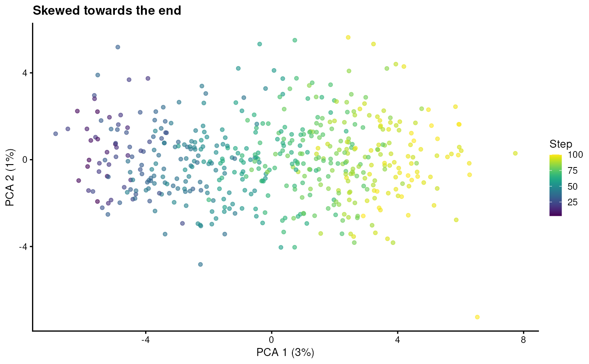

#### `path.nonlinearProb` - Non-linear probability

Most genes are interpolated in a linear way along a path but in reality
this may not always be the case. For example it is easy to imagine a
gene that is lowly-expressed at the start of a process, highly-expressed
in the middle and lowly-expressed again at the end. The
`path.nonlinearProb` parameter controls the probability that a gene will
change in a non-linear way along a path.

#### `path.sigmaFac` - Path skew

Non-linear changes along a path are achieved by building a Brownian
bridge between the two end points. A Brownian bridge is Brownian motion
controlled in such a way that the end points are fixed. The
`path.sigmaFac` parameter controls how extreme each step in the Brownian
motion is and therefore how much the interpolation differs from a linear
path.

## Session information

\
[`sessionInfo`](https://rdrr.io/r/utils/sessionInfo.html)`(``)`\
`#> R version 4.6.1 (2026-06-24)`\
`#> Platform: x86_64-pc-linux-gnu`\
`#> Running under: Ubuntu 24.04.5 LTS`\
`#> `\
`#> Matrix products: default`\
`#> BLAS:   /usr/lib/x86_64-linux-gnu/openblas-pthread/libblas.so.3 `\
`#> LAPACK: /usr/lib/x86_64-linux-gnu/openblas-pthread/libopenblasp-r0.3.26.so;  LAPACK version 3.12.0`\
`#> `\
`#> locale:`\
`#>  [1] LC_CTYPE=en_US.UTF-8       LC_NUMERIC=C              `\
`#>  [3] LC_TIME=en_US.UTF-8        LC_COLLATE=en_US.UTF-8    `\
`#>  [5] LC_MONETARY=en_US.UTF-8    LC_MESSAGES=en_US.UTF-8   `\
`#>  [7] LC_PAPER=en_US.UTF-8       LC_NAME=C                 `\
`#>  [9] LC_ADDRESS=C               LC_TELEPHONE=C            `\
`#> [11] LC_MEASUREMENT=en_US.UTF-8 LC_IDENTIFICATION=C       `\
`#> `\
`#> time zone: Etc/UTC`\
`#> tzcode source: system (glibc)`\
`#> `\
`#> attached base packages:`\
`#> [1] stats4    stats     graphics  grDevices utils     datasets  methods  `\
`#> [8] base     `\
`#> `\
`#> other attached packages:`\
`#>  [1] scater_1.41.3               ggplot2_4.0.3              `\
`#>  [3] scuttle_1.23.2              splatter_1.37.1            `\
`#>  [5] SingleCellExperiment_1.35.2 SummarizedExperiment_1.43.0`\
`#>  [7] Biobase_2.73.2              GenomicRanges_1.65.4       `\
`#>  [9] Seqinfo_1.3.2               IRanges_2.47.5             `\
`#> [11] S4Vectors_0.51.10           BiocGenerics_0.59.13       `\
`#> [13] generics_0.1.4              MatrixGenerics_1.25.0      `\
`#> [15] matrixStats_1.5.0           BiocStyle_2.41.0           `\
`#> `\
`#> loaded via a namespace (and not attached):`\
`#>  [1] tidyselect_1.2.1    viridisLite_0.4.3   dplyr_1.2.1        `\
`#>  [4] vipor_0.4.7         farver_2.1.2        viridis_0.6.5      `\
`#>  [7] S7_0.2.2            fastmap_1.2.0       digest_0.6.39      `\
`#> [10] rsvd_1.0.6          lifecycle_1.0.5     magrittr_2.0.5     `\
`#> [13] compiler_4.6.1      rlang_1.3.0         sass_0.4.10        `\
`#> [16] tools_4.6.1         yaml_2.3.12         knitr_1.52         `\
`#> [19] labeling_0.4.3      S4Arrays_1.13.2     htmlwidgets_1.6.4  `\
`#> [22] DelayedArray_0.39.8 RColorBrewer_1.1-3  abind_1.4-8        `\
`#> [25] BiocParallel_1.47.0 withr_3.0.3         desc_1.4.3         `\
`#> [28] grid_4.6.1          beachmat_2.29.3     scales_1.4.0       `\
`#> [31] cli_3.6.6           rmarkdown_2.32      crayon_1.5.3       `\
`#> [34] ragg_1.5.2          otel_0.2.0          ggbeeswarm_0.7.3   `\
`#> [37] cachem_1.1.0        parallel_4.6.1      BiocManager_1.30.27`\
`#> [40] XVector_0.53.0      vctrs_0.7.3         Matrix_1.7-6       `\
`#> [43] jsonlite_2.0.0      bookdown_0.48       BiocSingular_1.29.2`\
`#> [46] BiocNeighbors_2.7.3 ggrepel_0.9.8       irlba_2.4.1        `\
`#> [49] beeswarm_0.4.0      systemfonts_1.3.2   locfit_1.5-9.12    `\
`#> [52] jquerylib_0.1.4     glue_1.8.1          pkgdown_2.2.1      `\
`#> [55] codetools_0.2-20    cowplot_1.2.0       gtable_0.3.6       `\
`#> [58] ScaledMatrix_1.21.0 tibble_3.3.1        pillar_1.11.1      `\
`#> [61] htmltools_0.5.9     R6_2.6.1            textshaping_1.0.5  `\
`#> [64] evaluate_1.0.5      lattice_0.23-1      backports_1.5.1    `\
`#> [67] bslib_0.12.0        Rcpp_1.1.2          gridExtra_2.3.1    `\
`#> [70] SparseArray_1.13.5  checkmate_2.3.4     xfun_0.62          `\
`#> [73] fs_2.1.0            pkgconfig_2.0.3`
