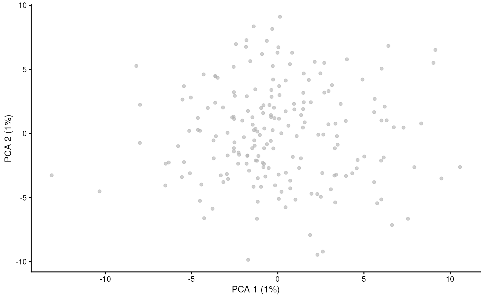
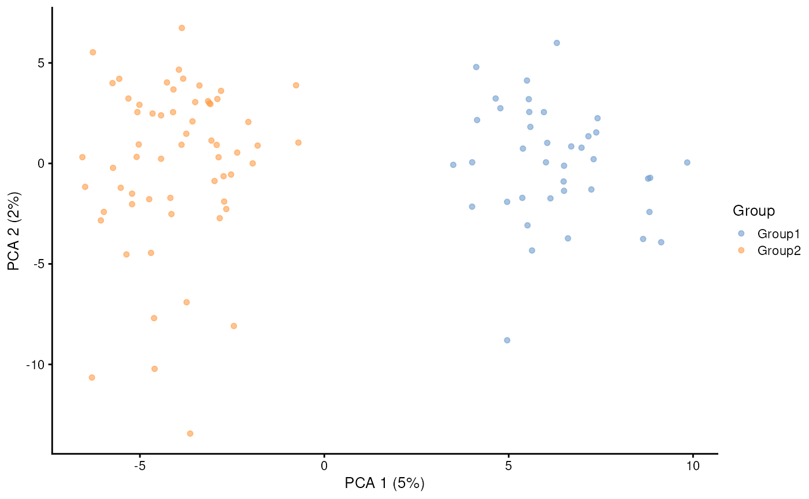
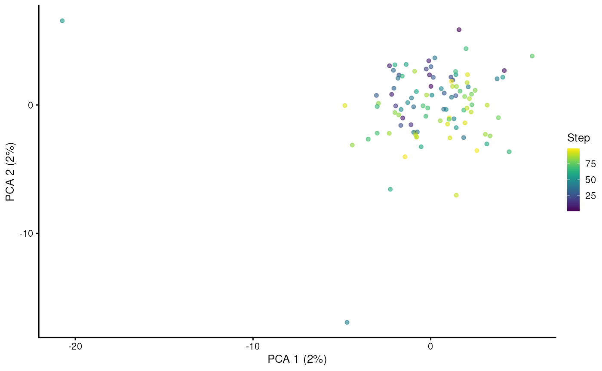
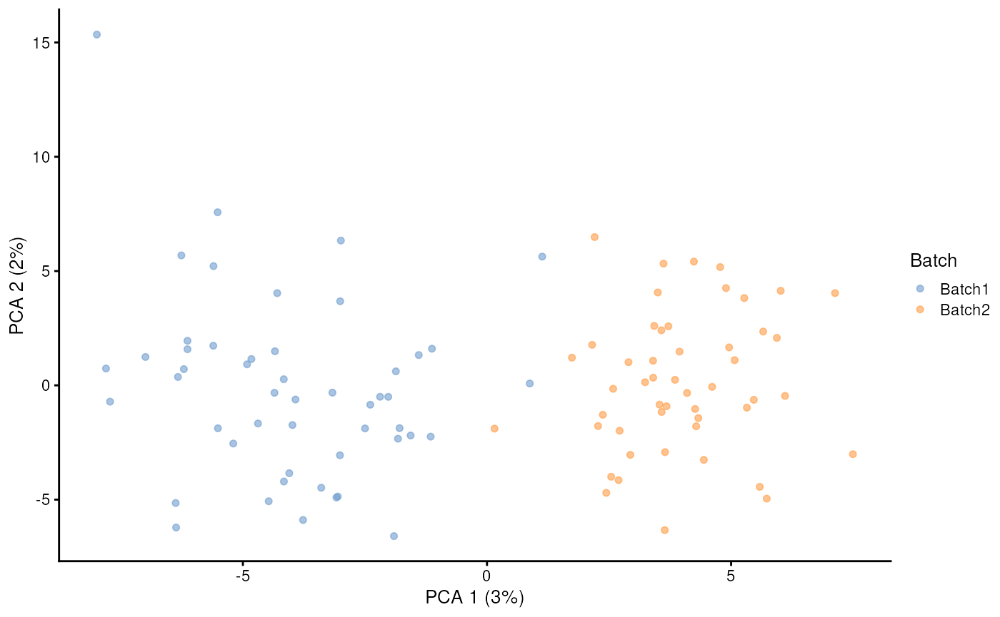
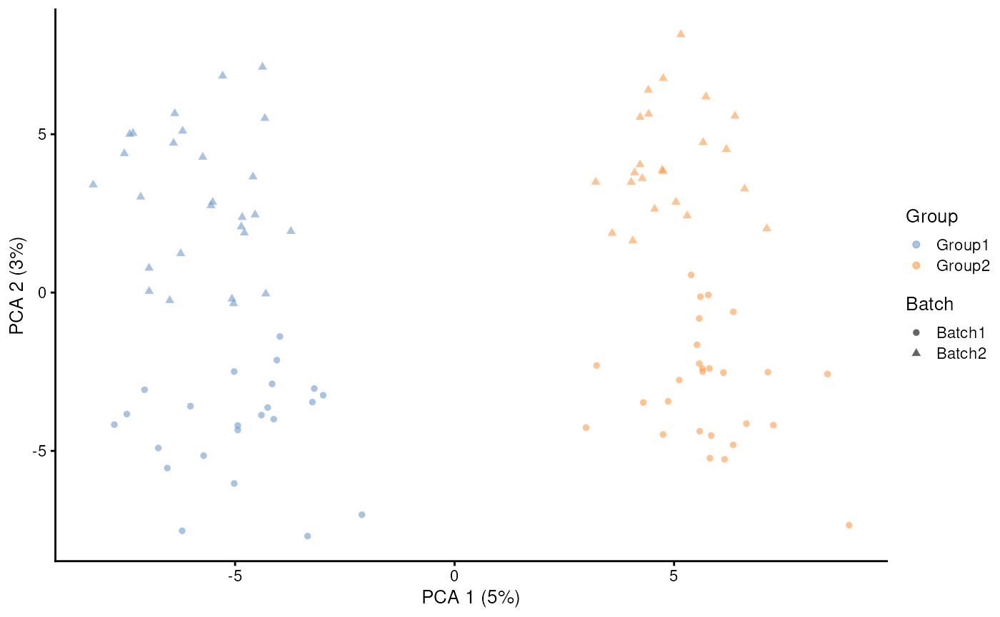
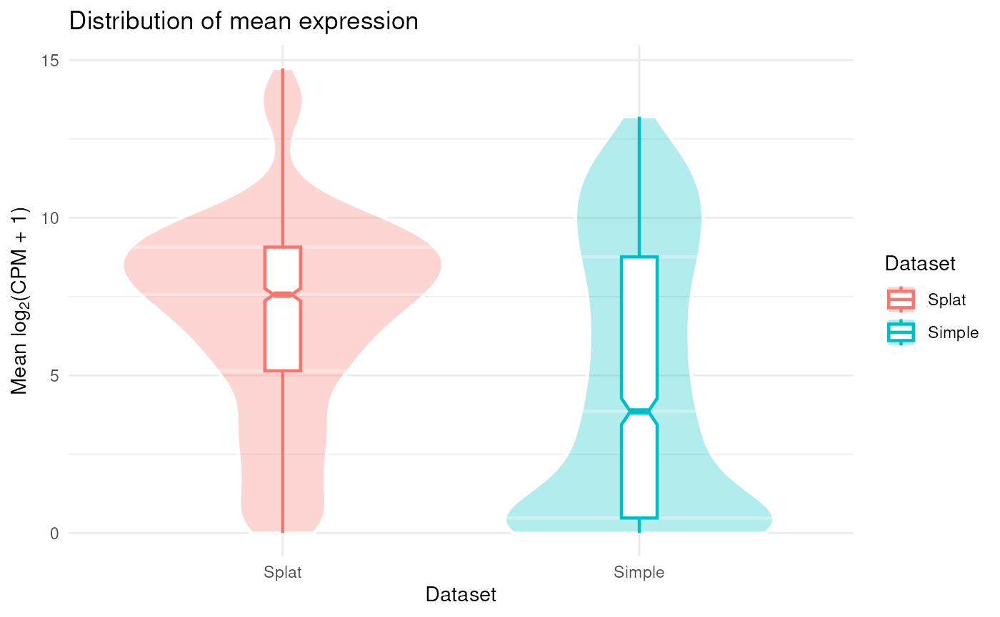
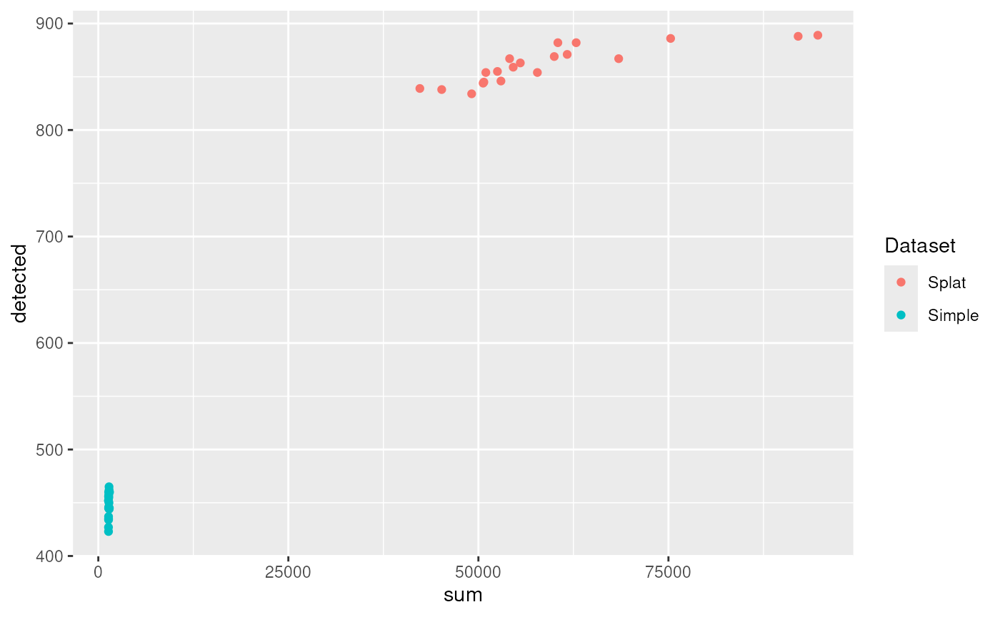
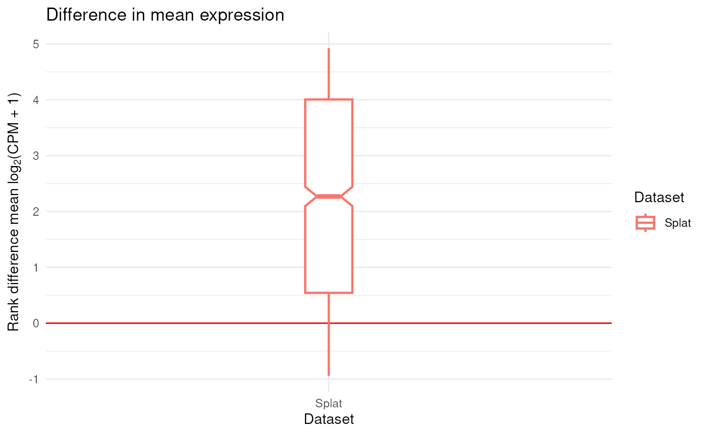
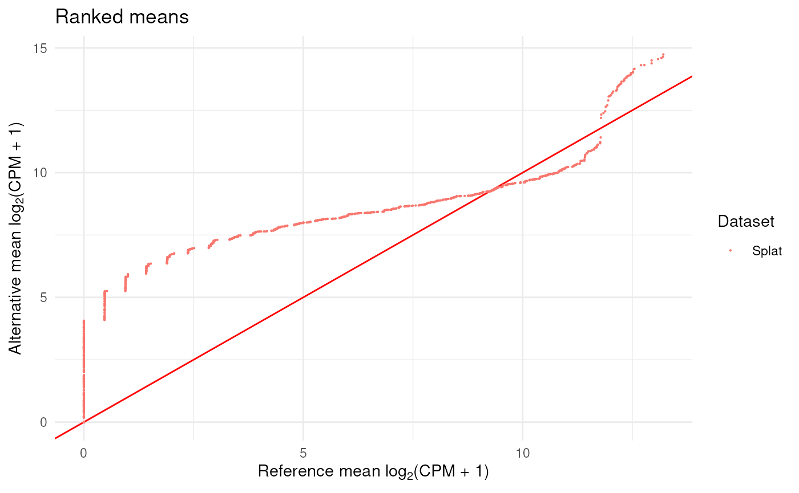

# Introduction to Splatter

Splatter logo

Welcome to Splatter! Splatter is an R package for the simple simulation
of single-cell RNA sequencing data. This vignette gives an overview and
introduction to Splatter’s functionality.

## Installation

Splatter can be installed from Bioconductor:

\
`BiocManager``::`[`install`](https://bioconductor.github.io/BiocManager/reference/install.html)`(``"splatter"``)`

To install the most recent development version from Github use:

\
`BiocManager``::`[`install`](https://bioconductor.github.io/BiocManager/reference/install.html)`(`\
`    ``"Oshlack/splatter"``,`\
`    dependencies ``=`` ``TRUE``,`\
`    build_vignettes ``=`` ``TRUE`\
`)`

## Quickstart

Assuming you already have a matrix of count data similar to that you
wish to simulate there are two simple steps to creating a simulated data
set with Splatter. Here is an example a mock dataset generated with the
`scater` package:

\
`# Load package`\
[`suppressPackageStartupMessages`](https://rdrr.io/r/base/message.html)`(``{`\
`    `[`library`](https://rdrr.io/r/base/library.html)`(`[`splatter`](https://bioconductor.org/packages/splatter/)`)`\
`    `[`library`](https://rdrr.io/r/base/library.html)`(`[`scater`](http://bioconductor.org/packages/scater/)`)`\
`}``)`\
\
`# Create mock data`\
[`set.seed`](https://rdrr.io/r/base/Random.html)`(``1``)`\
`sce`` ``<-`` `[`mockSCE`](https://rdrr.io/pkg/scuttle/man/mockSCE.html)`(``)`\
\
`# Estimate parameters from mock data`\
`params`` ``<-`` `[`splatEstimate`](http://oshlacklab.com/splatter/reference/splatEstimate.md)`(``sce``)`\
`#> NOTE: Library sizes have been found to be normally distributed instead of log-normal. You may want to check this is correct.`\
`# Simulate data using estimated parameters`\
`sim`` ``<-`` `[`splatSimulate`](http://oshlacklab.com/splatter/reference/splatSimulate.md)`(``params``)`\
`#> Getting parameters...`\
`#> Creating simulation object...`\
`#> Simulating library sizes...`\
`#> Simulating gene means...`\
`#> Simulating BCV...`\
`#> Warning in splatSimBCVMeans(sim, params): 'bcv.df' is infinite. This parameter`\
`#> will be ignored.`\
`#> Simulating counts...`\
`#> Simulating dropout (if needed)...`\
`#> Sparsifying assays...`\
`#> Automatically converting to sparse matrices, threshold = 0.95`\
`#> Skipping 'BatchCellMeans': estimated sparse size 1.5 * dense matrix`\
`#> Skipping 'BaseCellMeans': estimated sparse size 1.5 * dense matrix`\
`#> Skipping 'BCV': estimated sparse size 1.5 * dense matrix`\
`#> Skipping 'CellMeans': estimated sparse size 1.5 * dense matrix`\
`#> Skipping 'TrueCounts': estimated sparse size 2.72 * dense matrix`\
`#> Skipping 'counts': estimated sparse size 2.72 * dense matrix`\
`#> Done!`

These steps will be explained in detail in the following sections but
briefly the first step takes a dataset and estimates simulation
parameters from it and the second step takes those parameters and
simulates a new dataset.

## The Splat simulation

Before we look at how we estimate parameters let’s first look at how
Splatter simulates data and what those parameters are. We use the term
‘Splat’ to refer to the Splatter’s own simulation and differentiate it
from the package itself. The core of the Splat model is a gamma-Poisson
distribution used to generate a gene by cell matrix of counts. Mean
expression levels for each gene are simulated from a [gamma
distribution](https://en.wikipedia.org/wiki/Gamma_distribution) and the
Biological Coefficient of Variation is used to enforce a mean-variance
trend before counts are simulated from a [Poisson
distribution](https://en.wikipedia.org/wiki/Poisson_distribution). Splat
also allows you to simulate expression outlier genes (genes with mean
expression outside the gamma distribution) and dropout (random knock out
of counts based on mean expression). Each cell is given an expected
library size (simulated from a log-normal distribution) that makes it
easier to match to a given dataset.

Splat can also simulate differential expression between groups of
different types of cells or differentiation paths between different
cells types where expression changes in a continuous way. These are
described further in the [simulating counts](#simulating-counts)
section.

## The `SplatParams` object

All the parameters for the Splat simulation are stored in a
`SplatParams` object. Let’s create a new one and see what it looks like.

\
`params`` ``<-`` `[`newSplatParams`](http://oshlacklab.com/splatter/reference/newParams.md)`(``)`\
`params`\
`#> A ``Params`` object of class ``SplatParams`` `\
`#> Parameters can be (estimable) or ``[not estimable]``, 'Default' or  ``'NOT DEFAULT'`` `\
`#> ``Secondary`` parameters are usually set during simulation`\
`#> `\
`#> ``Global:`` `\
`#> (Genes)  (Cells)   ``[SEED]`` `\
`#>   10000      100   ``694289`` `\
`#> `\
`#> 29 additional parameters `\
`#> `\
`#> ``Batches:`` `\
`#>     ``[Batches]``  ``[Batch Cells]``     ``[Location]``        ``[Scale]``       ``[Remove]`` `\
`#>             1            100            0.1            0.1          FALSE `\
`#> `\
`#> ``Mean:`` `\
`#>  (Rate)  (Shape) `\
`#>     0.3      0.6 `\
`#> `\
`#> ``Library size:`` `\
`#> (Location)     (Scale)      (Norm) `\
`#>         11         0.2       FALSE `\
`#> `\
`#> ``Exprs outliers:`` `\
`#> (Probability)     (Location)        (Scale) `\
`#>          0.05              4            0.5 `\
`#> `\
`#> ``Groups:`` `\
`#>      ``[Groups]``  ``[Group Probs]`` `\
`#>             1              1 `\
`#> `\
`#> ``Diff expr:`` `\
`#> ``[Probability]``    ``[Down Prob]``     ``[Location]``        ``[Scale]`` `\
`#>           0.1            0.5            0.1            0.4 `\
`#> `\
`#> ``BCV:`` `\
`#> (Common Disp)          (DoF) `\
`#>           0.1             60 `\
`#> `\
`#> ``Dropout:`` `\
`#>     ``[Type]``  (Midpoint)     (Shape) `\
`#>       none           0          -1 `\
`#> `\
`#> ``Paths:`` `\
`#>         ``[From]``         ``[Steps]``          ``[Skew]``    ``[Non-linear]``  ``[Sigma Factor]`` `\
`#>              0             100             0.5             0.1             0.8`

As well as telling us what type of object we have (“A `Params` object of
class `SplatParams`”) and showing us the values of the parameter this
output gives us some extra information. We can see which parameters can
be estimated by the `splatEstimate` function (those in parentheses),
which can’t be estimated (those in brackets) and which have been changed
from their default values (those in ALL CAPS). For more details about
the parameters of the Splat simulation refer to the [Splat parameters
vignette](http://oshlacklab.com/splatter/articles/splat_params.md).

### Getting and setting

If we want to look at a particular parameter, for example the number of
genes to simulate, we can extract it using the `getParam` function:

\
[`getParam`](http://oshlacklab.com/splatter/reference/getParam.md)`(``params``, ``"nGenes"``)`\
`#> [1] 10000`

Alternatively, to give a parameter a new value we can use the `setParam`
function:

\
`params`` ``<-`` `[`setParam`](http://oshlacklab.com/splatter/reference/setParam.md)`(``params``, ``"nGenes"``, ``5000``)`\
[`getParam`](http://oshlacklab.com/splatter/reference/getParam.md)`(``params``, ``"nGenes"``)`\
`#> [1] 5000`

If we want to extract multiple parameters (as a list) or set multiple
parameters we can use the `getParams` or `setParams` functions:

\
`# Set multiple parameters at once (using a list)`\
`params`` ``<-`` `[`setParams`](http://oshlacklab.com/splatter/reference/setParams.md)`(``params``, update ``=`` `[`list`](https://rdrr.io/r/base/list.html)`(``nGenes ``=`` ``8000``, mean.rate ``=`` ``0.5``)``)`\
`# Extract multiple parameters as a list`\
[`getParams`](http://oshlacklab.com/splatter/reference/getParams.md)`(``params``, `[`c`](https://rdrr.io/r/base/c.html)`(``"nGenes"``, ``"mean.rate"``, ``"mean.shape"``)``)`\
`#> $nGenes`\
`#> [1] 8000`\
`#> `\
`#> $mean.rate`\
`#> [1] 0.5`\
`#> `\
`#> $mean.shape`\
`#> [1] 0.6`\
`# Set multiple parameters at once (using additional arguments)`\
`params`` ``<-`` `[`setParams`](http://oshlacklab.com/splatter/reference/setParams.md)`(``params``, mean.shape ``=`` ``0.5``, de.prob ``=`` ``0.2``)`\
`params`\
`#> A ``Params`` object of class ``SplatParams`` `\
`#> Parameters can be (estimable) or ``[not estimable]``, 'Default' or  ``'NOT DEFAULT'`` `\
`#> ``Secondary`` parameters are usually set during simulation`\
`#> `\
`#> ``Global:`` `\
`#> ``(GENES)``  (Cells)   ``[SEED]`` `\
`#>    ``8000``      100   ``694289`` `\
`#> `\
`#> 29 additional parameters `\
`#> `\
`#> ``Batches:`` `\
`#>     ``[Batches]``  ``[Batch Cells]``     ``[Location]``        ``[Scale]``       ``[Remove]`` `\
`#>             1            100            0.1            0.1          FALSE `\
`#> `\
`#> ``Mean:`` `\
`#>  ``(RATE)``  ``(SHAPE)`` `\
`#>     ``0.5``      ``0.5`` `\
`#> `\
`#> ``Library size:`` `\
`#> (Location)     (Scale)      (Norm) `\
`#>         11         0.2       FALSE `\
`#> `\
`#> ``Exprs outliers:`` `\
`#> (Probability)     (Location)        (Scale) `\
`#>          0.05              4            0.5 `\
`#> `\
`#> ``Groups:`` `\
`#>      ``[Groups]``  ``[Group Probs]`` `\
`#>             1              1 `\
`#> `\
`#> ``Diff expr:`` `\
`#> ``[PROBABILITY]``    ``[Down Prob]``     ``[Location]``        ``[Scale]`` `\
`#>           ``0.2``            0.5            0.1            0.4 `\
`#> `\
`#> ``BCV:`` `\
`#> (Common Disp)          (DoF) `\
`#>           0.1             60 `\
`#> `\
`#> ``Dropout:`` `\
`#>     ``[Type]``  (Midpoint)     (Shape) `\
`#>       none           0          -1 `\
`#> `\
`#> ``Paths:`` `\
`#>         ``[From]``         ``[Steps]``          ``[Skew]``    ``[Non-linear]``  ``[Sigma Factor]`` `\
`#>              0             100             0.5             0.1             0.8`

The parameters with have changed are now shown in ALL CAPS to indicate
that they been changed form the default.

We can also set parameters directly when we call `newSplatParams`:

\
`params`` ``<-`` `[`newSplatParams`](http://oshlacklab.com/splatter/reference/newParams.md)`(``lib.loc ``=`` ``12``, lib.scale ``=`` ``0.6``)`\
[`getParams`](http://oshlacklab.com/splatter/reference/getParams.md)`(``params``, `[`c`](https://rdrr.io/r/base/c.html)`(``"lib.loc"``, ``"lib.scale"``)``)`\
`#> $lib.loc`\
`#> [1] 12`\
`#> `\
`#> $lib.scale`\
`#> [1] 0.6`

## Estimating parameters

Splat allows you to estimate many of it’s parameters from a data set
containing counts using the `splatEstimate` function.

\
`# Get the mock counts matrix`\
`counts`` ``<-`` `[`counts`](https://rdrr.io/pkg/BiocGenerics/man/dge.html)`(``sce``)`\
\
`# Check that counts is an integer matrix`\
[`class`](https://rdrr.io/r/base/class.html)`(``counts``)`\
`#> [1] "matrix" "array"`\
[`typeof`](https://rdrr.io/r/base/typeof.html)`(``counts``)`\
`#> [1] "double"`\
\
`# Check the dimensions, each row is a gene, each column is a cell`\
[`dim`](https://rdrr.io/r/base/dim.html)`(``counts``)`\
`#> [1] 2000  200`\
\
`# Show the first few entries`\
`counts``[``1``:``5``, ``1``:``5``]`\
`#>           Cell_001 Cell_002 Cell_003 Cell_004 Cell_005`\
`#> Gene_0001        0        5        7      276       50`\
`#> Gene_0002       12        0        0        0        0`\
`#> Gene_0003       97      292       58       64      541`\
`#> Gene_0004        0        0        0      170       19`\
`#> Gene_0005      105      123      174      565     1061`\
\
`params`` ``<-`` `[`splatEstimate`](http://oshlacklab.com/splatter/reference/splatEstimate.md)`(``counts``)`\
`#> NOTE: Library sizes have been found to be normally distributed instead of log-normal. You may want to check this is correct.`

Here we estimated parameters from a counts matrix but `splatEstimate`
can also take a `SingleCellExperiment` object. The estimation process
has the following steps:

1.  Mean parameters are estimated by fitting a gamma distribution to the
    mean expression levels.
2.  Library size parameters are estimated by fitting a log-normal
    distribution to the library sizes.
3.  Expression outlier parameters are estimated by determining the
    number of outliers and fitting a log-normal distribution to their
    difference from the median.
4.  BCV parameters are estimated using the `estimateDisp` function from
    the `edgeR` package.
5.  Dropout parameters are estimated by checking if dropout is present
    and fitting a logistic function to the relationship between mean
    expression and proportion of zeros.

For more details of the estimation procedures see
[`?splatEstimate`](http://oshlacklab.com/splatter/reference/splatEstimate.md).

## Simulating counts

Once we have a set of parameters we are happy with we can use
`splatSimulate` to simulate counts. If we want to make small adjustments
to the parameters we can provide them as additional arguments,
alternatively if we don’t supply any parameters the defaults will be
used:

\
`sim`` ``<-`` `[`splatSimulate`](http://oshlacklab.com/splatter/reference/splatSimulate.md)`(``params``, nGenes ``=`` ``1000``)`\
`#> Getting parameters...`\
`#> Creating simulation object...`\
`#> Simulating library sizes...`\
`#> Simulating gene means...`\
`#> Simulating BCV...`\
`#> Warning in splatSimBCVMeans(sim, params): 'bcv.df' is infinite. This parameter`\
`#> will be ignored.`\
`#> Simulating counts...`\
`#> Simulating dropout (if needed)...`\
`#> Sparsifying assays...`\
`#> Automatically converting to sparse matrices, threshold = 0.95`\
`#> Skipping 'BatchCellMeans': estimated sparse size 1.5 * dense matrix`\
`#> Skipping 'BaseCellMeans': estimated sparse size 1.5 * dense matrix`\
`#> Skipping 'BCV': estimated sparse size 1.5 * dense matrix`\
`#> Skipping 'CellMeans': estimated sparse size 1.5 * dense matrix`\
`#> Skipping 'TrueCounts': estimated sparse size 2.8 * dense matrix`\
`#> Skipping 'counts': estimated sparse size 2.8 * dense matrix`\
`#> Done!`\
`sim`\
`#> class: SingleCellExperiment `\
`#> dim: 1000 200 `\
`#> metadata(1): Params`\
`#> assays(6): BatchCellMeans BaseCellMeans ... TrueCounts counts`\
`#> rownames(1000): Gene1 Gene2 ... Gene999 Gene1000`\
`#> rowData names(4): Gene BaseGeneMean OutlierFactor GeneMean`\
`#> colnames(200): Cell1 Cell2 ... Cell199 Cell200`\
`#> colData names(3): Cell Batch ExpLibSize`\
`#> reducedDimNames(0):`\
`#> mainExpName: NULL`\
`#> altExpNames(0):`

Looking at the output of `splatSimulate` we can see that `sim` is
`SingleCellExperiment` object with 1000 features (genes) and 200 samples
(cells). The main part of this object is a features by samples matrix
containing the simulated counts (accessed using `counts`), although it
can also hold other expression measures such as FPKM or TPM.
Additionally a `SingleCellExperiment` contains phenotype information
about each cell (accessed using `colData`) and feature information about
each gene (accessed using `rowData`). Splatter uses these slots, as well
as `assays`, to store information about the intermediate values of the
simulation.

\
`# Access the counts`\
[`counts`](https://rdrr.io/pkg/BiocGenerics/man/dge.html)`(``sim``)``[``1``:``5``, ``1``:``5``]`\
`#>       Cell1 Cell2 Cell3 Cell4 Cell5`\
`#> Gene1   397   147   366   163   430`\
`#> Gene2    25   140   351   382   106`\
`#> Gene3    30     9    35    33   140`\
`#> Gene4     1     2     0     7     2`\
`#> Gene5    41    56    34   124     2`\
`# Information about genes`\
[`head`](https://rdrr.io/r/utils/head.html)`(`[`rowData`](https://rdrr.io/pkg/SummarizedExperiment/man/SummarizedExperiment-class.html)`(``sim``)``)`\
`#> DataFrame with 6 rows and 4 columns`\
`#>              Gene BaseGeneMean OutlierFactor   GeneMean`\
`#>       <character>    <numeric>     <numeric>  <numeric>`\
`#> Gene1       Gene1   137.982596             1 137.982596`\
`#> Gene2       Gene2   101.114437             1 101.114437`\
`#> Gene3       Gene3    30.340638             1  30.340638`\
`#> Gene4       Gene4     0.893224             1   0.893224`\
`#> Gene5       Gene5    30.133545             1  30.133545`\
`#> Gene6       Gene6   137.105231             1 137.105231`\
`# Information about cells`\
[`head`](https://rdrr.io/r/utils/head.html)`(`[`colData`](https://rdrr.io/pkg/SummarizedExperiment/man/SummarizedExperiment-class.html)`(``sim``)``)`\
`#> DataFrame with 6 rows and 3 columns`\
`#>              Cell       Batch ExpLibSize`\
`#>       <character> <character>  <numeric>`\
`#> Cell1       Cell1      Batch1     347136`\
`#> Cell2       Cell2      Batch1     360873`\
`#> Cell3       Cell3      Batch1     348761`\
`#> Cell4       Cell4      Batch1     337947`\
`#> Cell5       Cell5      Batch1     373123`\
`#> Cell6       Cell6      Batch1     351380`\
`# Gene by cell matrices`\
[`names`](https://rdrr.io/r/base/names.html)`(`[`assays`](https://rdrr.io/pkg/SummarizedExperiment/man/SummarizedExperiment-class.html)`(``sim``)``)`\
`#> [1] "BatchCellMeans" "BaseCellMeans"  "BCV"            "CellMeans"     `\
`#> [5] "TrueCounts"     "counts"`\
`# Example of cell means matrix`\
[`assays`](https://rdrr.io/pkg/SummarizedExperiment/man/SummarizedExperiment-class.html)`(``sim``)``$``CellMeans``[``1``:``5``, ``1``:``5``]`\
`#>            Cell1       Cell2      Cell3      Cell4       Cell5`\
`#> Gene1 386.455070 138.0471045 335.612956 161.551558 458.0887943`\
`#> Gene2  18.892777 138.1806783 364.276651 412.061931 107.3066729`\
`#> Gene3  32.907304   9.0754951  42.204725  43.104487 156.6871995`\
`#> Gene4   1.305082   0.7320633   0.708767   4.617738   2.0073597`\
`#> Gene5  33.087821  69.1327018  19.934208 128.414136   0.4803943`

An additional (big) advantage of outputting a `SingleCellExperiment` is
that we get immediate access to other analysis packages, such as the
plotting functions in `scater`. For example we can make a PCA plot:

\
`# Use scater to calculate logcounts`\
`sim`` ``<-`` `[`logNormCounts`](https://rdrr.io/pkg/scuttle/man/logNormCounts.html)`(``sim``)`\
`#> Warning in .library_size_factors(assay(x, assay.type), ...): 'librarySizeFactors' is deprecated.`\
`#> Use 'scrapper::centerSizeFactors' instead.`\
`#> See help("Deprecated")`\
`#> Warning in .local(x, ...): 'normalizeCounts' is deprecated.`\
`#> Use 'scrapper::normalizeCounts' instead.`\
`#> See help("Deprecated")`\
`# Plot PCA`\
`sim`` ``<-`` `[`runPCA`](https://rdrr.io/pkg/BiocSingular/man/runPCA.html)`(``sim``)`\
[`plotPCA`](https://rdrr.io/pkg/BiocGenerics/man/plotPCA.html)`(``sim``)`

(**NOTE:** Your values and plots may look different as the simulation is
random and produces different results each time it is run.)

For more details about the `SingleCellExperiment` object refer to the
[vignette](https://bioconductor.org/packages/devel/bioc/vignettes/SingleCellExperiment/inst/doc/intro.html).
For information about what you can do with `scater` refer to the
`scater` documentation and
[vignette](https://bioconductor.org/packages/release/bioc/vignettes/scater/inst/doc/vignette.html).

The `splatSimulate` function outputs the following additional
information about the simulation:

- **Cell information (`colData`)**
  - `Cell` - Unique cell identifier.
  - `Group` - The group or path the cell belongs to.
  - `ExpLibSize` - The expected library size for that cell.
  - `Step` (paths only) - How far along the path each cell is.
- **Gene information (`rowData`)**
  - `Gene` - Unique gene identifier.
  - `BaseGeneMean` - The base expression level for that gene.
  - `OutlierFactor` - Expression outlier factor for that gene (1 is not
    an outlier).
  - `GeneMean` - Expression level after applying outlier factors.
  - `DEFac[Group]` - The differential expression factor for each gene in
    a particular group (1 is not differentially expressed).
  - `GeneMean[Group]` - Expression level of a gene in a particular group
    after applying differential expression factors.
- **Gene by cell information (`assays`)**
  - `BaseCellMeans` - The expression of genes in each cell adjusted for
    expected library size.
  - `BCV` - The Biological Coefficient of Variation for each gene in
    each cell.
  - `CellMeans` - The expression level of genes in each cell adjusted
    for BCV.
  - `TrueCounts` - The simulated counts before dropout.
  - `Dropout` - Logical matrix showing which counts have been dropped in
    which cells.

Values that have been added by Splatter are named using `UpperCamelCase`
to separate them from the `underscore_naming` used by `scater` and other
packages. For more information on the simulation see
[`?splatSimulate`](http://oshlacklab.com/splatter/reference/splatSimulate.md).

### Simulating groups

So far we have only simulated a single population of cells but often we
are interested in investigating a mixed population of cells and looking
to see what cell types are present or what differences there are between
them. Splatter is able to simulate these situations by changing the
`method` argument Here we are going to simulate two groups, by
specifying the `group.prob` parameter and setting the `method` parameter
to `"groups"`:

(**NOTE:** We have also set the `verbose` argument to `FALSE` to stop
Splatter printing progress messages.)

\
`sim.groups`` ``<-`` `[`splatSimulate`](http://oshlacklab.com/splatter/reference/splatSimulate.md)`(`\
`    group.prob ``=`` `[`c`](https://rdrr.io/r/base/c.html)`(``0.5``, ``0.5``)``,`\
`    method ``=`` ``"groups"``,`\
`    verbose ``=`` ``FALSE`\
`)`\
`sim.groups`` ``<-`` `[`logNormCounts`](https://rdrr.io/pkg/scuttle/man/logNormCounts.html)`(``sim.groups``)`\
`#> Warning in .library_size_factors(assay(x, assay.type), ...): 'librarySizeFactors' is deprecated.`\
`#> Use 'scrapper::centerSizeFactors' instead.`\
`#> See help("Deprecated")`\
`#> Warning in .local(x, ...): 'normalizeCounts' is deprecated.`\
`#> Use 'scrapper::normalizeCounts' instead.`\
`#> See help("Deprecated")`\
`sim.groups`` ``<-`` `[`runPCA`](https://rdrr.io/pkg/BiocSingular/man/runPCA.html)`(``sim.groups``)`\
[`plotPCA`](https://rdrr.io/pkg/BiocGenerics/man/plotPCA.html)`(``sim.groups``, colour_by ``=`` ``"Group"``)`

As we have set both the group probabilities to 0.5 we should get
approximately equal numbers of cells in each group (around 50 in this
case). If we wanted uneven groups we could set `group.prob` to any set
of probabilities that sum to 1.

### Simulating paths

The other situation that is often of interest is a differentiation
process where one cell type is changing into another. Splatter
approximates this process by simulating a series of steps between two
groups and randomly assigning each cell to a step. We can create this
kind of simulation using the `"paths"` method.

\
`sim.paths`` ``<-`` `[`splatSimulate`](http://oshlacklab.com/splatter/reference/splatSimulate.md)`(`\
`    de.prob ``=`` ``0.2``,`\
`    nGenes ``=`` ``1000``,`\
`    method ``=`` ``"paths"``,`\
`    verbose ``=`` ``FALSE`\
`)`\
`sim.paths`` ``<-`` `[`logNormCounts`](https://rdrr.io/pkg/scuttle/man/logNormCounts.html)`(``sim.paths``)`\
`#> Warning in .library_size_factors(assay(x, assay.type), ...): 'librarySizeFactors' is deprecated.`\
`#> Use 'scrapper::centerSizeFactors' instead.`\
`#> See help("Deprecated")`\
`#> Warning in .local(x, ...): 'normalizeCounts' is deprecated.`\
`#> Use 'scrapper::normalizeCounts' instead.`\
`#> See help("Deprecated")`\
`sim.paths`` ``<-`` `[`runPCA`](https://rdrr.io/pkg/BiocSingular/man/runPCA.html)`(``sim.paths``)`\
[`plotPCA`](https://rdrr.io/pkg/BiocGenerics/man/plotPCA.html)`(``sim.paths``, colour_by ``=`` ``"Step"``)`

Here the colours represent the “step” of each cell or how far along the
differentiation path it is. We can see that the cells with dark colours
are more similar to the originating cell type and the light coloured
cells are closer to the final, differentiated, cell type. By setting
additional parameters it is possible to simulate more complex process
(for example multiple mature cell types from a single progenitor).

### Batch effects

Another factor that is important in the analysis of any sequencing
experiment are batch effects, technical variation that is common to a
set of samples processed at the same time. We apply batch effects by
telling Splatter how many cells are in each batch:

\
`sim.batches`` ``<-`` `[`splatSimulate`](http://oshlacklab.com/splatter/reference/splatSimulate.md)`(``batchCells ``=`` `[`c`](https://rdrr.io/r/base/c.html)`(``50``, ``50``)``, verbose ``=`` ``FALSE``)`\
`sim.batches`` ``<-`` `[`logNormCounts`](https://rdrr.io/pkg/scuttle/man/logNormCounts.html)`(``sim.batches``)`\
`#> Warning in .library_size_factors(assay(x, assay.type), ...): 'librarySizeFactors' is deprecated.`\
`#> Use 'scrapper::centerSizeFactors' instead.`\
`#> See help("Deprecated")`\
`#> Warning in .local(x, ...): 'normalizeCounts' is deprecated.`\
`#> Use 'scrapper::normalizeCounts' instead.`\
`#> See help("Deprecated")`\
`sim.batches`` ``<-`` `[`runPCA`](https://rdrr.io/pkg/BiocSingular/man/runPCA.html)`(``sim.batches``)`\
[`plotPCA`](https://rdrr.io/pkg/BiocGenerics/man/plotPCA.html)`(``sim.batches``, colour_by ``=`` ``"Batch"``)`

This looks at lot like when we simulated groups and that is because the
process is very similar. The difference is that batch effects are
applied to all genes, not just those that are differentially expressed,
and the effects are usually smaller. By combining groups and batches we
can simulate both unwanted variation that we aren’t interested in
(batch) and the wanted variation we are looking for (group):

\
`sim.groups`` ``<-`` `[`splatSimulate`](http://oshlacklab.com/splatter/reference/splatSimulate.md)`(`\
`    batchCells ``=`` `[`c`](https://rdrr.io/r/base/c.html)`(``50``, ``50``)``,`\
`    group.prob ``=`` `[`c`](https://rdrr.io/r/base/c.html)`(``0.5``, ``0.5``)``,`\
`    method ``=`` ``"groups"``,`\
`    verbose ``=`` ``FALSE`\
`)`\
`sim.groups`` ``<-`` `[`logNormCounts`](https://rdrr.io/pkg/scuttle/man/logNormCounts.html)`(``sim.groups``)`\
`#> Warning in .library_size_factors(assay(x, assay.type), ...): 'librarySizeFactors' is deprecated.`\
`#> Use 'scrapper::centerSizeFactors' instead.`\
`#> See help("Deprecated")`\
`#> Warning in .local(x, ...): 'normalizeCounts' is deprecated.`\
`#> Use 'scrapper::normalizeCounts' instead.`\
`#> See help("Deprecated")`\
`sim.groups`` ``<-`` `[`runPCA`](https://rdrr.io/pkg/BiocSingular/man/runPCA.html)`(``sim.groups``)`\
[`plotPCA`](https://rdrr.io/pkg/BiocGenerics/man/plotPCA.html)`(``sim.groups``, shape_by ``=`` ``"Batch"``, colour_by ``=`` ``"Group"``)`

Here we see that the effects of the group (first component) are stronger
than the batch effects (second component) but by adjusting the
parameters we could made the batch effects dominate.

### Convenience functions

Each of the Splatter simulation methods has it’s own convenience
function. To simulate a single population use
[`splatSimulateSingle()`](http://oshlacklab.com/splatter/reference/splatSimulate.md)
(equivalent to `splatSimulate(method = "single")`), to simulate groups
use
[`splatSimulateGroups()`](http://oshlacklab.com/splatter/reference/splatSimulate.md)
(equivalent to `splatSimulate(method = "groups")`) or to simulate paths
use
[`splatSimulatePaths()`](http://oshlacklab.com/splatter/reference/splatSimulate.md)
(equivalent to `splatSimulate(method = "paths")`).

### splatPop: Simulating populations

splatPop uses the splat model to simulate single cell count data across
a population with relationship structure including expression
quantitative loci (eQTL) effects. The major addition in splatPop is the
`splatPopSimulateMeans` function, which simulates gene means for each
gene for each individual using parameters estimated from real data.
These simulated means are then used as input to`splatPopSimulateSC`,
which is essentially a wrapper around the base `splatSimulate`. For more
information on generating population scale single-cell count data, see
the [splatPop
vignette](http://oshlacklab.com/splatter/articles/splatPop.md).

## Other simulations

As well as it’s own Splat simulation method the Splatter package
contains implementations of other single-cell RNA-seq simulations that
have been published or wrappers around simulations included in other
packages. To see all the available simulations run the
[`listSims()`](http://oshlacklab.com/splatter/reference/listSims.md)
function:

\
[`listSims`](http://oshlacklab.com/splatter/reference/listSims.md)`(``)`\
`#> Splatter currently contains 14 simulations `\
`#> `\
`#> ``Splat`` ``(splat)`` `\
`#> ``DOI:`` ``10.1186/s13059-017-1305-0``     ``GitHub:`` ``Oshlack/splatter``     ``Dependencies:``  `\
`#> The Splat simulation generates means from a gamma distribution, adjusts them for BCV and generates counts from a gamma-poisson. Dropout and batch effects can be optionally added. `\
`#> `\
`#> ``Splat Single`` ``(splatSingle)`` `\
`#> ``DOI:`` ``10.1186/s13059-017-1305-0``     ``GitHub:`` ``Oshlack/splatter``     ``Dependencies:``  `\
`#> The Splat simulation with a single population. `\
`#> `\
`#> ``Splat Groups`` ``(splatGroups)`` `\
`#> ``DOI:`` ``10.1186/s13059-017-1305-0``     ``GitHub:`` ``Oshlack/splatter``     ``Dependencies:``  `\
`#> The Splat simulation with multiple groups. Each group can have it's own differential expression probability and fold change distribution. `\
`#> `\
`#> ``Splat Paths`` ``(splatPaths)`` `\
`#> ``DOI:`` ``10.1186/s13059-017-1305-0``     ``GitHub:`` ``Oshlack/splatter``     ``Dependencies:``  `\
`#> The Splat simulation with differentiation paths. Each path can have it's own length, skew and probability. Genes can change in non-linear ways. `\
`#> `\
`#> ``Kersplat`` ``(kersplat)`` `\
`#> ``DOI:``       ``GitHub:`` ``Oshlack/splatter``     ``Dependencies:`` ``scuttle, igraph`` `\
`#> The Kersplat simulation extends the Splat model by adding a gene network, more complex cell structure, doublets and empty cells (Experimental). `\
`#> `\
`#> ``splatPop`` ``(splatPop)`` `\
`#> ``DOI:`` ``10.1186/s13059-021-02546-1``    ``GitHub:`` ``Oshlack/splatter``     ``Dependencies:`` ``VariantAnnotation, preprocessCore`` `\
`#> The splatPop simulation enables splat simulations to be generated for multiple individuals in a population, accounting for correlation structure by simulating expression quantitative trait loci (eQTL). `\
`#> `\
`#> ``Simple`` ``(simple)`` `\
`#> ``DOI:`` ``10.1186/s13059-017-1305-0``     ``GitHub:`` ``Oshlack/splatter``     ``Dependencies:``  `\
`#> A simple simulation with gamma means and negative binomial counts. `\
`#> `\
`#> ``Lun`` ``(lun)`` `\
`#> ``DOI:`` ``10.1186/s13059-016-0947-7``     ``GitHub:`` ``MarioniLab/Deconvolution2016``     ``Dependencies:``  `\
`#> Gamma distributed means and negative binomial counts. Cells are given a size factor and differential expression can be simulated with fixed fold changes. `\
`#> `\
`#> ``Lun 2`` ``(lun2)`` `\
`#> ``DOI:`` ``10.1093/biostatistics/kxw055``      ``GitHub:`` ``MarioniLab/PlateEffects2016``      ``Dependencies:`` ``scran, scuttle, lme4, pscl, limSolve`` `\
`#> Negative binomial counts where the means and dispersions have been sampled from a real dataset. The core feature of the Lun 2 simulation is the addition of plate effects. Differential expression can be added between two groups of plates and optionally a zero-inflated negative-binomial can be used. `\
`#> `\
`#> ``scDD`` ``(scDD)`` `\
`#> ``DOI:`` ``10.1186/s13059-016-1077-y``     ``GitHub:`` ``kdkorthauer/scDD``     ``Dependencies:`` ``scDD`` `\
`#> The scDD simulation samples a given dataset and can simulate differentially expressed and differentially distributed genes between two conditions. `\
`#> `\
`#> ``BASiCS`` ``(BASiCS)`` `\
`#> ``DOI:`` ``10.1371/journal.pcbi.1004333``      ``GitHub:`` ``catavallejos/BASiCS``      ``Dependencies:`` ``BASiCS`` `\
`#> The BASiCS simulation is based on a bayesian model used to deconvolve biological and technical variation and includes spike-ins and batch effects. `\
`#> `\
`#> ``PhenoPath`` ``(pheno)`` `\
`#> ``DOI:`` ``10.1038/s41467-018-04696-6``    ``GitHub:`` ``kieranrcampbell/phenopath``    ``Dependencies:`` ``phenopath`` `\
`#> The PhenoPath simulation produces a pseudotime trajectory with different types of genes. `\
`#> `\
`#> ``ZINB-WaVE`` ``(zinb)`` `\
`#> ``DOI:`` ``10.1038/s41467-017-02554-5``    ``GitHub:`` ``drisso/zinbwave``      ``Dependencies:`` ``zinbwave`` `\
`#> The ZINB-WaVE simulation simulates counts from a sophisticated zero-inflated negative-binomial distribution including cell and gene-level covariates. `\
`#> `\
`#> ``SparseDC`` ``(sparseDC)`` `\
`#> ``DOI:`` ``10.1093/nar/gkx1113``   ``GitHub:`` ``cran/SparseDC``    ``Dependencies:`` ``SparseDC`` `\
`#> The SparseDC simulation simulates a set of clusters across two conditions, where some clusters may be present in only one condition.`

Each simulation has it’s own prefix which gives the name of the
functions associated with that simulation. For example the prefix for
the simple simulation is `simple` so it would store it’s parameters in a
`SimpleParams` object that can be created using
[`newSimpleParams()`](http://oshlacklab.com/splatter/reference/newParams.md)
or estimated from real data using
[`simpleEstimate()`](http://oshlacklab.com/splatter/reference/simpleEstimate.md).
To simulate data using that simulation you would use
[`simpleSimulate()`](http://oshlacklab.com/splatter/reference/simpleSimulate.md).
Each simulation returns a `SingleCellExperiment` object with
intermediate values similar to that returned by
[`splatSimulate()`](http://oshlacklab.com/splatter/reference/splatSimulate.md).
For more detailed information on each simulation see the appropriate
help page (eg.
[`?simpleSimulate`](http://oshlacklab.com/splatter/reference/simpleSimulate.md)
for information on how the simple simulation works or
[`? lun2Estimate`](http://oshlacklab.com/splatter/reference/lun2Estimate.md)
for details of how the Lun 2 simulation estimates parameters) or refer
to the appropriate paper or package.

## Other expression values

Splatter is designed to simulate count data but some analysis methods
expect other expression values, particularly length-normalised values
such as TPM or FPKM. The `scater` package has functions for adding these
values to a `SingleCellExperiment` object but they require a length for
each gene. The `addGeneLengths` function can be used to simulate these
lengths:

\
`sim`` ``<-`` `[`simpleSimulate`](http://oshlacklab.com/splatter/reference/simpleSimulate.md)`(``verbose ``=`` ``FALSE``)`\
`sim`` ``<-`` `[`addGeneLengths`](http://oshlacklab.com/splatter/reference/addGeneLengths.md)`(``sim``)`\
[`head`](https://rdrr.io/r/utils/head.html)`(`[`rowData`](https://rdrr.io/pkg/SummarizedExperiment/man/SummarizedExperiment-class.html)`(``sim``)``)`\
`#> DataFrame with 6 rows and 3 columns`\
`#>              Gene    GeneMean    Length`\
`#>       <character>   <numeric> <numeric>`\
`#> Gene1       Gene1 2.65458e-04      1398`\
`#> Gene2       Gene2 2.27249e-01      1036`\
`#> Gene3       Gene3 1.47678e-01      5511`\
`#> Gene4       Gene4 1.00810e+01      1193`\
`#> Gene5       Gene5 8.93350e-02      3250`\
`#> Gene6       Gene6 1.51442e+00       655`

We can then use `scater` to calculate TPM:

\
[`tpm`](https://rdrr.io/pkg/SingleCellExperiment/man/assays.html)`(``sim``)`` ``<-`` `[`calculateTPM`](https://rdrr.io/pkg/scuttle/man/calculateTPM.html)`(``sim``, `[`rowData`](https://rdrr.io/pkg/SummarizedExperiment/man/SummarizedExperiment-class.html)`(``sim``)``$``Length``)`\
[`tpm`](https://rdrr.io/pkg/SingleCellExperiment/man/assays.html)`(``sim``)``[``1``:``5``, ``1``:``5``]`\
`#> 5 x 5 sparse Matrix of class "dgCMatrix"`\
`#>          Cell1    Cell2    Cell3    Cell4     Cell5`\
`#> Gene1   .        .         .        .        .     `\
`#> Gene2   .        .         .        .      150.6985`\
`#> Gene3   .        .         .        .        .     `\
`#> Gene4 918.5844 656.8136 1395.598 1193.577 1046.9317`\
`#> Gene5   .        .         .        .        .`

The default method used by `addGeneLengths` to simulate lengths is to
generate values from a log-normal distribution which are then rounded to
give an integer length. The parameters for this distribution are based
on human protein coding genes but can be adjusted if needed (for example
for other species). Alternatively lengths can be sampled from a provided
vector (see
[`?addGeneLengths`](http://oshlacklab.com/splatter/reference/addGeneLengths.md)
for details and an example).

## Reducing simulation size

The simulations in Splatter include many of the intermediate values used
during the simulation process as part of the final output. These values
can be useful for evaluating various things but if you don’t need them
they can greatly increase the size of the object. If you would like to
reduce the size of your simulation output you can use the
[`minimiseSCE()`](http://oshlacklab.com/splatter/reference/minimiseSCE.md)
function:

\
`sim`` ``<-`` `[`splatSimulate`](http://oshlacklab.com/splatter/reference/splatSimulate.md)`(``)`\
`#> Getting parameters...`\
`#> Creating simulation object...`\
`#> Simulating library sizes...`\
`#> Simulating gene means...`\
`#> Simulating BCV...`\
`#> Simulating counts...`\
`#> Simulating dropout (if needed)...`\
`#> Sparsifying assays...`\
`#> Automatically converting to sparse matrices, threshold = 0.95`\
`#> Skipping 'BatchCellMeans': estimated sparse size 1.5 * dense matrix`\
`#> Skipping 'BaseCellMeans': estimated sparse size 1.5 * dense matrix`\
`#> Skipping 'BCV': estimated sparse size 1.5 * dense matrix`\
`#> Skipping 'CellMeans': estimated sparse size 1.49 * dense matrix`\
`#> Skipping 'TrueCounts': estimated sparse size 1.65 * dense matrix`\
`#> Skipping 'counts': estimated sparse size 1.65 * dense matrix`\
`#> Done!`\
[`minimiseSCE`](http://oshlacklab.com/splatter/reference/minimiseSCE.md)`(``sim``)`\
`#> Minimising SingleCellExperiment...`\
`#> Original size: 43.9 Mb`\
`#> Removing all rowData columns`\
`#> Removing all colData columns`\
`#> Removing all metadata items`\
`#> Keeping 1 assays: counts`\
`#> Removing 5 assays: BatchCellMeans, BaseCellMeans, BCV, CellMeans, TrueCounts`\
`#> Sparsifying assays...`\
`#> Automatically converting to sparse matrices, threshold = 0.95`\
`#> Skipping 'counts': estimated sparse size 1.65 * dense matrix`\
`#> Minimised size: 5.3 Mb (12% of original)`\
`#> class: SingleCellExperiment `\
`#> dim: 10000 100 `\
`#> metadata(0):`\
`#> assays(1): counts`\
`#> rownames(10000): Gene1 Gene2 ... Gene9999 Gene10000`\
`#> rowData names(0):`\
`#> colnames(100): Cell1 Cell2 ... Cell99 Cell100`\
`#> colData names(0):`\
`#> reducedDimNames(0):`\
`#> mainExpName: NULL`\
`#> altExpNames(0):`

By default it will remove everything in `rowData(sce)`, `colData(sce)`
and `metadata(sce)` and all assays except for `counts`. If there are
other things you would like to keep you can specify them in the various
`keep` arguments. Giving a character will keep only columns/items with
those names or you can use `TRUE` to keep everything in that slot.

\
[`minimiseSCE`](http://oshlacklab.com/splatter/reference/minimiseSCE.md)`(``sim``,`\
`    rowData.keep ``=`` ``"Gene"``,`\
`    colData.keep ``=`` `[`c`](https://rdrr.io/r/base/c.html)`(``"Cell"``, ``"Batch"``)``,`\
`    metadata.keep ``=`` ``TRUE`\
`)`\
`#> Minimising SingleCellExperiment...`\
`#> Original size: 43.9 Mb`\
`#> Keeping 1 rowData columns: Gene`\
`#> Removing 3 rowData columns: BaseGeneMean, OutlierFactor, GeneMean`\
`#> Keeping 2 colData columns: Cell, Batch`\
`#> Removing 1 colData columns: ExpLibSize`\
`#> Keeping 1 assays: counts`\
`#> Removing 5 assays: BatchCellMeans, BaseCellMeans, BCV, CellMeans, TrueCounts`\
`#> Sparsifying assays...`\
`#> Automatically converting to sparse matrices, threshold = 0.95`\
`#> Skipping 'counts': estimated sparse size 1.65 * dense matrix`\
`#> Minimised size: 5.9 Mb (14% of original)`\
`#> class: SingleCellExperiment `\
`#> dim: 10000 100 `\
`#> metadata(1): Params`\
`#> assays(1): counts`\
`#> rownames(10000): Gene1 Gene2 ... Gene9999 Gene10000`\
`#> rowData names(1): Gene`\
`#> colnames(100): Cell1 Cell2 ... Cell99 Cell100`\
`#> colData names(2): Cell Batch`\
`#> reducedDimNames(0):`\
`#> mainExpName: NULL`\
`#> altExpNames(0):`

## Comparing simulations and real data

One thing you might like to do after simulating data is to compare it to
a real dataset, or compare simulations with different parameters or
models. Splatter provides a function `compareSCEs` that aims to make
these comparisons easier. As the name suggests this function takes a
list of `SingleCellExperiment` objects, combines the datasets and
produces some plots comparing them. Let’s make two small simulations and
see how they compare.

\
`sim1`` ``<-`` `[`splatSimulate`](http://oshlacklab.com/splatter/reference/splatSimulate.md)`(``nGenes ``=`` ``1000``, batchCells ``=`` ``20``, verbose ``=`` ``FALSE``)`\
`sim2`` ``<-`` `[`simpleSimulate`](http://oshlacklab.com/splatter/reference/simpleSimulate.md)`(``nGenes ``=`` ``1000``, nCells ``=`` ``20``, verbose ``=`` ``FALSE``)`\
`comparison`` ``<-`` `[`compareSCEs`](http://oshlacklab.com/splatter/reference/compareSCEs.md)`(`[`list`](https://rdrr.io/r/base/list.html)`(``Splat ``=`` ``sim1``, Simple ``=`` ``sim2``)``)`\
\
[`names`](https://rdrr.io/r/base/names.html)`(``comparison``)`\
`#> [1] "RowData" "ColData" "Plots"`\
[`names`](https://rdrr.io/r/base/names.html)`(``comparison``$``Plots``)`\
`#> [1] "Means"        "Variances"    "MeanVar"      "LibrarySizes" "ZerosGene"   `\
`#> [6] "ZerosCell"    "MeanZeros"    "VarGeneCor"`

The returned list has three items. The first two are the combined
datasets by gene (`RowData`) and by cell (`ColData`) and the third
contains some comparison plots (produced using `ggplot2`), for example a
plot of the distribution of means:

\
`comparison``$``Plots``$``Means`

These are only a few of the plots you might want to consider but it
should be easy to make more using the returned data. For example, we
could plot the number of expressed genes against the library size:

\
[`library`](https://rdrr.io/r/base/library.html)`(`[`"ggplot2"`](https://ggplot2.tidyverse.org)`)`\
[`ggplot`](https://ggplot2.tidyverse.org/reference/ggplot.html)`(``comparison``$``ColData``, `[`aes`](https://ggplot2.tidyverse.org/reference/aes.html)`(``x ``=`` ``sum``, y ``=`` ``detected``, colour ``=`` ``Dataset``)``)`` ``+`\
`    `[`geom_point`](https://ggplot2.tidyverse.org/reference/geom_point.html)`(``)`

### Comparing differences

Sometimes instead of visually comparing datasets it may be more
interesting to look at the differences between them. We can do this
using the `diffSCEs` function. Similar to `compareSCEs` this function
takes a list of `SingleCellExperiment` objects but now we also specify
one to be a reference. A series of similar plots are returned but
instead of showing the overall distributions they demonstrate
differences from the reference.

\
`difference`` ``<-`` `[`diffSCEs`](http://oshlacklab.com/splatter/reference/diffSCEs.md)`(`[`list`](https://rdrr.io/r/base/list.html)`(``Splat ``=`` ``sim1``, Simple ``=`` ``sim2``)``, ref ``=`` ``"Simple"``)`\
`difference``$``Plots``$``Means`

We also get a series of Quantile-Quantile plot that can be used to
compare distributions.

\
`difference``$``QQPlots``$``Means`

### Making panels

Each of these comparisons makes several plots which can be a lot to look
at. To make this easier, or to produce figures for publications, you can
make use of the functions `makeCompPanel`, `makeDiffPanel` and
`makeOverallPanel`.

These functions combine the plots into a single panel using the
`cowplot` package. The panels can be quite large and hard to view (for
example in RStudio’s plot viewer) so it can be better to output the
panels and view them separately. Luckily `cowplot` provides a convenient
function for saving the images. Here are some suggested parameters for
outputting each of the panels:

\
`# This code is just an example and is not run`\
`panel`` ``<-`` `[`makeCompPanel`](http://oshlacklab.com/splatter/reference/makeCompPanel.md)`(``comparison``)`\
`cowplot``::`[`save_plot`](https://wilkelab.org/cowplot/reference/save_plot.html)`(``"comp_panel.png"``, ``panel``, nrow ``=`` ``4``, ncol ``=`` ``3``)`\
\
`panel`` ``<-`` `[`makeDiffPanel`](http://oshlacklab.com/splatter/reference/makeDiffPanel.md)`(``difference``)`\
`cowplot``::`[`save_plot`](https://wilkelab.org/cowplot/reference/save_plot.html)`(``"diff_panel.png"``, ``panel``, nrow ``=`` ``3``, ncol ``=`` ``5``)`\
\
`panel`` ``<-`` `[`makeOverallPanel`](http://oshlacklab.com/splatter/reference/makeOverallPanel.md)`(``comparison``, ``difference``)`\
`cowplot``::`[`save_plot`](https://wilkelab.org/cowplot/reference/save_plot.html)`(``"overall_panel.png"``, ``panel``, ncol ``=`` ``4``, nrow ``=`` ``7``)`

## Citing Splatter

If you use Splatter in your work please cite our paper:

\
[`citation`](https://rdrr.io/r/utils/citation.html)`(``"splatter"``)`\
`#> If you use Splatter in your work please cite the publication below.`\
`#> Please ALSO cite the publcations for the models you have used (run`\
`` #> `listSims()` for details). ``\
`#> `\
`#>   Zappia L, Phipson B, Oshlack A. Splatter: Simulation of single-cell`\
`#>   RNA sequencing data. Genome Biology. 2017;`\
`#>   doi:10.1186/s13059-017-1305-0`\
`#> `\
`#> A BibTeX entry for LaTeX users is`\
`#> `\
`#>   @Article{,`\
`#>     author = {Luke Zappia and Belinda Phipson and Alicia Oshlack},`\
`#>     title = {Splatter: simulation of single-cell RNA sequencing data},`\
`#>     journal = {Genome Biology},`\
`#>     year = {2017},`\
`#>     url = {https://doi.org/10.1186/s13059-017-1305-0},`\
`#>     doi = {10.1186/s13059-017-1305-0},`\
`#>   }`

## Session information

\
[`sessionInfo`](https://rdrr.io/r/utils/sessionInfo.html)`(``)`\
`#> R version 4.6.1 (2026-06-24)`\
`#> Platform: x86_64-pc-linux-gnu`\
`#> Running under: Ubuntu 24.04.5 LTS`\
`#> `\
`#> Matrix products: default`\
`#> BLAS:   /usr/lib/x86_64-linux-gnu/openblas-pthread/libblas.so.3 `\
`#> LAPACK: /usr/lib/x86_64-linux-gnu/openblas-pthread/libopenblasp-r0.3.26.so;  LAPACK version 3.12.0`\
`#> `\
`#> locale:`\
`#>  [1] LC_CTYPE=en_US.UTF-8       LC_NUMERIC=C              `\
`#>  [3] LC_TIME=en_US.UTF-8        LC_COLLATE=en_US.UTF-8    `\
`#>  [5] LC_MONETARY=en_US.UTF-8    LC_MESSAGES=en_US.UTF-8   `\
`#>  [7] LC_PAPER=en_US.UTF-8       LC_NAME=C                 `\
`#>  [9] LC_ADDRESS=C               LC_TELEPHONE=C            `\
`#> [11] LC_MEASUREMENT=en_US.UTF-8 LC_IDENTIFICATION=C       `\
`#> `\
`#> time zone: Etc/UTC`\
`#> tzcode source: system (glibc)`\
`#> `\
`#> attached base packages:`\
`#> [1] stats4    stats     graphics  grDevices utils     datasets  methods  `\
`#> [8] base     `\
`#> `\
`#> other attached packages:`\
`#>  [1] scater_1.41.3               ggplot2_4.0.3              `\
`#>  [3] scuttle_1.23.2              splatter_1.37.1            `\
`#>  [5] SingleCellExperiment_1.35.2 SummarizedExperiment_1.43.0`\
`#>  [7] Biobase_2.73.2              GenomicRanges_1.65.4       `\
`#>  [9] Seqinfo_1.3.2               IRanges_2.47.5             `\
`#> [11] S4Vectors_0.51.10           BiocGenerics_0.59.13       `\
`#> [13] generics_0.1.4              MatrixGenerics_1.25.0      `\
`#> [15] matrixStats_1.5.0           BiocStyle_2.41.0           `\
`#> `\
`#> loaded via a namespace (and not attached):`\
`#>  [1] tidyselect_1.2.1    viridisLite_0.4.3   dplyr_1.2.1        `\
`#>  [4] vipor_0.4.7         farver_2.1.2        viridis_0.6.5      `\
`#>  [7] S7_0.2.2            fastmap_1.2.0       scrapper_1.7.11    `\
`#> [10] digest_0.6.39       rsvd_1.0.6          lifecycle_1.0.5    `\
`#> [13] statmod_1.5.2       survival_3.8-12     magrittr_2.0.5     `\
`#> [16] compiler_4.6.1      rlang_1.3.0         sass_0.4.10        `\
`#> [19] tools_4.6.1         yaml_2.3.12         knitr_1.52         `\
`#> [22] labeling_0.4.3      S4Arrays_1.13.2     fitdistrplus_1.2-6 `\
`#> [25] htmlwidgets_1.6.4   DelayedArray_0.39.8 RColorBrewer_1.1-3 `\
`#> [28] abind_1.4-8         BiocParallel_1.47.0 withr_3.0.3        `\
`#> [31] desc_1.4.3          grid_4.6.1          beachmat_2.29.3    `\
`#> [34] edgeR_4.99.12       MASS_7.3-66         scales_1.4.0       `\
`#> [37] cli_3.6.6           crayon_1.5.3        rmarkdown_2.32     `\
`#> [40] ragg_1.5.2          otel_0.2.0          ggbeeswarm_0.7.3   `\
`#> [43] cachem_1.1.0        splines_4.6.1       parallel_4.6.1     `\
`#> [46] BiocManager_1.30.27 XVector_0.53.0      vctrs_0.7.3        `\
`#> [49] Matrix_1.7-6        jsonlite_2.0.0      bookdown_0.48      `\
`#> [52] BiocSingular_1.29.2 BiocNeighbors_2.7.3 ggrepel_0.9.8      `\
`#> [55] irlba_2.4.1         beeswarm_0.4.0      systemfonts_1.3.2  `\
`#> [58] locfit_1.5-9.12     limma_3.99.4        jquerylib_0.1.4    `\
`#> [61] glue_1.8.1          pkgdown_2.2.1       codetools_0.2-20   `\
`#> [64] cowplot_1.2.0       gtable_0.3.6        ScaledMatrix_1.21.0`\
`#> [67] tibble_3.3.1        pillar_1.11.1       htmltools_0.5.9    `\
`#> [70] R6_2.6.1            textshaping_1.0.5   evaluate_1.0.5     `\
`#> [73] lattice_0.23-1      backports_1.5.1     bslib_0.12.0       `\
`#> [76] Rcpp_1.1.2          gridExtra_2.3.1     SparseArray_1.13.5 `\
`#> [79] checkmate_2.3.4     xfun_0.62           fs_2.1.0           `\
`#> [82] pkgconfig_2.0.3`
